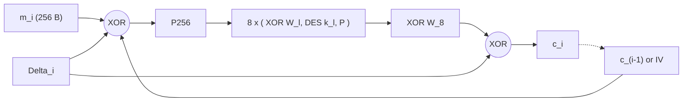

# Mathematical analysis of SillyDES 5.2.6

This analyses the wrapping scheme around DES and, in section 13, DES itself. In sections 2 to 12 DES is treated as a keyed random permutation on 64-bit words; section 13 says what is known about the real cipher and where that assumption is used. Section 14 relates the scheme to the theory of key-length extension by randomised cascades (Gaži and Tessaro, 2012, and the work that followed). Everything below refers to the current code in [src/](src/) (the cipher is in [src/sillydes_cipher.cpp](src/sillydes_cipher.cpp)). Items marked **(measured)** were checked against the built binary or a model run for this revision (section 12). Classical and quantum attackers are treated side by side: each attack is costed classically first and then in the quantum models of section 2. Claims about key-search cost are heuristic arguments about a custom construction that nobody has reviewed.

## 1. Summary

| Property | Result |
|---|---|
| Block width | 2048 bits (32 DES words); one plaintext bit reaches every word after 6 layers, one output word depends on every plaintext word after 5 layers, in both directions **(measured)** |
| Layers | 8 DES layers, 256 DES operations per 256-byte block |
| Keys | 8 DES keys (64 bytes); all 512 key bits feed the 2048-bit whitening and the per-block tweak |
| Per-block tweak | XEX: a secret 2048-bit mask, a PRF of key, salt and block index, XORed before and after the cipher. Every block is encrypted by its own permutation instance, used once |
| What the security rests on | HMAC-SHA-512 as a pseudorandom function under the 64 key bytes. Under that assumption a file shows an attacker only $G(y)\oplus y$ at secret random points $y$, one per block, and choosing the plaintext does not change that (section 5.2) |
| Generic key search | about $2^{512}$ classically, $2^{256}$ Grover iterations: the key length of HMAC-SHA-512, which derives whitening, tweak and MAC key from all 512 key bits. A guess is tested on the tag without running the cipher. The DES layers add nothing provable to this figure (sections 5.2, 5.4 and 14) |
| Same cascade without whitening | $2^{224}$ time from the 4\|4 split; about $2^{149}$ with quantum claw finding |
| Bare core: one fixed instance that an attacker may query | far below the 512-bit key, and still out of reach in practice. Told from a random permutation with about $2^{45}$ chosen texts and no key guess; key recovery with about $2^{45}$ chosen texts and about $2^{120}$ DES operations for each layer, about $2^{63}$ with a quantum computer and classical data. That is the range of AES-128, not of AES-256, and it is what tabulating DES costs (section 14.4). The cause is the 64-bit word and the half-word swap, not DES (section 6.2) **(structure measured with the real DES, rates in scaled models)**. The same swaps are why an attacker needs that much data: without them the core would be 32 separate 64-bit ciphers, told from a random permutation with two chosen texts (section 5.7) |
| The same attacks on the deployed scheme | need about $2^{45}$ texts under one permutation instance; the tweak and the fresh salt and IV provide one. Slide and Simon-type attacks find no structure (sections 6.4 and 6.5). Linear approximations with equal input and output masks pass through the tweak, with a correlation estimated below $2^{-180}$, which would take $2^{360}$ blocks of one file to see (section 6.3) |
| What the DES core contributes | Not the 512-bit level. It is necessary, since without it the tweak cancels; it is a second line of defence at about $2^{120}$ should a mask ever repeat; and it keeps every whitening and tweak value out of sight, so that HMAC-SHA-512 cannot be attacked through known outputs. The masks and the core cover each other's weak side (section 5.7) |
| Chaining | CBC around all layers with a random 256-byte IV, inside the tweak |
| Randomisation | Salt, IV and padding are random and drawn inside the sealing routine only, with error 14 if the generator fails: equal messages give unrelated ciphertexts **(measured)**; two files made with one key file share no whitening and no tweak |
| Integrity | HMAC-SHA-512 (512-bit key, 512-bit tag) over header and ciphertext, verified before decryption; $2^{256}$ Grover iterations for the MAC key or a forgery |
| Passphrase | Argon2id (2 GiB, 1 pass, 4 lanes, RFC 9106 first recommendation), random salt; optionally Argon2i (2 GiB, 6 passes, 4 lanes) against cache observers; strength is the phrase entropy, halved by Grover |
| 64-bit word collisions | occur at the random rate (about $2^{30}$ blocks) and carry no information, because the tweak masks every ciphertext word with a block-specific secret (section 8) |
| Speed | 1 MiB in 0.09 s each way; 16 MiB in 1.22 s each way, about 13 MB/s; phrase mode adds 1.8 s **(measured)** |
| DES itself | 56-bit key, 64-bit block. Exhaustive search has been practical since 1998; differential and linear cryptanalysis need $2^{47}$ chosen and $2^{43}$ known texts. None of it applies here, because no input or output of a DES word is ever visible. DES is not the weak point of the scheme and not the source of its key length (section 13) |
| Key-length extension theory | In the ideal-cipher model a cascade of DES with whitening can be proven secure up to at most $2^{120}$ DES evaluations, whatever its length and key size (Gaži and Tessaro 2012 and later work). The theory supports whitening between the layers and locates the $2^{512}$ figure with HMAC, not with the cascade (section 14). The wide block does not move that ceiling, and the cheapest attack found on the bare core costs about as much (section 14.4) |
| Against AES-256 | about $2^{256}$ quantum for key search and MAC against $2^{128}$ for AES-256, heuristic, unreviewed and owed to HMAC-SHA-512; the block cipher on its own is in the range of AES-128; one key guess takes about 120 times as long as an AES-256 trial (section 5.4); 100 to 700 times slower (section 10) |

The argument has two parts, and it is worth keeping them apart. The key-search bound is a statement about HMAC-SHA-512: whitening, tweak and MAC key are pseudorandom functions of **all** 512 key bits, so nothing an attacker computes can be checked against a part of the key. The resistance to structural attacks is a statement about use: no permutation instance is ever used for more than one block, so the attacks that break the bare core have no data to work on. The DES layers with the block expansion sit between the two. They are not the source of the 512-bit level, and on their own they are far below it (section 6.2). They are not decoration either: without them the tweak would cancel, they are a cipher of about $2^{120}$ in their own right, and they keep every HMAC output out of an attacker's sight (section 5.7). Both parts hold for a quantum attacker as well as a classical one.

## 2. Model

Let $D_k$ be DES-ECB applied to each of the 32 eight-byte words of a 256-byte block, and let $P_s$ be the keyless nibble swap on $s$-byte groups (section 3). The eight keys $k_0,\dots,k_7$ and nine whitening blocks $W_0,\dots,W_8$ (each 2048 bits) define the wide block cipher $G$:

$$s_0 = P_{256}(u),\qquad s_{l+1} = P_{g_l}\big(D_{k_l}(s_l \oplus W_l)\big)\ (l<7),\qquad G(u) = D_{k_7}(s_7\oplus W_7)\oplus W_8$$

with $g_l = 16\cdot 2^{\,l \bmod 5}$ bytes, that is 16, 32, 64, 128, 256, 16, 32 for $l=0,\dots,6$. With $K = k_0\|\cdots\|k_7$ (all 64 bytes) and the 16-byte salt from the file header, the whitening and the per-block tweak are

$$W_j = \mathrm{HMAC\text{-}SHA\text{-}512}_{K}\big(\text{"SillyDES 5.2.0 white"}\,\|\,\text{salt}\,\|\,j\,\|\,c\big)_{c=0..3},\qquad
\Delta_i = \mathrm{HMAC\text{-}SHA\text{-}512}_{K}\big(\text{"SillyDES 5.2.0 tweak"}\,\|\,\text{salt}\,\|\,i\,\|\,c\big)_{c=0..3},$$

four 64-byte outputs each, $i$ the 8-byte big-endian block index. The whitening costs 36 HMAC calls once per file; the tweak costs 4 per block, with the HMAC pad states computed once.

The message is encrypted in CBC mode around $G$, and each block is wrapped in its tweak (the XEX construction). For padded plaintext blocks $m_i$:

$$u_i = m_i \oplus c_{i-1},\qquad c_i = G(u_i \oplus \Delta_i)\oplus\Delta_i,\qquad c_{-1} = \mathrm{IV}$$

Decryption is $m_i = G^{-1}(c_i\oplus\Delta_i)\oplus\Delta_i\oplus c_{i-1}$. Writing $G_i(x) = G(x\oplus\Delta_i)\oplus\Delta_i$, the scheme is plain CBC over a family of permutations $G_0, G_1, \dots$ of which each member encrypts exactly one block.

The file is `SD\x05\x20 | log2 m, t, p, v | salt | IV | c_0 ... c_n | tag`: a 280-byte header (format version bytes major and minor·16+patch; $m$ the Argon2 memory in KiB, $t$ the passes, $p$ the lanes, $v$ the variant: 0 Argon2id, 1 Argon2i), the blocks, and $\text{tag}=\mathrm{HMAC\text{-}SHA\text{-}512}(K_{mac},\ \text{everything before it})$, 64 bytes, with $K_{mac}$ a 512-bit key. Salt and IV are drawn from the system random generator inside the sealing routine on every encryption; no interface accepts them from a caller, and the program stops with error 14 if the generator fails or returns an all-zero value.

Key material by mode:

| | Key-file mode | Phrase mode |
|---|---|---|
| $K$ (DES keys) | the 64 bytes of the file | Argon2id output bytes 0..63 |
| $K_{mac}$ | $\mathrm{HMAC\text{-}SHA\text{-}512}_K(\text{"SillyDES 5.2.0 mac"})$ | Argon2id output bytes 64..127 |
| Salt | input to $W_j$ and $\Delta_i$ | input to Argon2id, $W_j$ and $\Delta_i$ |
| Varies per file | salt, hence all $W_j$ and $\Delta_i$, and IV | salt, hence $K$, $K_{mac}$, all $W_j$, $\Delta_i$, and IV |

The three HMAC labels share the prefix `SillyDES 5.2.0 ` and differ in the word after it, and the three inputs have different lengths (38, 45 and 18 bytes), so whitening, tweak and MAC key are domain-separated outputs of one PRF under $K$.

**Attacker models.** Three settings are used throughout:

- **Classical.** The attacker has classical computation and, at most, classical access to an encryption oracle.
- **Q1.** The attacker has a quantum computer but only classical access to the encryption. This fits stored files: the data must be collected classically and cannot be amplified afterwards; only the attacker's own computation gets a quantum speed-up.
- **Q2.** The attacker can query the encryption in superposition. This is not realistic for file encryption, but it is the model in which the exponential quantum speed-ups (Simon's algorithm) are known, so it is included to show which structures would be exposed if the oracle existed.

Shor's algorithm does not apply: the scheme is purely symmetric, and how the keys are exchanged is outside this analysis. Grover's algorithm finds a $k$-bit key in about $2^{k/2}$ iterations, each running the whole cipher in superposition; it parallelises poorly, $S$ machines giving only a factor $\sqrt S$. Two further terms are used from section 6 on: the **bare core** is one fixed instance of $G$ that the attacker may query at will; the **deployed scheme** is the file format, with the tweak and a fresh salt and IV for every encryption.

## 3. The expansion permutations

For a group of $s$ bytes and $i < s/2$, with $j = i + s/2$:

$$\text{new}[i] = (\text{old}[j] \,\&\, \mathtt{0x0F}) \ll 4 \;\big|\; (\text{old}[i] \,\&\, \mathtt{0x0F}),\qquad
\text{new}[j] = (\text{old}[j] \,\&\, \mathtt{0xF0}) \;\big|\; (\text{old}[i] \gg 4)$$

Properties, all checked on random blocks for $s = 16, 32, 64, 128, 256$ **(measured)**:

- **Bit permutation:** $P_s$ is linear over $\mathrm{GF}(2)$ and has no key. An attacker can apply or invert it freely.
- **Involution:** $P_s^2 = \mathrm{id}$.
- **Lane-preserving:** the byte position inside a 64-bit word never changes, because $s/2$ is a multiple of 8.
- **Pairing:** each layer pairs word $b$ with word $b \oplus \text{stride}$, taking half the nibbles from each.
- **Stay set:** in every $P_s$, exactly 32 of the 64 bit positions of a word stay in that word: the low nibbles for a word in the lower half of its group, the high nibbles for a word in the upper half. The other 32 move to the partner word. This half-and-half split is what the cheapest attack found on the bare core uses (section 6.2).

| Position | initial | after $D_0$ | $D_1$ | $D_2$ | $D_3$ | $D_4$ | $D_5$ | $D_6$ |
|---|---|---|---|---|---|---|---|---|
| Permutation | $P_{256}$ | $P_{16}$ | $P_{32}$ | $P_{64}$ | $P_{128}$ | $P_{256}$ | $P_{16}$ | $P_{32}$ |
| Stride (words) | 16 | 1 | 2 | 4 | 8 | 16 | 1 | 2 |

Read forwards, the strides after $D_0$ to $D_4$ are 1, 2, 4, 8, 16: each bit of the five-bit word index once, a butterfly. Read backwards from the ciphertext, the strides are 2, 1, 16, 8, 4: again each bit once. So the network is a butterfly in both directions, and the sixth to eighth layers repeat the pattern.

## 4. Diffusion

Modelling each DES layer as fully mixing its word, the word-level cones over all 2048 start bits are **(measured, model)**:

| After layer | 1 | 2 | 3 | 4 | 5 | 6 | 7 | 8 |
|---|---|---|---|---|---|---|---|---|
| Words reached by one plaintext bit | 1 | 2 | 4 | 8 | 16 | 32 | 32 | 32 |
| Words reached by one ciphertext bit (inverse layers 8 to 1) | 1 | 2 | 4 | 8 | 16 | 32 | 32 | 32 |
| Plaintext words that one output word of the layer depends on | 2 | 4 | 8 | 16 | 32 | 32 | 32 | 32 |

- The counts are identical for every start bit (min = max).
- The third row starts at 2 because $P_{256}$ precedes the first layer: every input word of $D_0$ already holds nibbles from two plaintext words.
- A single bit reaches the whole block at layer 6, and every output word depends on the whole plaintext at layer 5. Layers 7 and 8 are extra margin, not needed for diffusion. Symmetrically, from the ciphertext side layers 1 and 2 are margin.
- Hence every pair of consecutive layers can be regarded as "spare" from one side or the other, but no layer is spare from both sides.
- **Reach is not mixing.** These counts say which words a bit can influence, not how well. The two halves of a word travel on separate branches for five layers and meet again only at the input of the seventh; until then each branch carries 32 bits of information through every layer. Section 6.2 shows what that costs: the margin of two layers that the table suggests does not exist for an attacker who has many texts of one instance.
- $c_i$ depends on $m_0,\dots,m_i$ and the IV. A change in $m_i$ changes about half of the bits of $c_i$, and since $c_i$ is the next chaining value, every later block changes too.

## 5. Key space and generic attacks

### 5.1 Cascade without whitening

With public permutations between the layers, a meet-in-the-middle split works: guess the keys of the first half from the plaintext side and of the second half from the ciphertext side. For $r$ layers the time is about $2^{56\lceil r/2\rceil}$. For $r=8$ that is $2^{224}$. Deriving the layer keys from a master key does not change this, because the attacker searches the layer keys directly.

A quantum attacker does better still: claw finding replaces the classical meet-in-the-middle and costs about the $2/3$ power of it, if a large quantum memory exists, which puts the eight-layer cascade without whitening near $2^{149}$. The same applies to any cascade of standard ciphers, which is why a cascade of AES-256 would not raise its quantum level either (section 10).

The plain cascade and its whitened variants are what the literature on key-length extension treats; section 14 gives the proven bounds and what they mean here.

### 5.2 Whitening and tweak derived from all key bits

Assume that HMAC-SHA-512 under the 64-byte key $K$ is a pseudorandom function (PRF). To an attacker without $K$, every $W_j$ and every $\Delta_i$ is then an independent uniform 2048-bit string, new for every salt. Three things follow, and together they are the security argument of the scheme.

**1. What an attacker sees.** Write $x_i = m_i\oplus c_{i-1}$ for the chained input, which the attacker knows, and $y_i = x_i\oplus\Delta_i$ for the input of the core. Because $\Delta_i$ is uniform, used for this block only and independent of everything before it, $y_i$ is uniform and independent of $x_i$. The ciphertext block is

$$c_i = G(y_i)\oplus\Delta_i = x_i\oplus F(y_i),\qquad F(y) = G(y)\oplus y .$$

The scheme is therefore a one-time pad on $x_i$ whose pad is $F$ at a secret, uniform point that is never used again. All that a file gives an attacker is the list $F(y_0), F(y_1), \dots$ for independent uniform $y_i$ that he does not see. Choosing the plaintext changes nothing, since $y_i$ stays uniform, and there is no decryption oracle, since the tag is checked first.

**2. What that asks of the core.** Confidentiality holds as long as $F(y)$ at a uniform secret $y$ cannot be told from a uniform string. For a mask $\alpha\ne 0$ the bias of $\alpha\cdot F(y)$ is the correlation of the linear approximation $\alpha\cdot y\oplus\alpha\cdot G(y)$, the one with the same mask on both sides of $G$. The distribution of $F(y)$ is uniform exactly when all of these correlations are zero, so they are the complete leak. For the eight DES layers they are estimated below $2^{-180}$ (section 6.3).

This is far less than the XEX proof asks of its cipher. That proof needs a strong pseudorandom permutation because a tweak is used for many blocks; here a mask is used for one. Two extreme cases show the range:

- With $G = \mathrm{id}$, $F = 0$ and the scheme outputs $x_i$ in clear. The core is necessary.
- With $G$ a fixed public linear map for which $G\oplus\mathrm{id}$ is invertible, $F(y)$ is exactly uniform and the scheme is perfectly secret in this model, although such a $G$ is no cipher at all.

Under the PRF assumption the DES layers are therefore not what an attacker has to break. They have to keep the tweak from cancelling, which any map with small equal-mask correlations does, and the confidentiality of the deployed scheme is carried by the tweak, that is by HMAC-SHA-512. What the DES layers add for someone who does not want to lean on that assumption alone is the subject of section 5.7.

**3. Key search.** The only secret behind $W_j$, $\Delta_i$ and the MAC key is $K$, and under the PRF assumption no output helps to find another output or a part of $K$. So **there is no partial-key test**: no guess of fewer than 512 bits can be confirmed or refuted, which excludes meet-in-the-middle and divide-and-conquer over layers or words and leaves brute force over $K$ at about $2^{512}$, or Grover over $K$ for a quantum attacker (section 5.4). The cheapest test of a guess does not run the cipher at all: derive the MAC key and check the tag. The figure $2^{512}$ is the key length of HMAC-SHA-512. It is not a product of eight DES keys: the 448 DES key bits count because they are part of the HMAC key.

**What the argument rests on.**

- **The PRF assumption.** The generic attacks on HMAC-SHA-512 are a search over its 512-bit key and collisions in its 512-bit chaining state, which need about $2^{256}$ queries under one key. A file of $n$ blocks makes $36 + 4n$ queries.
- **One key for two primitives.** The same 64 bytes key HMAC and the DES layers. No interaction between SHA-512 and DES is known, and no output of a DES word is ever visible unmasked, but a proof would want separate keys. A later format could derive the DES keys from $K$ with a label of their own at no cost.
- **One use per mask.** The mask depends on the salt and the block index. The salt has 128 bits, so two files made with one key file share a salt with probability $2^{-128}$ per pair, and about $2^{64}$ files are needed before one such pair is expected. Blocks at equal positions of those two files would be two texts of one instance, with an input difference that the two random IVs make random. That is far from the $2^{45}$ chosen texts that section 6.2 needs, but it is where the statement "one text per instance" ends.
- **The core under many texts.** With many texts of one fixed instance the argument does not apply, and the core falls well below $2^{512}$ (section 6.2). The figure rests on the tweak and on the randomisation, not on the core.

For completeness, a bit-count model treats every whitening word as 64 independent unknown bits and asks what a meet-in-the-middle on a single known pair of the core would have to guess at each cut, ignoring the tweak. The cut sits at the output of $D_l$; the forward side needs the cone of one output word, the backward side the cone of the two words of $s_{l+1}$ that feed it (64 bits per whitening word, 56 per key, 64 per ciphertext word because of $W_8$):

| Cut after layer | Forward unknown bits | Backward unknown bits | Cost of the split ($\max$) |
|---|---|---|---|
| 1 | 120 | 10504 | $2^{10504}$ |
| 2 | 304 | 8400 | $2^{8400}$ |
| 3 | 616 | 6296 | $2^{6296}$ |
| 4 | 1184 | 3168 | $2^{3168}$ |
| 5 | 2264 | 1576 | $2^{2264}$ |
| 6 | 4368 | 752 | $2^{4368}$ |
| 7 | 6472 | 312 | $2^{6472}$ |

The numbers above $2^{512}$ are an artefact of treating the whitening as independent: a real attacker would guess $K$ instead. The table's only content is that every cut needs far more than 512 unknown bits on each side, which is the same conclusion as the PRF argument. It concerns one pair only and says nothing about attacks that use many texts of one instance, which need far fewer unknowns (section 6.2). As a check of the method, the same model applied to a hypothetical six-layer cascade without whitening gives $2^{168}$ at the 3|3 cut, matching $2^{56\lceil r/2\rceil}$.

### 5.3 DES-specific properties

- **Key bits.** DES ignores the lowest bit of each key byte, so the DES layers use 448 bits. The whitening reads all 64 bits of each key, so all 512 bits count. A key file that differs in one such bit fails authentication **(measured)**.
- **Complementation.** DES satisfies $D_{\bar k}(\bar x) = \overline{D_k(x)}$, which halves brute force on a plain DES cascade. Here complementing $K$ replaces every $W_l$ by an unrelated PRF output, so the property gives no saving in a search over $K$. An attacker who guesses a layer key together with a whitening word as independent unknowns (section 6.2) does see it: $(k, W)$ and $(\bar k, \bar W)$ give complementary values, so such a guess costs $2^{119}$ and not $2^{120}$.
- **Weak and semi-weak keys.** A weak key makes $D_k$ an involution. Random keys hit one with probability $2^{-52}$ per layer; with chosen key files the program refuses every key with at most four different round keys (the 4 weak, 12 semi-weak and 240 further keys, including the 48 published possibly weak ones) when encrypting, also among the keys of a phrase (error 16; `allowweak` or `SILLYDES_ALLOW_WEAK=1` overrides it, for research only) and accepts them when decrypting. Even then, the whitening between layers means no $D_k \circ D_k$ cancellation can occur.
- **Equivalent keys.** Two keys $K \ne K'$ give the same cipher only if they agree on all 448 DES bits and all nine $W_j$ and every $\Delta_i$ collide, which for a PRF has probability below $2^{-18432}$.

### 5.4 Quantum key search

With no partial-key test (section 5.2), the quantum generic attack is Grover over the whole key:

| | AES-256 | SillyDES 5.2.0, key file | Hypothetical 512-bit cipher |
|---|---|---|---|
| Key bits | 256 | 512 (448 DES bits, 64 bits that only feed whitening and tweak) | 512 |
| Grover iterations | $2^{128}$ | $2^{256}$ | $2^{256}$ |
| Cost per iteration | one AES-256 circuit | the tag check: HMAC-SHA-512 for the MAC key and over the file, 12 SHA-512 compressions for the smallest file. The cipher is not needed; through it the test would cost 256 DES circuits and 40 HMAC-SHA-512 computations | one circuit |

**Time per guess.** A guess costs more here than against AES-256. On the CPU of section 12, one tag check of the smallest file (600 bytes) with OpenSSL's SHA-512 takes 1.49 µs, and one AES-256 trial, key expansion and one block with AES-NI, takes 12.5 ns: about 120 times, or $2^{7}$ **(measured)**. The tag covers the whole file, so the check of a longer file takes longer. For a classical search this adds about 7 bits: $2^{512}$ guesses at $2^{7}$ AES trials each against $2^{256}$ AES trials. Neither test needs memory to speak of, about 1 KB for SHA-512 and 240 bytes of round keys for AES. In phrase mode the time per guess is set by Argon2id (section 8).

AES-256 key search is NIST's reference for its highest post-quantum category (category 5). Without the whitening the cascade would be near $2^{149}$ by claw finding (section 5.1), which is another reason to keep it.

The cipher key is not the only 512-bit quantity. Where the quantum bound of the whole scheme lies:

| Part | Quantum cost | Reason |
|---|---|---|
| Cipher key | $2^{256}$ iterations | Grover on 512 bits; the key length is that of HMAC-SHA-512 (section 5.2) |
| MAC key | $2^{256}$ iterations | HMAC-SHA-512 key is 512 bits, derived from the keys or the passphrase |
| Tag forgery | $2^{256}$ iterations | 512-bit tag |
| **Whole scheme, key file** | **about $2^{256}$** | limited by the cipher and MAC keys, which are both 512 bits |

- A 256-bit MAC key and tag, such as HMAC-SHA256, would limit the whole scheme to $2^{128}$, the same as AES-256 with HMAC-SHA256 or GCM. The 512-bit MAC key and tag give authentication the same quantum cost as encryption. Both the whitening and the MAC use HMAC-SHA-512; BLAKE2b is used only inside Argon2id, on the passphrase path.
- This is a cost model of the keys and tag, not a proof. The MAC key is a PRF output of the same keys as the cipher, so the two are not independent, and nobody has reviewed the construction.
- In phrase mode the limit is the phrase entropy, halved by Grover (section 8).

### 5.5 What this does not show

- It is a heuristic about cost, not a proof. Under the PRF assumption the argument of section 5.2 is close to a reduction, but it has not been written out in full or checked by anyone else.
- The key length comes from HMAC-SHA-512, an additional assumption beyond DES, and the DES layers add nothing provable to it. Under the same assumption, HMAC-SHA-512 output XORed onto the data would be as secure and much faster. The difference lies outside that assumption: such a stream would hand every HMAC output to an attacker with known plaintext and would have nothing behind it if a mask were repeated, and this scheme does neither (section 5.7). In key-file mode the MAC key is a PRF output of the same $K$, so cipher and MAC are not independent.
- The core on its own is far below the 512-bit level: about $2^{120}$ by the best attack found, which is an upper bound and not a proof of strength (sections 5.7 and 6.2). Nothing here supports using it without the tweak and the random salt and IV.
- In phrase mode the real limit is the phrase entropy (section 8).
- The construction is custom and unreviewed. A standard cipher such as AES-256 would give a 256-bit bound with reviewed security.

### 5.6 Other bounds

- **Unicity:** one known 256-byte block gives 2048 bits of constraint against 512 key bits, so a single block identifies the key.
- **Known pairs:** in CBC the attacker knows $u_i = m_i\oplus c_{i-1}$, but the input of $G$ is $u_i\oplus\Delta_i$ and its output is $c_i\oplus\Delta_i$, both unknown. Each known plaintext block is therefore a known pair of $G_i$, a permutation instance that encrypts nothing else. There are no known pairs of $G$ itself.

### 5.7 What the DES core contributes

Sections 5.2, 6.2 and 14 say what the eight DES layers with the block expansion are not: they are not the source of the 512-bit level, and used alone they are far below it. That is half of the picture. The core is not decoration either. Three things can be said for it, each with its limit, and one thing cannot.

**1. The core is necessary.** The tweak is XORed in before and after the core. With nothing between, the two XORs cancel and the plaintext comes out (section 9). This shows that the scheme needs a core, and no more: for this purpose alone, any permutation $G$ for which $G(y)\oplus y$ looks random would serve (section 5.2).

**2. The core is a cipher of considerable strength in its own right, and the block expansion is what makes it one.** The best attack that this analysis found on the core without the tweak costs about $2^{120}$ DES operations for each layer and needs $2^{45}$ chosen blocks under one mask, or about $2^{63}$ with a quantum computer and the same data (section 6.2). For comparison:

| Cipher | Best known key recovery | Data |
|---|---|---|
| DES | $2^{56}$ | one known block |
| Triple DES, three keys | $2^{112}$; about $2^{90}$ | a few known blocks; $2^{32}$ known blocks |
| The core without the tweak | $2^{120}$; $2^{63}$ quantum | $2^{45}$ chosen blocks under one mask (8 PiB) |
| AES-128 | $2^{128}$; $2^{64}$ Grover iterations | a few known blocks |
| AES-256 | $2^{256}$; $2^{128}$ Grover iterations | a few known blocks |

What the block expansion and the whitening add to DES to get there:

- a block of 2048 bits, so the limit of $2^{32}$ blocks that a 64-bit block imposes is gone;
- every ciphertext word depends on every plaintext word after five layers (section 4);
- a layer key can only be tested together with whitening words, at least 120 bits at a time, because no input or output of a DES word is visible (section 13.3);
- the attack needs texts chosen in structures. Random texts show nothing: in the scaled model they give 0.999 and 1.000 times the random rate where a structure gives 33.7, and 0.44 pairs that agree in two ciphertext words where a structure gives 5987 (section 12).

**What the swaps themselves are worth is data.** The third item is the work of the whitening; the other three are the work of the swaps. $D_k$ and the XORs act on every 64-bit word by itself (section 2), so without the swaps the core would be 32 separate 64-bit ciphers side by side. For one fixed instance:

| | Without the swaps | With the swaps |
|---|---|---|
| Told from a random permutation of 2048 bits | with two chosen texts: change one plaintext word and only one ciphertext word changes | with about $2^{45}$ chosen texts of one structure (section 6.2) |
| Reading without the key | every known word is a dictionary entry for its place, and an equal ciphertext word shows an equal plaintext word | only a whole equal block shows an equal block; no way to read anything else without the key was found |
| Key recovery | not worked out here | about $2^{45}$ chosen texts (8 PiB) and $2^{120}$ DES operations for each layer; the texts must agree in 1984 bits, and random texts show nothing in the scaled model (section 12) |

- **Data.** The swaps raise the amount and the kind of data that an attacker needs of one instance: from two chosen texts to about $2^{45}$ to tell it from a random permutation, and from single known words to whole blocks to read anything without the key.
- **Computing time and memory.** The swaps are not shown to raise either. The attack works on the coupling that the swaps make and costs about $2^{120}$ DES operations, which is the ceiling that the theory sets for every construction from DES, with or without swaps (section 14.4). Its memory is the storage of its own texts.
- **Limits.** The left column follows from the definition and was not measured. The right column gives the cheapest attacks found, not lower bounds. All of it concerns one fixed instance, and the data is a number of blocks that pass through that instance, not the size of a file: in the deployed scheme a file of any size gives each instance one block. There, under the assumption of section 5.2, every word of every block has its own mask and a key guess is tested on the tag (section 5.4), so the swaps add nothing that an attacker has to pay for.

The consequence is a second line of defence. If a mask were ever used twice, through a fault in an implementation or through a repeated salt after about $2^{64}$ files (section 5.2), the data would not lie open: it would be behind this cipher. The limits of the statement:

- $2^{120}$ is the cost of the best attack found here, an upper bound on the strength of the core. It is not a proof that nothing cheaper exists, and nobody else has looked.
- It is a second line at about $2^{120}$, not at $2^{512}$, and it is below AES-128.
- A repeated mask also makes equal inputs give equal outputs, which shows that two blocks are equal even when it shows nothing else.

**3. The core hides the HMAC outputs.** An attacker with known plaintext sees $c_i\oplus x_i = G(y_i)\oplus y_i$ with $y_i = x_i\oplus\Delta_i$. To learn $\Delta_i$ he would have to find $y_i$, which means inverting $y\mapsto G(y)\oplus y$ for a $G$ whose keys and whitening he does not have. The whitening values are inside the core and are not visible either. So no output of HMAC-SHA-512 under $K$ ever reaches the attacker: he sees only what the DES layers make of them. Compare the two simpler constructions:

- HMAC output XORed onto the data: every known plaintext byte gives a byte of HMAC output.
- A linear map in place of the DES layers: $c_i\oplus x_i = (G\oplus\mathrm{id})\,y_i$ can be solved for $y_i$, and then $\Delta_i = y_i\oplus x_i$ is known.

In this scheme an attack on HMAC-SHA-512 that starts from known outputs has nothing to start from; it would first have to get through the DES layers in the setting where they are strongest, one text per instance. The limits of the statement:

- Under the PRF assumption of section 5.2 this adds nothing, because that assumption already allows the attacker to see outputs. It matters only if HMAC-SHA-512 has a weakness that needs known outputs, and none is known. HMAC-SHA-512 is by far the better studied of the two parts.
- It is an observation about what is visible, not a proof.
- The tag is a visible HMAC output, but under the MAC key and not under $K$. In key-file mode the MAC key is itself an HMAC output under $K$ that is used as a key and never shown; in phrase mode it is independent of $K$.

**What cannot be said.** That DES with the block expansion makes the 512-bit key space, or the $2^{512}$ level. The 448 DES key bits are part of the 512, but the size of a key space is not the cost of searching it: no cascade of DES can be shown secure beyond $2^{120}$ DES operations (section 14), the core falls at about that figure, and a guess of the key is tested on the tag without the core (section 5.4).

**Taken together.** The two parts cover each other's weak side. The masks see to it that the core never gets two related blocks, which is where the core is weak. The core sees to it that no mask is ever visible, so that the scheme does not lean on HMAC-SHA-512 in its most exposed form, and it stands behind the masks as a cipher of about $2^{120}$ should one of them ever repeat. The 512-bit key length is carried by HMAC-SHA-512; the DES core with the block expansion turns it into a cipher in which neither a mask nor any input or output of a DES word can be seen.

## 6. Differential, linear, slide and period-finding attacks

This section treats the structural attacks: first why the deployed scheme gives them nothing to work with, then how the bare core would fare without that protection, classically and with a quantum computer. The published quantum results used, checked against their abstracts unless stated otherwise:

- Kaplan, Leurent, Leverrier, Naya-Plasencia, *Quantum differential and linear cryptanalysis*, ToSC 2016(1): differential and linear distinguishers get at most a quadratic speed-up in Q2 (about $p^{-1/2}$ queries for a differential of probability $p$); key-recovery variants gain less than quadratic; in Q1 the data cannot be amplified, so only the offline key guessing gets a Grover speed-up.
- Kaplan, Leurent, Leverrier, Naya-Plasencia, *Breaking symmetric cryptosystems using quantum period finding*, Crypto 2016: Simon's algorithm in Q2 breaks CBC-MAC, PMAC, GMAC, GCM and OCB with $O(n)$ queries, and slides a one-round self-similar cipher at the same cost. The Even-Mansour break by the same method is Kuwakado and Morii 2012, cited from memory.
- Leander and May, *Grover meets Simon*, Asiacrypt 2017: in Q2, whitening keys add essentially nothing, because an FX construction is broken in about the time Grover takes on the inner cipher alone, with Simon stripping the whitening inside each Grover iteration.
- Bonnetain, Hosoyamada, Naya-Plasencia, Sasaki, Schrottenloher, *Quantum attacks without superposition queries: the offline Simon's algorithm*, Asiacrypt 2019: Even-Mansour and FX fall in Q1 with about $2^{n/3}$ classical queries and comparable quantum time, better than Grover, by reusing a classical database inside a Grover search.
- Bonnetain, Naya-Plasencia, Schrottenloher, *On quantum slide attacks*, SAC 2019: quantum versions of the advanced slide attacks (Feistel self-similarity up to four rounds, sliding with a twist, complementation slide, mirror slidex, slides combined with FX, cycle finding), all in Q2.
- Anand, Targhi, Tabia, Unruh, *Post-quantum security of the CBC, CFB, OFB, CTR and XTS modes*, PQCrypto 2016: OFB and CTR are IND-qCPA from a standard-secure PRF; CBC and CFB need a quantum-secure PRP, with counterexamples otherwise; XTS is not IND-qCPA from a standard-secure PRF.

### 6.1 Why the tweak closes the door

Differential cryptanalysis and the structural attack of section 6.2 compare texts under the **same** permutation with a known input difference. Here block $i$ is encrypted by $G_i$ and block $j$ by $G_j$; relative to the core $G$ their inputs differ by $\Delta u\oplus\Delta_i\oplus\Delta_j$ and their outputs by $\Delta c\oplus\Delta_i\oplus\Delta_j$, where $\Delta_i\oplus\Delta_j$ is an unknown PRF output. The attacker therefore knows neither the input nor the output difference of $G$ for any two blocks, in this file or in any other file, because the salt enters the tweak. There is no pair to analyse. The same holds for any attack that needs a repeated input or a repeated internal state across blocks, and it holds in Q2 as well: a superposition query to the encryption carries a fresh salt and IV, so even such a query reaches a family $\{G_i\}$ that is never queried again. Linear cryptanalysis is the one exception: an approximation with the same mask on both sides passes through the tweak (section 6.3).

This depends on the salt and the IV being fresh for every encryption, which [src/container.cpp](src/container.cpp) enforces: both are drawn inside `seal` from the system random generator, no interface accepts them from a caller, and an all-zero value or a generator failure stops the program with error 14. Two files made with the same key file, salt and IV would share every $W_j$ and $\Delta_i$; their first blocks would then be texts of the single permutation $G_0$ with input differences that the sender of the plaintexts controls, and the attack of section 6.2 would apply to it, block for block, across such files. The tweak alone does not prevent this, since a constant XOR is transparent to differences; the randomisation does.

The remainder of this section asks how the core $G$ would fare **if the tweak and the randomisation were not there**, that is, if the attacker could query one fixed instance of $G$ at will. It shows how much the DES layers would hold on their own, which is far less than the deployed bound.

### 6.2 The core without the tweak: half-word structure

XOR with the chaining value or with $W_l$ does not change differences, so for an attacker who compares texts of one instance the core is a network of 256 secret 64-bit permutations, $x\mapsto D_{k_l}(x\oplus W_l[w])$ for layer $l$ and word $w$, joined by public swaps that move half of each word to a partner word. The cheapest attacks found do not follow a difference through the DES words. They use a property of the network that needs nothing of DES: only that the words have 64 bits and that a swap moves exactly half of them.

**Structure.** $P_{256}$ fills each input word of $D_0$ from 64 plaintext bits (32 from each of two plaintext words). A structure is a set of plaintexts that differ only in the 64 bits of one such word $w$; it has up to $2^{64}$ members, and the other 31 input words of $D_0$ are equal for all of them.

**Two branches.** Split the output word of $D_0$ into $a$, the 32 bits that $P_{16}$ leaves in word $w$, and $b$, the 32 bits it moves to word $w\oplus 1$. The swaps after $D_1$ to $D_4$ have strides 2, 4, 8 and 16, so the words reached from $a$ and the words reached from $b$ keep different lowest index bits and do not meet again before the swap after $D_5$, which has stride 1. Through $D_1$ to $D_5$ every word that varies depends on $a$ alone or on $b$ alone: 1, 2, 4, 8 and 16 words in each branch. At the input of $D_6$ every one of the 32 words holds 32 bits that depend only on $a$ and 32 bits that depend only on $b$ **(measured with the project's DES and cipher class, section 12)**.

**Collision rates.** On the way to $D_6$ each branch passes five times through a 32-bit half. Five random functions on $2^{32}$ points in a row collide with probability about $5\cdot 2^{-32}$, so for two texts of a structure the half of a $D_6$ input word that comes from $a$ agrees with probability about $6\cdot 2^{-32}$ (once for $a = a'$, five times for a later collision), and likewise for $b$. A given word at the input of $D_6$, and so at its output, is equal for two texts of a structure with probability

$$\Pr \approx (6\cdot 2^{-32})^2 = 36\cdot 2^{-64}\qquad\text{against } 2^{-64} \text{ for a random permutation.}$$

A scaled model with 16-bit words gives 34 where this predicts 36 **(measured, model)**.

**The last layer hides a word, not a pair of words.** $P_{32}$ after $D_6$ exchanges halves between the words $p$ and $p\oplus 2$ and between no others, and $D_7$ and $W_8$ work on every word by itself. The two ciphertext words $p$ and $p\oplus 2$ are therefore a one-to-one image of the two words $p$ and $p\oplus 2$ at the input of $D_6$: two texts agree in the one pair exactly when they agree in the other **(measured with the project's DES and cipher class, section 12)**.

Two texts of a structure agree in both of these words at the input of $D_6$ when they agree in one branch altogether and the other branch collides on its way to each of the two words. The first is $a = a'$ or $b = b'$, with probability $2^{-32}$ each. For the second, the paths to the words $p$ and $p\oplus 2$ part at the swap after $D_1$ and pass five 32-bit halves each, which gives $5\cdot 5 - 1 = 24$ ways: both halves of the output of $D_1$ cannot collide, because the two texts differ. So for each of the 16 pairs of words

$$\Pr \approx 2\cdot 2^{-32}\cdot 24\cdot 2^{-64} = 48\cdot 2^{-96}\qquad\text{against } 2^{-128} \text{ for a random permutation.}$$

With $h$ for the number of values of a half word this is $48/h^3$ against $1/h^4$, and the cipher has $h = 2^{32}$, where nothing can be counted. Models with $h = 2^8$, $2^{12}$ and $2^{16}$ count 5987, 1433 and 22 such pairs of texts where the formula gives 6144, 1536 and 24, and where a random permutation gives 0.5, 0.008 and $10^{-5}$; random texts in place of a structure give 0.44 and 0 **(measured, models, section 12)**. The rate follows the formula over a factor of $2^{24}$. Of the pairs of texts found this way, all but a share of about $12/h$ agree in $a$ or in $b$: 95.8% in the first model, 99.8% in the second and all 22 in the third, and all but $2^{-28}$ in the cipher.

**What follows for one fixed instance.**

- **Seven layers are no cipher.** With $D_7$ left out, equal ciphertext words between texts of a structure occur 36 times too often; about $2^{30}$ chosen texts show it.
- **Eight layers are distinguishable without any key guess.** Over the 16 pairs of words, two texts of a structure agree in both ciphertext words of a pair with probability about $768\cdot 2^{-96}\approx 2^{-86}$. About $2^{45}$ chosen texts of one structure give about six such agreements, and a random permutation of 2048 bits gives none ($2^{-35}$ expected). A single ciphertext word says far less: it is equal $1 + 122\cdot 2^{-32}$ times as often as at random (the model gives a factor 1.43 where the same formula predicts 1.48), which would take about $2^{57}$ texts to see.
- **Key recovery through the first layer.** A guess of $k_0$ and $W_0[w]$, 120 bits or $2^{119}$ distinct cases after the complementation property (section 5.3), gives $a$ and $b$ for every text. The pairs of texts that agree in two ciphertext words are found without the key. Under the right guess each of them agrees in $a$ or in $b$; under a wrong guess a pair does so with probability $2^{-31}$. About $2^{45}$ chosen texts give about four such pairs of texts (one pair of texts often agrees in more than one pair of words), which is 124 bits of condition on a guess of 119 bits. A guess is dropped at the first pair that fails, after two DES evaluations, so the work is about $2^{119}\cdot 2 = 2^{120}$ DES operations. In the scaled model, with a 4-bit key and a 16-bit whitening word in the first layer and all $2^{20}$ guesses tried, the right guess passes 179 pairs and the best wrong guess 11 **(measured, model)**. Single equal words show the right guess as well, at far higher cost: pairs with equal $a$ or equal $b$ show an equal ciphertext word 36 times as often as other pairs (the right guess scores about 270000 there in the model and the best of 50 wrong guesses 12100), which takes about $2^{47}$ texts and a list of about $2^{34}$ pairs to go through for every guess. With $k_0$ and the words of $W_0$ known the first layer is removed and the next layer is taken in the same way at about the same cost; the further layers were not worked out in the same detail.
- **With little data.** Guessing $k_7$ and the two words of $W_8$ that cover one output word of $D_6$ (184 bits) and testing for the factor 36 there needs only about $2^{34}$ chosen texts, at about $2^{218}$ work.
- **A difference that stays in one word** costs far more. A difference confined to one word survives a swap with probability $2^{-31}$, because it may stay in its word or move to the partner as a whole (the model gives $2^{-7}$ for 16-bit words). Seven swaps give $2^{-217}$, and with structures of $2^{64}$ texts one right pair costs about $2^{154}$ chosen texts.

| Setting | Data | Work | For comparison |
|---|---|---|---|
| Bare core, classical, distinguisher | $2^{45}$ chosen texts of one instance | about the same | $2^{1024}$ for a random permutation |
| Bare core, classical, key recovery | $2^{45}$ chosen texts of one instance | $2^{120}$ for each layer | $2^{128}$ for AES-128, $2^{256}$ for AES-256 |
| Bare core, quantum computer, classical data (Q1) | $2^{45}$ chosen texts of one instance | about $2^{63}$: $2^{60}$ Grover iterations over the first-layer guess, each a test on four of the listed pairs | $2^{64}$ iterations for AES-128, $2^{128}$ for AES-256 |
| Bare core, superposition queries (Q2) | not worked out | not above the Q1 figure | |
| Deployed scheme, any model | one text per instance | $2^{256}$ (Grover on $K$) | |

- **Data model.** The texts are chosen but not adaptive: a structure is fixed in advance. They must all go through one instance of $G$.
- **Assumption.** The 256 word permutations are taken to be independent and random. The attack uses no property of DES, and a different 64-bit cipher in its place would change only the size of the guess.
- **Deployed scheme.** A structure needs texts whose inputs to the core agree in 1984 chosen bits. The input of block $i$ is $x_i\oplus\Delta_i$ with a secret uniform $\Delta_i$ that is used once (section 5.2), so two blocks agree there with probability $2^{-1984}$, in one file or across files. The attack has one text per instance and needs $2^{45}$; it does not start. If an implementation ever fixed the salt and the IV (deterministic encryption), the first blocks of all files would be texts of one fixed permutation of $m_0$, and every row of the table above would apply to them.

The bare core is therefore not a 512-bit cipher and not a 256-bit one. With one key and many blocks, the way a block cipher is normally used, it would stand below AES-128 classically and about level with it against a quantum computer. The attack is out of reach all the same: $2^{120}$ DES operations are beyond any computer, and they need $2^{45}$ chosen blocks under one mask. That is what makes the core a second line of defence (section 5.7). These are the cheapest attacks found in this review; it does not claim that there are no cheaper ones.

### 6.3 The core without the tweak: linear approximations

A linear trail needs at least one active DES word in every layer. The best 16-round DES approximation has bias $1.49\cdot 2^{-24}$, about $2^{-23.4}$ (Matsui 1993, cited from memory). By the piling-up lemma, eight layers give a bias of at most about $2^{7}\cdot 2^{-8\cdot 23.4} \approx 2^{-180}$, needing roughly $2^{360}$ known texts of the bare $G$, and only if the masks could be chained through the stay sets of the permutations, which Matsui's masks cannot be assumed to do.

- **Quantum.** Kaplan et al. give a Q2 linear distinguisher with about $\varepsilon^{-1}$ queries for bias $\varepsilon$, against $\varepsilon^{-2}$ classically, by amplitude estimation; again nothing in Q1. With $\varepsilon \le 2^{-180}$ the Q2 distinguisher needs about $2^{180}$ superposition queries, and it presupposes a linear mask that chains through the 32-bit stay sets of seven permutations, which has not been shown to exist for DES's best approximations. The structure of section 6.2 is cheaper by far, so linear cryptanalysis is not the limiting attack on the core in any model.
- **Deployed scheme.** This is the one kind of attack that the tweak does not remove. For an approximation of $G$ with input mask $\alpha$ and output mask $\beta$, the quantity $\alpha\cdot x_i\oplus\beta\cdot c_i$, which the attacker can compute, has the bias of the approximation with the sign $(-1)^{(\alpha\oplus\beta)\cdot\Delta_i}$. For $\alpha\ne\beta$ that sign is a fresh random bit for every block and the bias averages out. For $\alpha = \beta$ the tweak cancels: the bias is the same for every block of a file, with a sign fixed by that file's $W_0$ and $W_8$. These equal-mask approximations are exactly the leak that section 5.2 identifies. The bound above applies to them, with the further condition that the mask is the same on both sides: a bias of at most $2^{-180}$ needs $2^{360}$ blocks of one file, and a file is limited by RAM. The leak exists and is of no practical size.

### 6.4 Slide and related-key attacks

Every slide attack, classical or quantum, needs self-similarity: the cipher must be $F_k^r$ for some keyed round $F_k$ that repeats with the same key, or with keys that differ in a known way (complementation slide, sliding with a twist). The Simon-based slide of Kaplan et al. and all the variants of Bonnetain et al. are quantizations of that requirement; cycle finding needs the same thing.

Layer $l$ of $G$ is $x \mapsto P_{g_l}\big(D_{k_l}(x\oplus W_l)\big)$. The stride pattern repeats with period five (layers 0 to 2 use $P_{16}, P_{32}, P_{64}$ and so do layers 5 to 7), which is the only self-similar element. It is broken twice over:

- The layer keys $k_l$ are independent bytes of the key file or of the Argon2id output. For $k_l = k_{l+5}$ the user would have to supply a key file with repeated keys, and even then:
- The whitening blocks $W_l$ are HMAC outputs whose input contains the layer index $j$ ([src/sillydes_cipher.cpp](src/sillydes_cipher.cpp)). $W_l = W_{l+5}$ would need a 2048-bit PRF collision, probability about $2^{-2048}$ per pair of layers. A key file with eight identical DES keys therefore still gives eight distinct layer functions. No related-key or twisted relation between $W_l$ and $W_{l+5}$ exists either, since they are unrelated PRF outputs, which rules out the complementation and twist variants.
- Eight layers are not a multiple of five, so even with identical keys and whitening the cipher would be $R'\circ R$ with $R$ the five-layer period and $R'$ only its first three layers, and a pair slid by one period would not close.
- The complementation slide relies on $D_{\bar k}(\bar x) = \overline{D_k(x)}$. Complementing $K$ replaces every $W_j$ and $\Delta_i$ with an unrelated PRF output (section 5.3), so the property does not survive the whitening.
- The slide-with-FX attacks of Bonnetain et al. strip an outer whitening by Simon and slide the inner cipher; the inner cipher here is not self-similar, so there is nothing to slide after stripping.
- Every block has its own tweak on top of all this, so the deployed scheme has even less self-similarity than the bare core.
- Related keys are outside the threat model: keys are random or Argon2id-derived, and whitening and tweak are PRFs of the whole key, so related DES keys give unrelated masks.

Conclusion: there is no slide structure to exploit or to quantize. This holds for the bare core and a fortiori for the deployed scheme. The per-layer index in the whitening label is the element that guarantees it even for degenerate key files.

### 6.5 Simon-type attacks on the whitening and the tweak

The XOR masks are the obvious target for period finding. Each known attack needs a specific shape:

- **Even-Mansour** (Kuwakado and Morii 2012; offline version in Q1 by Bonnetain et al. 2019): $E(x) = P(x\oplus k_1)\oplus k_2$ with $P$ public. Here nothing is public: the DES layers are keyed. Not applicable.
- **FX / Grover meets Simon** (Leander and May 2017): $E(x) = E'_k(x\oplus k_1)\oplus k_2$ with a small inner key $k$. The function $x\mapsto E(x)\oplus E'_{k}(x)$ is periodic with period $k_1$ for the right $k$, so a Grover search over $k$ with Simon inside finds an $m$-bit inner key in about $2^{m/2}$ iterations. For the bare core the inner cipher is $D_{k_7}\circ\cdots\circ(\oplus W_1)\circ P_{16}\circ D_{k_0}$, which contains the seven inner whitening blocks. The attacker's candidate $E'$ must reproduce them, and they are PRF outputs of all 512 bits of $K$; so the "inner key" is $K$ itself and the Grover search is over $2^{512}$, that is $2^{256}$ iterations, the generic figure. Guessing only the 448 DES bits does not give a periodic function, because wrong inner whitening leaves a nonlinear mismatch rather than an XOR period.
- **If the outer masks were independent keys.** Had $W_0$, $W_8$ and the tweak been keys independent of the DES layers, the FX attack would strip them and reduce the scheme to the search for the inner cascade's key. The inner whitening $W_1,\dots,W_7$ would still not be stripped, since it sits between nonlinear layers, so even then the residual search would be over the 448 DES bits and the seven inner blocks, not over DES alone. Deriving everything from one $K$ is what removes the small inner key entirely.
- **Offline Simon in Q1** (Bonnetain et al. 2019): trades $2^{n/3}$ classical queries to one Even-Mansour or FX instance for a Grover search over the inner key with Simon reusing the stored queries. It needs the FX shape and a fixed instance. Neither is present: the shape fails as above, and the deployed scheme gives at most one query per instance.
- **The tweak as XEX.** For a fixed block index $i$, $G_i(x) = G(x\oplus\Delta_i)\oplus\Delta_i$ is an FX construction around $G$. Simon on $G_i$ reduces to Grover meets Simon with inner cipher $G$, whose key is $K$: again $2^{256}$. Independent masks per block, rather than the XTS sequence $\Delta_0\alpha^i$, mean that no linear relation between $\Delta_i$ and $\Delta_j$ exists for Simon to exploit across indices (section 9).
- **Period finding on the mode.** Kaplan et al. break CBC-MAC and GCM by constructing a function of the message that is periodic in a key-dependent value. CBC encryption with a fresh random IV per query is not such a function, and here each query also has a fresh salt, so no two queries evaluate the same keyed function. Simon needs $O(n)$ queries to one function and gets one.

None of the Simon-type attacks obtains a function with a hidden period that is cheaper to find than $K$. This is an argument about shapes, not a proof of qPRP security of $G$.

### 6.6 The mode under superposition queries

Anand et al. show that CBC and XTS are not IND-qCPA secure from a standard-secure PRP alone, but CBC is from a quantum-secure PRP. The deployed scheme differs from their CBC in three ways that each make the attacker's job harder, none of which is a proof:

1. Each block is encrypted by its own permutation $G_i$ (XEX inside CBC), so the chaining never feeds two blocks through the same permutation.
2. The salt is fresh per encryption, so every query, superposition or not, meets a fresh family $\{G_i\}$ and a fresh whitening. The IND-qCPA counterexamples and the Simon attacks all query one fixed keyed function many times.
3. The IV is random and 2048 bits wide.

What the Q2 security of the deployed scheme then rests on is that $G_i$ behaves as a strong pseudorandom permutation under a *single* superposition query. That is a weaker requirement than the quantum-secure PRP assumption of Anand et al., but it has not been shown for this core, and section 6.2 shows that under *many* queries to one instance the core is far below its generic bound, classically already. The honest statement is: the scheme's quantum security beyond Grover rests on never reusing an instance, which the file format enforces, and not on a proven property of $G$. Standard AES-GCM and CBC-based schemes are likewise not secure against superposition queries; the sensible assumption for both is that no such oracle exists.

### 6.7 Summary and a design remark

| Attack | Bare core, classical | Bare core, quantum | Deployed scheme | Limiting factor |
|---|---|---|---|---|
| Half-word structure (6.2) | distinguisher $2^{45}$ texts; key recovery $2^{45}$ texts, $2^{120}$ work for each layer | $2^{45}$ classical texts, $2^{63}$ work (Q1) | not applicable | needs about $2^{45}$ texts of one instance that agree in 1984 input bits |
| Single-word differential (6.2) | $2^{154}$ texts for one right pair | not worked out; the half-word structure is cheaper | not applicable | same |
| Linear (6.3) | $2^{360}$ texts, if a chaining mask exists | $2^{180}$ Q2 queries, same proviso | equal masks only: $2^{360}$ blocks of one file | bias of eight DES layers |
| Slide, all variants (6.4) | no self-similarity | no self-similarity | not applicable | layer index in the whitening, independent keys |
| Simon on whitening or tweak (6.5) | — | reduces to Grover on $K$, $2^{256}$ | $2^{256}$ | inner whitening between nonlinear layers |
| Mode-level Q2 (6.6) | — | not applicable | one query per instance | fresh salt and IV per encryption |
| Generic key search | $2^{512}$ | $2^{256}$ (Grover) | $2^{256}$ | 512-bit HMAC key |

The half-word structure is the weakest point found, and it has one cause: a swap moves exactly half of a 64-bit word, and the butterfly order of the strides keeps the two halves of a word apart for five layers. Each branch then runs through a chain of 32-bit halves, and 32 bits collide at a rate of $2^{-32}$. The last swap joins the words in pairs, so the last layer does not hide a pair of words. A larger word, or a mixing step that brings the two halves together earlier, would change this; either one is a different cipher with a different file format that needs its own analysis. No figures for wider swaps are given here.

None of this changes the bound of the deployed scheme, which is $2^{512}$ classically and $2^{256}$ against a quantum computer because the tweak and the randomisation deny the attacker a second text of any instance. The nibble swap is therefore kept, and the randomisation is enforced in code (section 6.1) rather than left to convention. The randomisation is what the stated level depends on. Behind it the core is a second line of defence at about $2^{120}$, not at $2^{512}$ (section 5.7).

All figures in this section are heuristic counts and cost models on a custom construction assuming independent layers, not proofs.

## 7. Equal plaintext blocks

**Why the chaining is outside $G$.** If the chaining XOR sat before only the last layer, equal inputs to that layer would have a public difference, and a single-DES search would recover the last key in about $2^{55}$ operations. The XOR sits at the input of the whole cipher instead, so every layer sees the chained value and checking a key requires all eight keys and all masks.

**Why the tweak makes chaining a second line.** With $m_i = m_j$ at different positions, the inputs to the core are $m_i\oplus c_{i-1}\oplus\Delta_i$ and $m_j\oplus c_{j-1}\oplus\Delta_j$, already unrelated by the tweak alone. Chaining is kept because it costs one XOR per block and makes $c_i$ depend on the whole prefix of the message, which the tweak alone does not provide.

**Measured.** The unit test in [test/test_primitives.cpp](test/test_primitives.cpp) encrypts blocks $A,B,A$ and asserts that blocks 0 and 2 differ in at least 200 of 256 bytes and share no 8-byte word; feeds the same value to the core at block index 0 and 1 and asserts the outputs are unrelated; asserts that two tweak values are unrelated; asserts that changing the salt or any tested key bit, parity bits included, changes the first ciphertext block; and seals the same plaintext twice and asserts that the two containers share neither salt, IV nor first block.

## 8. Mode properties and key derivation

| Property | Result |
|---|---|
| Determinism | Random salt, IV and padding. The same message encrypts to unrelated ciphertext, every block differs **(measured)**. |
| Repeated blocks | Nine identical blocks give nine distinct blocks with no repeated 8-byte word **(measured)**. |
| Padding | Always at least one byte: random fill plus a length byte `cnt ^ lenmask`, where `lenmask` is a key-derived mask. The mask adds nothing, since the length byte is inside the encrypted and authenticated block. The output is $256(\lfloor n/256\rfloor + 1)$ bytes plus 344 bytes of header and tag. |
| Integrity | Encrypt-then-MAC with HMAC-SHA-512, constant-time compare, checked before any decryption. Truncation, block edits, header edits and a wrong key all fail with error 13 **(measured)**. A 1-byte message gives a 600-byte file **(measured)**. |
| Timing of the cipher | DES is bitsliced ([src/des.cpp](src/des.cpp)): the S-boxes are boolean circuits, every array index is a compile-time or loop constant, and no branch depends on key or data. Encryption and decryption time depends only on the file size. |
| Oracles | Every failure returns the same error 13, so there is no padding or length oracle. Format checks (magic, size, KDF bounds) fail before the KDF runs and are therefore faster, but they depend only on public data. |
| Denial of service | In phrase mode the KDF runs before the tag can be checked, since the MAC key comes from it. The header bounds cap this at 2 GiB of memory and 4 passes per attempt, four times the default work. The memory is checked against what the machine has before it is allocated, so a hostile header makes the program stop with error 7 rather than swap or be killed. |
| Error propagation | Moot: damaged data is rejected whole. At the cipher level, as in any CBC, one flipped bit in $c_i$ garbles $m_i$ fully and flips exactly the same bit in $m_{i+1}$, which is why the MAC is required. |
| Full-block collisions | In plain CBC, $c_i = c_j$ leaks $m_i \oplus m_j = c_{i-1} \oplus c_{j-1}$ (Sweet32 on 64-bit ciphers). Here it would need about $2^{1024}$ blocks, and even then the tweak turns the leak into $m_i\oplus m_j = c_{i-1}\oplus c_{j-1}\oplus\Delta_i\oplus\Delta_j$, with an unknown right-hand side. Quantum collision finding applies to data an attacker can query, not to stored ciphertext, so it changes little here. |
| Word collisions | Occur at the random rate and carry no information; see below. |
| Data ceiling | The program reads the whole file into memory, so the practical limit per file is RAM. |
| Memory hygiene | **Linux** (the other systems are below): core dumps are disabled and the process is marked non-dumpable at startup, so a crash leaves no core file and same-user processes cannot read its memory. Keys, key schedules, whitening, HMAC pad states, the phrase and all KDF intermediates are zeroised with `explicit_bzero` when they go out of scope, on error paths too: a failure is an exception that unwinds to `main` instead of a call to `exit`, so the destructors run. Every `std::vector` that holds data or a secret has an allocator that wipes the block before it is released, so growth leaves no stale copy; the phrase is read with `read(2)` into such a vector, not through stdio, its code points during normalisation are held in vectors of the same kind, and the key file is read through the same wiped buffer as the data. Keys, key schedules, the phrase and the hash intermediates are kept in RAM on a best-effort basis: a window of 256 KiB of stack, and the page-sized blocks of the phrase and of the derived keys, are locked with `mlock` as far as `RLIMIT_MEMLOCK` allows, and blocks of 64 KiB and more are excluded from core dumps. The 2 GiB Argon2id table is a `memfd_secret` mapping when the kernel has one (Linux 5.14 and later) and `RLIMIT_MEMLOCK` is at least its size or the process has `CAP_IPC_LOCK`: the kernel then never swaps it, inhibits hibernation while it exists and removes it from its own direct map, so that `/proc/<pid>/mem`, `ptrace` and `process_vm_readv` cannot read it, root included. Otherwise it is locked with `mlock` when the limit permits, which is rare for an ordinary user, and else it, and always the data buffer, can be swapped out; `requirelock` on the command line or `SILLYDES_REQUIRE_LOCK=1` makes that last case error 15. The limit is the same for both, so `memfd_secret` adds protection where the table is lockable at all, not new places where it is. Past the limit the kernel does not refuse the mapping but sends SIGBUS at the first touch (measured on Linux 7.0), so the program checks the limit and the capability first and touches every page under a SIGBUS handler before it uses the mapping. Measured by test/residue_scan.cpp: after the program has exited, normally or with error 13, a search of its own heap, stack and mappings finds no copy of the phrase (a 5000-character one included, and for a phrase outside ASCII its 32-bit code points as well), the key text, the key bytes or the plaintext. Before `main` returns, the 256 KiB stack window is wiped as well (`scrub_stack`), because which temporaries and spilled registers of finished functions keep plaintext or key bytes depends on the compiler and cannot be audited from the source. The scan finds a deliberately unwiped 400-byte or 30 KB stack array without it and nothing with it; no leak of this kind has been found in the program itself. Encrypted swap closes the remaining gap. **macOS** does the same with `memset_s`, `mlock` and `RLIMIT_CORE` 0, refuses debuggers with `PT_DENY_ATTACH` (not verified: the test machines refuse every debugger, so there is no control) and is signed with the hardened runtime and no entitlements, which the build checks on every slice; it has no `MADV_DONTDUMP`, which core dumps being off makes unnecessary. **Windows** wipes with `SecureZeroMemory`, locks with `VirtualLock` after raising the working set, registers the 2 GiB table, the locked pages and the stack window with Windows Error Reporting as excluded from dumps (the registration cannot be read back, so it is not verified), switches off the crash dialog, replaces the access list of the process by one that leaves its owner no right to read its memory (checked by opening the own process for reading, with the debug privilege switched off in the checking process, because an enabled one bypasses the list), and sets four mitigation policies (no dynamic code, no extension points, no remote images, no child process), which the tests read back. Administrators, root and the debug privilege are outside what any of this stops. None of it covers hibernation, which writes all RAM to disk. The same residue search runs on all three systems (`test/residue_core.cpp`: the writable regions of the exited process, listed from `/proc/self/maps`, `VirtualQuery` or `mach_vm_region`): the phrase, key text, key bytes and plaintext are found nowhere after encryption, decryption and a failed authentication, with a control that shows the search finds a mark that is there. |
| CRC-32 (e-mail mode) | Unkeyed, detects accidents only. The HMAC is authoritative. |
| Cost | 256 DES operations, 4 HMAC-SHA-512 calls (8 SHA-512 compressions with the pad states precomputed) and 12 XORs of 256 bytes per block. |

**Word collisions.** The last layer is, per word position $w$, a fixed permutation of the state followed by the block's mask: $c_i[w] = D_{k_7}(s_7^{(i)}[w] \oplus W_7[w]) \oplus W_8[w]\oplus\Delta_i[w]$. Two ciphertext words at the same position in blocks $i \ne j$ are equal exactly when

$$D_{k_7}(x_i)\oplus D_{k_7}(x_j) = \Delta_i[w]\oplus\Delta_j[w],$$

and the right-hand side is an unknown PRF output, different for every pair of blocks. The event therefore says nothing about the internal states; in particular it does not say that they are equal. With $n$ blocks there are about $32\,n^2/2^{65}$ such coincidences, the first one expected near $n\approx 2^{30}$ blocks (256 GiB), exactly the rate for a random 2048-bit permutation, and a random permutation is indistinguishable from this on that evidence. Collisions between different positions $w\ne w'$ involve $W_8[w]\oplus W_8[w']$ as well and are equally uninformative. From the plaintext side, the attacker knows $u_i$ but not $u_i\oplus\Delta_i$, so he cannot even tell when two blocks present equal input words to $D_0$.

Passphrase derivation:

- The phrase is first brought into a canonical form, which is part of the file format: it must be well-formed UTF-8 without control characters; it is normalised to NFKC (Unicode 18.0.0) with the default-ignorable code points removed; trailing spaces are dropped. At least 20 characters must be left and there is no upper limit. Every byte of the canonical form enters the KDF.
- **Canonical form and entropy:** the folding maps several spellings to one phrase, so that a phrase gives the same keys on every system. It merges only what is one text to the person typing it: composed and decomposed accents, full-width and ordinary forms, the kinds of space, the presence of invisible characters. An attacker who guesses phrases never had to try those spellings apart, because a guess is a text too. Case and look-alike characters are not merged. A phrase of random printable ASCII is not changed at all, so the lengths in section 7 of the README hold as they stand.
- Argon2id (RFC 9106, version 0x13) over the phrase and a random 16-byte salt yields 128 bytes: 64 for the eight DES keys and 64 for the MAC key. The implementation is the project's own, with BLAKE2b written for it; it passes the RFC 9106 vector and eight vectors of the reference implementation (section 12).
- **Parameters:** $m = 2^{21}$ KiB (2 GiB), $t = 1$ pass, $p = 4$ lanes, the first recommendation of RFC 9106 section 4. The lanes are computed one after another, so the running time is that of a single thread. Argon2i mode (below) uses $t = 6$.
- **Argon2i mode.** `argon2i` on the command line or `SILLYDES_ARGON2I=1` in the environment, when encrypting with a phrase, derives the keys with Argon2i (type 1 of RFC 9106; the same code with every segment addressed independently of the phrase) with $m = 2^{21}$ KiB, $t = 6$, $p = 4$. The default stays Argon2id. The variant is byte 7 of the header, which was reserved and zero, so no existing file changes and the format has no new number; the type is also an input of Argon2's initial hash, so the two variants give different keys for the same phrase and salt, and the byte is covered by the tag. Decryption reads the variant from the header and needs no option. Why six passes: RFC 9106 section 7.2 gives the best known time-memory attacks on Argon2i, a reduction of the time-area product by a factor of 3 for 3 passes at 1 GiB, growing by about 0.5 with every doubling of memory, and says that the passes must exceed the binary logarithm of the memory minus 26 to prevent them completely. With memory counted in bytes ($2^{31}$) that is more than 5, so $t = 6$; the RFC does not state the unit, so this is the reading that is safe either way. Argon2id with one pass loses at most a factor of about 1.33 (section 7.2), and Argon2i is slower for it: 7.5 s against 1.8 s for a small file on an Intel Core Ultra 7 265 under Linux (section 12), about four times. The mode is for machines that share a processor with code you do not trust (next item). It does not protect against a host that can read the process's memory.
- **Work per guess:** $t \cdot m = 2^{21}$ block compressions, each two BLAKE2b-style rounds over 1 KiB, plus three BLAKE2b hashes that cost almost nothing. All 128 output bytes come from the same memory-hard pass, so verifying a guess through plaintext structure saves nothing. Encrypting 1 MiB in phrase mode takes 1.9 s against 0.09 s with a key file, so the KDF costs about 1.8 s **(measured)**, zeroing and wiping of the 2 GiB included.
- **Memory-hardness:** Argon2id's first half pass addresses memory independently of the phrase, the remainder depends on it. An attacker who keeps less than the full 2 GiB must recompute the missing blocks; for the data-dependent half the cost of that grows steeply with the memory saved, and RFC 9106 section 9 describes the known trade-offs for the data-independent half. A GPU or ASIC must give every parallel guess its own 2 GiB and its own memory bandwidth, which removes most of the advantage over a CPU that a cheap hash-based KDF would give.
- **Strength:** guess count times that cost. The 20-character minimum is set for random input: 20 printable ASCII characters carry about 131 bits, 39 carry 256 and 78 carry 512 (6.57 bits each). English text carries about 1 to 1.5 bits per character, so a 20-character sentence gives only $2^{20}$ to $2^{30}$ guesses, and even 100 characters give $2^{100}$ to $2^{150}$. The 512-bit key bound only applies to random keys, and a key file reaches it directly.
- **Quantum:** Grover halves the entropy: $H$ bits of phrase entropy give about $2^{H/2}$ iterations, each needing a reversible Argon2id with 2 GiB of partly data-dependent memory access. That makes each iteration expensive, but I have not costed it and I am not aware of a published bound for it. To reach $2^{128}$ quantum security from a phrase takes 256 bits of entropy: about 39 random printable characters (6.57 bits each), or about 170 to 250 characters of English text. Use a key file or a random phrase from a password manager. AES-256 with a passphrase-derived key has the same limit. In this mode the phrase, not the 512-bit keys, is the limit for every attacker.
- **Human factor:** the phrase is the only part of the system chosen by a person, and a memorable phrase follows the statistics of a language, which is what a guessing program exploits. Typing errors, reuse and disclosure are not addressed by any KDF. The README therefore recommends a password manager's random string over a phrase from memory.
- **Side channel:** Argon2id's second half of the first pass and all later passes index memory by data derived from the phrase; on a shared machine, cache observation of that access pattern can test phrase guesses offline. The data-independent first half is what distinguishes Argon2id from scrypt here: an observer gets no information from it, and the trade-off attacks that pure data-independent addressing (Argon2i) permits are blocked by the dependent half. This is the compromise RFC 9106 recommends. The normalisation before it is not constant-time either: for a phrase outside ASCII its table lookups and branches depend on the characters. The exposure is the same, a local observer on a shared machine, and an ASCII phrase touches no table. **With Argon2i this part is closed:** every address of the 2 GiB table is computed from public values (pass, lane, slice, position, the parameters) and never from the phrase, so cache observation of the KDF learns nothing about it. The `constant-time` test checks this with Valgrind for a secret phrase through Argon2i (no conditional branch and no address depends on it), and the same test with Argon2id reports the dependency, which shows the test can see it. What remains for Argon2i is the normalisation of a phrase outside ASCII (above), the memory itself (a host can read it) and the weaker trade-off resistance that the six passes compensate.
- **Constant-time verification (measured, not proved).** The `constant-time` workflow checks, for DES, SHA-512, HMAC, BLAKE2b, the MAC compare, the hexadecimal decoding of key files, key derivation from a key file, the cipher in CBC mode and `seal`: (1) with Valgrind's Memcheck, secrets marked as uninitialised, that no conditional jump and no memory address depends on them: no report with gcc and clang at -O0, -O2 and -O3 on x86-64 and arm64, and a deliberate leak is caught; (2) a list of the conditional branches per function in the binary, in which `hex_digit` must have none; (3) a statistical timing test (Welch's t, fixed against random data, a zero key against a random one, a MAC that differs in its first byte against its last, a whole `unseal` with the wrong tag in either place): |t| below 10 on Linux x86-64 and arm64, macOS arm64 and Windows (MSVC), and a leaky comparison is detected with |t| in the thousands. This shows that the compilers used did not introduce a branch or a data-dependent address and that no timing difference of the size these tests can resolve exists on those machines; it does not cover other compilers, other CPUs, microarchitectural effects below the noise, or code that Valgrind cannot see to depend on a secret through the kernel. Excluded by design: Argon2id in phrase mode and the normalisation of a phrase (above). Argon2i in phrase mode is included, with a small table.
- **Resource check:** before the 2 GiB are allocated, the program compares the requirement with what the system has free and with the limits of the process, and stops with error 7 if either is too small ([src/kdf.cpp](src/kdf.cpp), `require_memory`, with `available_memory()` of the platform file). Linux: `MemAvailable` from `/proc/meminfo` and the address-space and data limits; without this, Linux would overcommit the allocation and kill the process when the pages are touched, without an exit code. Windows: the smaller of the free physical memory, the free commit limit and the memory limit of a job object, and the arena is committed at once, so a failure is error 7 and not a crash later. macOS: free, inactive and purgeable pages; an estimate, since macOS compresses and swaps, so a loaded Mac can get error 7 where the allocation would have worked (a decision: the check stays strict). Tested with an address-space limit on Linux and a job-object limit on Windows; on macOS no limit can be set below the mapped address space, so the test is skipped there. The check reads only public data and runs before any key material is derived.
- **Header limits:** $\log_2 m$, $t$, $p$ and the variant are stored in the header. When reading a file they must satisfy $10\le\log_2 m\le 21$ (1 MiB to 2 GiB), $1\le p\le 8$ and, for Argon2id (variant 0), $1\le t\le 4$, for Argon2i (variant 1) $3\le t\le 8$ (a header cannot ask for an Argon2i with fewer passes than the mode uses by default, where the trade-off attacks above get easy); any other variant fails; all of it with error 13 ([src/keys.cpp](src/keys.cpp), `kdf_ok`). Changing them changes the derived keys, so a modified header also fails authentication. In key-file mode the parameters are written and authenticated but not used.

## 9. The per-block tweak: design rationale

The tweak is the XEX construction (Rogaway, 2004; the core of XTS) applied to the 2048-bit cipher: $G_i(x) = G(x\oplus\Delta_i)\oplus\Delta_i$ with $\Delta_i$ a PRF of key, salt and block index. The choices behind it:

- **Same mask on both sides.** Because $\Delta_i$ is applied at the input and at the output, the masks cancel if $G$ does nothing: with $G=\mathrm{id}$ the scheme would output $u_i$ in clear. The core is therefore necessary. It is not, however, the thing an attacker has to break. The XEX proof requires a strong pseudorandom permutation because it lets a tweak be used for many blocks; here every mask is used once, and then the scheme needs much less of $G$: only that $G(y)\oplus y$ at a secret random $y$ looks random (section 5.2). A construction that masked one side only would be counter-mode HMAC output XORed onto the data, and its security would not depend on $G$ at all. With both sides masked it depends on $G$ a little, and on HMAC-SHA-512 for the rest. In return the core keeps every mask out of sight: an attacker sees $G(y)\oplus y$ and never a $\Delta_i$, where the one-sided construction would show its HMAC output to anyone with known plaintext (section 5.7).
- **Secret, not public, masks.** A public per-block value (a counter, a hash of the index) would leave $G$'s input and output differences known to the attacker and change nothing. The mask must be a PRF of the key.
- **Independent masks, not a geometric sequence.** XTS derives its masks as $\Delta_i = \Delta_0\cdot\alpha^i$ in $\mathrm{GF}(2^{128})$, so that consecutive masks are related by a public linear map. Here every $\Delta_i$ is a fresh PRF output, so $\Delta_i\oplus\Delta_j$ is unknown for every pair. This costs four HMAC calls per block instead of one multiplication, and it is why section 6.1 can say that no two blocks have a known difference, and why no Simon-type attack finds a linear relation between masks (section 6.5).
- **Salt in the tweak and the whitening.** The salt is random per file and authenticated. Feeding it to both PRFs means that two files made with the same key file share no mask at all unless their salts are equal (probability $2^{-128}$ per pair, section 5.2), so blocks at equal positions in different files are as unrelated as blocks in one file. In phrase mode the salt already changes $K$; including it again is harmless.
- **Domain separation.** The labels `SillyDES 5.2.0 white`, `SillyDES 5.2.0 tweak` and `SillyDES 5.2.0 mac` differ in their last word, and the three inputs have different lengths, so no two PRF uses under $K$ ever have the same input.
- **Chaining retained.** CBC inside the tweak costs one XOR and makes $c_i$ depend on the whole message prefix (section 7).
- **Cost.** About 14 percent of the running time: 16 MiB takes 1.22 s each way, 256 DES operations and 8 SHA-512 compressions per block **(measured)**.
- **Derived from the same key as the layers.** Masks that were independent keys would be stripped by Grover-meets-Simon in Q2 and the attack would continue against the inner cascade. Because the masks are PRF outputs of $K$, the "inner key" of that attack is $K$ itself (section 6.5). This is an observation, not a proof, and no file-encryption attacker has a superposition oracle anyway.

## 10. Comparison with AES-256

### 10.1 What is compared

- **"AES-512" does not exist.** AES has a 128-bit block and 128, 192 or 256-bit keys; the original Rijndael design stops at 256 bits for both. The comparison is with AES-256 (as AES-256-GCM, or CBC plus HMAC-SHA256). A hypothetical cipher with a 512-bit key is used where the key size matters (section 5.4).
- Both schemes are purely symmetric, so Shor's algorithm applies to neither, and both are limited by the phrase entropy when the key comes from a passphrase (section 8).

### 10.2 Parameters

| | AES-256 | SillyDES 5.2.0 |
|---|---|---|
| Block size | 128 bits | 2048 bits (64-bit DES words inside) |
| Key material | 32 bytes | 64 bytes, plus a 64-byte MAC key derived from it |
| Birthday limit on observed data | $2^{64}$ blocks, in practice kept well below | $2^{1024}$ blocks, and the tweak masks even that leak (section 8) |
| Hash used | SHA-256 in HMAC | HMAC-SHA-512 for the tag, the whitening and the tweak; BLAKE2b only inside Argon2id |
| Side channels | AES-NI is constant-time | bitsliced DES with no key- or data-dependent memory access or branch; Argon2id in phrase mode is data-dependent after its first half pass, Argon2i is not (section 8) |
| Hardware support | AES-NI | none |
| Review | standardised (FIPS 197), decades of analysis | custom, unreviewed, estimates only |

### 10.3 Security levels and speed

| Criterion | AES-256-GCM or AES-256-CBC + HMAC-SHA256 | SillyDES 5.2.0, key file |
|---|---|---|
| Classical key search | $2^{256}$ | $2^{512}$, the key length of HMAC-SHA-512 (heuristic, section 5.2) |
| Time for one classical key guess on this CPU | 12.5 ns, key expansion and one block with AES-NI **(measured)** | 1.49 µs, the tag check of a 600-byte file, about 120 times as long (section 5.4) **(measured)** |
| Quantum key search (Q1) | $2^{128}$ iterations | $2^{256}$ for the cipher and for the MAC (heuristic, section 5.4) |
| Overall quantum level | about $2^{128}$ (limited by the 128-bit tag or 256-bit MAC key) | about $2^{256}$ (heuristic) |
| The block cipher on its own: one key, many blocks, no per-block mask | $2^{256}$ classically, $2^{128}$ quantum; no attack on the full cipher in a usable model | $2^{45}$ chosen texts and $2^{120}$ work classically, $2^{63}$ quantum (section 6.2). The scheme never uses the core this way |
| What the level rests on | the block cipher | HMAC-SHA-512 as a PRF, and a mask that is never used twice; behind them the DES core as a second line at about $2^{120}$ (section 5.7) |
| Superposition queries (Q2) | not secure; assumed not to exist | one query per instance; rests on never reusing an instance (section 6.6) |
| Throughput on this CPU | 1.8 GB/s (CBC), 9.2 GB/s (GCM) **(measured)** | about 13 MB/s **(measured)**, roughly 100 to 700 times slower |

AES-256 already reaches the highest NIST post-quantum category, $2^{128}$. With the 512-bit key and the HMAC-SHA-512 MAC, this scheme's modelled quantum cost is $2^{256}$ in key-file mode, twice the exponent. AES has no 512-bit key, and a cascade of AES-256 would not supply one, since quantum claw finding attacks cascades (section 5.1).

Three things qualify that margin. It is a cost model for a custom, unreviewed construction. It comes from HMAC-SHA-512 and not from DES: the DES core is the weaker block cipher of the two by a wide margin, and the scheme reaches its level only because it never gives the core two texts under one mask. What the core adds is a second line of defence and the hiding of the HMAC outputs (section 5.7). And a $2^{128}$ level is already out of reach for any foreseeable quantum computer, so the extra margin has little practical value, while the scheme is two to three orders of magnitude slower.

## 11. Recommendations

1. **Get the construction reviewed**, or use a standard cipher, before relying on it. The bounds in sections 5 and 6 come from cost models and heuristic counting, not from proofs, and that applies to the classical and the quantum figures alike. The figures for the bare core are the cheapest attacks that one review found, and another reader may find cheaper ones. AES-256 gives a reviewed $2^{128}$ post-quantum level, which is already beyond any foreseeable quantum computer (section 10).
2. **Keep the data-at-rest threat model.** The structure in the bare core needs chosen plaintexts under one permutation instance (section 6.2), and the tweak denies that; encrypting a file offers no such oracle and no superposition oracle either. The same assumption about superposition queries is made for AES-GCM.
3. **Use a key file or a random phrase from a password manager.** In phrase mode the limit is the phrase entropy, not the cipher, and Grover halves it (section 8). The 20-character minimum assumes random characters; English text needs about 100 characters for the same 128 bits and 170 to 250 for the 256 bits that $2^{128}$ quantum security needs.
4. **Keep the tweak and the random salt and IV mandatory. The stated level depends on them.** The core on its own is below AES-128 (section 6.2); the scheme reaches its bound only because no permutation instance is ever used twice. The core behind the masks is a second line of defence, not a substitute for them (section 5.7). The sealing routine enforces this (section 6.1) and the unit tests check it. Do not add a variant that fixes the salt or the IV, for deterministic output or for deduplication: the first blocks of such files would be open to key recovery with $2^{45}$ chosen texts and $2^{120}$ work, or $2^{63}$ with a quantum computer.
5. **Leave the core as it is.** A linear layer without the half-word bottleneck would make the bare core stronger, but the deployed bound stays at $2^{512}$ classically and $2^{256}$ against a quantum computer either way (section 6.7), and a new core is a new cipher. The change is not worth a format break on its own.
6. **Describe the strength as what it is.** The key length is that of HMAC-SHA-512, and the DES layers add nothing provable to it (sections 5.2 and 14). Statements that the eight DES keys or the cascade give 512 bits should be avoided in the documentation. What can be said of the DES core with the block expansion is that it is necessary, that it is a second line of defence at about $2^{120}$, and that it hides the HMAC outputs (section 5.7).
7. **At the next format change, separate the keys.** Derive the DES keys and the HMAC key for whitening and tweak from $K$ with labels of their own, so that no key bytes are used by two primitives (section 5.2). There is no known attack on the present arrangement; the change would only make the argument cleaner.
8. **Do not count on more than about $2^{64}$ files under one key file.** Beyond that a repeated 128-bit salt is expected (section 5.2). No realistic use comes near it.

## 12. Experiments run

The rows marked *tools* were run with three programs in [tools/](tools/): [core_structure.cpp](tools/core_structure.cpp) walks two texts through the real layers with the project's `Des` and `SillyDesCipher`, [core_model.cpp](tools/core_model.cpp) is a scaled model of the core with 16-bit words, and [core_scale.cpp](tools/core_scale.cpp) counts the pairs of section 6.2 in the same network with 24-bit and 32-bit words. All three stop with an error when a figure leaves the range that sections 6.2 and 14.4 predict, and all three have a control. They are built and run with `cmake -S . -B build -DSILLYDES_ANALYSIS_TOOLS=ON` and `cmake --build build --target check_analysis`; the figures are the same on every system, because the random numbers do not depend on the library. The row on one key guess comes from [guess_cost.cpp](tools/guess_cost.cpp) (`-DSILLYDES_GUESS_COST=ON`, target `guess_cost`), a benchmark against OpenSSL 3.5.5 that does not run the program. All other rows are from the release run of 5.2.2. The cipher, the key derivation and the file format of 5.2.4 are the same; the program differs from 5.2.2 in the handling of the output file and of the prompt.

| Check | Result |
|---|---|
| *Tools.* Real DES and cipher class, 400 random keys, salts, words and halves: two texts of one structure whose outputs of layer 0 agree in one nibble half (section 6.2) | words that differ at the input of layers 0 to 7: 1, 1, 2, 4, 8, 16, 32, 32 in every case; at the input of layer 6 the difference of every word lies in one nibble half; the walk gives the same block as `encrypt_block` |
| *Tools.* The same with 400 pairs that differ in both nibble halves, as a control | 1, 2, 4, 8, 16, 32, 32, 32 words, and both halves of all 32 words at the input of layer 6 |
| *Tools.* Scaled model (32 words of 16 bits, an independent random permutation for every layer and word, the same swaps), all $2^{16}$ texts of one structure, three keys | words that vary after layers 0 to 7: 1, 2, 4, 8, 16, 32, 32, 32; pairs with an equal word after layer 6: 33.7 times the random rate (predicted 36); after layer 7: 1.43 times (predicted 1.48) |
| *Tools.* Same model, $2^{16}$ random texts in place of a structure, as a control | 0.999 and 1.000 times the random rate after layers 6 and 7 |
| *Tools.* Same model, an eighth of the structure ($2^{13}$ texts) | the factor after layer 6 is the same, 33.6 |
| *Tools.* Same model, guess of the first layer's word: pairs with an equal ciphertext word that share a nibble half under the guess | right guess 258000 to 281000; 50 wrong guesses per key, at most 12100 |
| *Tools.* Same model, guess of the last layer's two words: pairs with an equal rebuilt word of layer 6 | right guess 733000 to 1280000; 20 wrong guesses per key, at most 41300 |
| *Tools.* Same model: a difference in one word is in one word again after a swap | 0.00767, that is $2^{-7}$, where the stay set alone gives $2^{-8}$ |
| *Tools.* Real DES and cipher class, 400 random keys, salts and words: two states at the input of layer 6 that agree in the words $p$ and $p\oplus 2$ only, both walked back to their plaintexts (section 6.2) | the ciphertexts agree in the words $p$ and $p\oplus 2$ and in no other; control, 400 pairs that agree in word $p\oplus 2$ only: no ciphertext word agrees; every ciphertext is what `encrypt_block` gives for its plaintext |
| *Tools.* Scaled model, all $2^{16}$ texts of one structure, three keys: pairs of texts that agree in both ciphertext words of a pair $(p, p\oplus 2)$ | 5987 for a pair of words (predicted $48/h^3$ of the pairs of texts: 6144; a random permutation: 0.5); 95.8% of them agree in a nibble half of the output of layer 0; $2^{16}$ random texts as a control: 0.44 |
| *Tools.* Same model: pairs with an equal word after layer 5 | 1261 times the random rate (predicted $5h = 1280$) |
| *Tools.* The same network with 24-bit words ($h = 2^{12}$) and a keyed Feistel permutation for every layer and word, $2^{19}$ texts of one structure, six keys: pairs of texts that agree in both ciphertext words of a pair, over the 16 pairs of words | 1433 for a key (predicted 1536; a random permutation: 0.008); 1430 of them agree in a nibble half of the output of layer 0; $2^{19}$ random texts as a control: none |
| *Tools.* The same with 32-bit words ($h = 2^{16}$), $2^{22}$ texts, three keys | 22 for a key (predicted 24; a random permutation: $10^{-5}$); all of them agree in a nibble half of the output of layer 0. Single keys differ by about a third |
| *Tools.* Scaled model with a 4-bit key and a 16-bit whitening word in the first layer of one word, all $2^{20}$ guesses, each scored by the pairs of texts that agree in two ciphertext words; the table of the layer cipher whole, a quarter and a sixteenth, with $2^{12}$, $2^{14}$ and $2^{16}$ texts (section 14.4) | right guess 179, 204 and 187; best wrong guess 11 each time; control, a sixteenth of the table with $2^{12}$ texts: 0 against 2 |
| *Tools.* Same model, guess of the last layer (two words) with the table whole, a half and a quarter and $2^{10}$, $2^{12}$ and $2^{14}$ texts; guess of the last two layers (four words and two) with the table whole and a half and $2^{7}$ and $2^{13}$ texts | last layer: 180, 196 and 179 against at most 17 for 20 wrong guesses; last two layers: 149 and 188 against at most 2; controls with the smallest table and the fewest texts: 2 against 1, and 0 against 0 |
| `cmake --preset ci`, build and `ctest --preset ci` (unit tests and end-to-end tests) | pass |
| $P_s$ involution and byte-lane preservation, $s = 16 \dots 256$, random blocks | true |
| Stay set size per word per $P_s$, both halves | 32 bits in every case |
| Forward and backward cones, 8 layers, all 2048 start bits | 1, 2, 4, 8, 16, 32, 32, 32 words, identical for every start bit |
| Plaintext words feeding one output word, layers 1 to 8 | 2, 4, 8, 16, 32, 32, 32, 32 |
| Split-cost model, 8 layers with whitening | minimum over cuts $2^{2264}$ |
| Split-cost model, hypothetical 6 layers without whitening | minimum $2^{168}$ at the 3\|3 cut, matching $2^{56\lceil r/2\rceil}$ |
| BLAKE2b (RFC 7693 "abc", empty, 20-byte digest, one and three blocks, against Python's hashlib), Argon2 $H'$, SHA-512, HMAC-SHA-512 (RFC 4231 cases 2 and 6), Argon2id (RFC 9106 section 5.3 and eight vectors of the reference implementation: $p = 1, 2, 4$; $t = 1, 2, 3, 4$; $m$ from 32 KiB to 256 MiB) | pass ([test/test_primitives.cpp](test/test_primitives.cpp)) |
| Argon2i (RFC 9106 section 5.2, and the reference implementation computed with argon2-cffi: $p = 1, 2, 4$; $t = 2, 3, 6$; $m$ from 256 KiB to 64 MiB) | pass |
| KDF header bounds: default accepted, each limit rejected on its own, per variant; phrase-mode seal and unseal with non-default parameters, both variants; the variant byte flipped is error 13 | pass |
| Argon2i mode end to end: the word and the variable select it, anything but `1` does not, decryption needs neither, a key file refuses the word and ignores the variable, a fixture made with it opens | pass ([test/test_e2e.cpp](test/test_e2e.cpp)) |
| Valgrind: a secret phrase through Argon2i touches no secret-dependent branch or address; the same with Argon2id is reported (checked once by hand) | pass |
| Generated S-box circuits against the FIPS 46 tables, all 8 x 64 inputs; DES against four published vectors, both directions; the bitsliced layer equals 32 single-word calls, inverts itself, and a change in one word stays in that word | pass |
| One core block with a fixed key and salt against a stored answer, and back | pass |
| Wrong phrase, oversized KDF parameters in the header | error 13 |
| Phrase of 19 characters; phrase mode with a 1.5 GB address-space limit (Linux) or job-object limit (Windows) | error 10, no output; error 7, no output |
| Cipher and CBC round trips, padding for 0, 1, 255, 256, 257, 700 bytes | pass |
| Equal blocks $A,B,A$, unit test | blocks 0 and 2 unrelated |
| Every tested key bit (parity bits included) changes the ciphertext, unit test | pass |
| Changing one salt bit changes the ciphertext, unit test | pass |
| Equal core input at block index 0 and 1 gives unrelated output; two tweak values unrelated, unit test | pass |
| One flipped input bit or one changed input word, 64 trials each way through the core | all 32 output words change, 896 to 1152 output bits flip, unit test |
| Eight identical DES keys: avalanche holds, output unrelated to input, encrypting twice is not the identity, unit test | pass |
| Same plaintext sealed twice: salt, IV and first block all differ, both unseal correctly, unit test | pass |
| Container magic `SD 5 0x20`, variant byte 0 or 1, size $280 + 256(\lfloor n/256\rfloor+1) + 64$, unit test | pass |
| Version byte and e-mail tags changed to those of format 5.1.0 | error 13; error 8 |
| Files of format 5.2.0: e-mail style and binary with the key file, e-mail style with an ASCII phrase and with a phrase of Latin, Greek and Japanese text and a character outside the BMP | decrypt |
| Normalisation against the conformance file of Unicode 18.0.0 (the CMake target `check_unicode`): 20171 cases, each from all five columns; the 1094910 code points the file does not list | NFKC column reproduced; unchanged |
| Phrase folding on the same file and on every single code point: the five columns of a line fold to one result, no ignorable code point is left, a second pass changes nothing | pass |
| Normalisation and folding of 200000 random strings (combining marks, decomposable, Hangul, ignorable and other characters assigned in Unicode 16.0.0) against Python's `unicodedata` | equal |
| The committed Unicode tables against the generator's output from the data files of 18.0.0 (checked by SHA-256); SHA-512 of the tables, unit test | identical; pass |
| One key file with LF, CR LF and CR line endings, with a byte order mark and as UTF-16 in both byte orders; e-mail text in the same variants and inside a mail message | same keys; decodes |
| The non-ASCII phrase typed another way (decomposed accents, no-break space, ohm and micro signs, full-width and half-width forms, zero width space, soft hyphen, trailing ideographic space, byte order mark, CR LF) | same keys, file decrypts |
| Phrase in Latin-1, in UTF-16, with a tab, with an arrow-key sequence, of nine characters in 27 bytes; under a 1.5 GB address-space limit | error 10, no output, no key derivation |
| Data with CR, LF, 0x1A and NUL bytes, both modes; file names outside ASCII | byte-exact; pass |
| Phrase canonical form, e-mail decoder and key file parser on 420000 random and damaged inputs under ASan and UBSan | no finding; every accepted phrase is stable under a second pass |
| The same build and test suite on Linux (x86-64, arm64; gcc, clang), macOS (arm64, Intel, one slice and universal), Windows (MSVC x64 and arm64, MinGW-w64), and with AddressSanitizer and UndefinedBehaviorSanitizer on Linux and macOS | pass on every push (GitHub runners) |
| Files made by each of seven builds (key file, ASCII phrase, non-ASCII phrase, binary and armored; on Windows also through PowerShell 5.1, PowerShell 7 and cmd.exe), opened by each of the seven | all 49 combinations open |
| Big endian: the unit tests and the files of an s390x build under QEMU, opened on x86-64 and the other way round | pass |
| A phrase typed into a terminal (pseudo-terminal, ConPTY): no echo, same keys as the piped phrase, retries, end of input | pass on Linux, macOS and Windows |
| Hardening read back from the binary and the process (ELF, PE and Mach-O flags, the signature of the macOS build; the Windows access list and policies) | pass |
| The time of the phrase derivation (2 GiB, t = 1, p = 4), one encryption of 70 KB | 2.1 s Linux arm64, 2.4 s Linux x86-64 and macOS arm64, 3.0 s MinGW, 3.2 s MSVC, 4.8 s Windows arm64, 6.2 s macOS Intel (runner virtual machines) |
| Salt bytes of two encryptions of one file | differ |
| Round trips through the program, sizes 0, 1, 255, 256, 257, 1000, 5000, both modes | pass |
| Key file differing in one parity bit | error 13 |
| Key file with six keys | error 5 |
| Same data encrypted twice with one key file | every byte of ciphertext differs |
| Bit flip, truncation, version byte changed to 0, wrong key | error 13 |
| Container size for a 1-byte message | 600 bytes = 280 header + 256 block + 64 tag |
| 1 MiB file, key file | 0.09 s encrypt, 0.09 s decrypt |
| 1 MiB file, phrase | 1.86 s encrypt, 2.05 GiB peak memory (1.8 s of it Argon2id) |
| Small file, phrase, Argon2id against Argon2i (6 passes), Intel Core Ultra 7 265, Linux | 1.75 s against 7.50 s, 2.0 GiB peak memory for both |
| 16 MiB file | 1.22 s encrypt, 1.23 s decrypt (about 13 MB/s); 2.01 s with the table-based DES of 5.02 |
| OpenSSL 3.5.5 on the same CPU (AES-NI) | AES-256-CBC 1.8 GB/s, AES-256-GCM 9.2 GB/s |
| One key guess on one core of the same CPU, [guess_cost.cpp](tools/guess_cost.cpp): an AES-256 trial (key expansion and one block with AES-NI intrinsics, eight keys interleaved, checked against OpenSSL); the tag check of a 600-byte file (HMAC-SHA-512 for the MAC key and for the tag, OpenSSL 3.5.5's SHA-512, checked against the program's `Hmac512`) | 12.5 ns; 1.49 µs |

## 13. DES itself

Sections 2 to 12 treat DES as a random permutation per key. This section says what is known about the real cipher, how each known property meets the scheme, and what the scheme actually needs from it. The results quoted are the standard ones of the open literature and are cited from memory, not checked against the papers for this revision.

### 13.1 The cipher and this implementation

DES (FIPS 46, 1977, developed at IBM from Lucifer) is a Feistel network of 16 rounds on a 64-bit block with a 56-bit key. A round expands the 32-bit right half to 48 bits, XORs a 48-bit round key, passes the result through eight S-boxes of 6 input and 4 output bits, permutes the 32 output bits and XORs them into the left half. Every round key is a selection of 48 of the 56 key bits: the key schedule only rotates and selects, so it is linear. The initial and final permutations are fixed and have no cryptographic effect. The key is written as 8 bytes of which the lowest bit of each is ignored.

[src/des.cpp](src/des.cpp) is this cipher and nothing else: no round, table or schedule was changed, so the published analysis applies as it stands. It is bitsliced over the 32 words of a block (the technique of Biham, 1997), with the S-boxes as generated boolean circuits, and is checked against the FIPS 46 tables for all $8\times 64$ S-box inputs and against four published vectors in both directions (section 12).

### 13.2 What is known about DES

| Property or attack | Result |
|---|---|
| Exhaustive key search | $2^{56}$ keys, $2^{55}$ with the complementation property. Done by a purpose-built machine in 56 hours in 1998 (EFF "Deep Crack") and in 22 hours in 1999; on 120 low-cost FPGAs for about 10000 US dollars in 2006 (COPACOBANA, about a week on average). Today it is a matter of days on rented hardware |
| Differential cryptanalysis | $2^{47}$ chosen plaintexts for all 16 rounds (Biham and Shamir, 1992). The best characteristics repeat a two-round pattern of probability about $1/234$: $2^{-47.2}$ over 13 rounds, $2^{-55.1}$ over 15. The S-boxes were designed against this attack (Coppersmith, 1994) |
| Linear cryptanalysis | $2^{43}$ known plaintexts (Matsui, 1993 and 1994), the first attack on full DES carried out in practice. Best 16-round approximation: bias $1.49\cdot 2^{-24}$. Later work lowered the computation, not the data. DES was not designed against it |
| Davies' attack | about $2^{50}$ known plaintexts (Biham and Biryukov, 1997) |
| Complementation | $D_{\bar k}(\bar x) = \overline{D_k(x)}$ for every key and block |
| Weak keys | 4 weak keys ($D_k$ is its own inverse and has $2^{32}$ fixed points), 6 pairs of semi-weak keys ($D_{k_1}$ inverts $D_{k_2}$), 48 possibly weak keys with four different round keys |
| Group structure | DES is not a group (Campbell and Wiener, 1992): two DES encryptions in a row are in general not one DES encryption under a third key, and the group generated by the DES permutations is far larger than the set of keys |
| Block length | 64 bits: in the usual modes collisions between blocks appear after about $2^{32}$ blocks, 32 GiB (the Sweet32 attack on Triple DES in TLS, Bhargavan and Leurent, 2016) |
| Multiple encryption | Double DES: meet-in-the-middle at about $2^{57}$. Triple DES with three keys: $2^{112}$ by meet-in-the-middle, about $2^{90}$ with $2^{32}$ known texts (Lucks, 1998) |
| Quantum | Grover's algorithm finds a DES key in about $2^{28}$ iterations. No quantum attack on the structure of DES beyond the generic ones is known to me |
| Status | FIPS 46-3 was withdrawn in 2005. NIST disallows Triple DES for encryption after 2023 (SP 800-131A revision 2). DES is not an approved algorithm anywhere, so nothing built on it can be |

In almost fifty years no attack on the 16 rounds has been found that is cheaper than a key search in practice: the analytic attacks need $2^{43}$ texts or more under one key. The weaknesses of DES are its key length and its block length, not its internal design.

### 13.3 How each property meets this scheme

| DES property | In the bare core | In the deployed scheme |
|---|---|---|
| 56-bit key | A single DES word could be searched in $2^{56}$ if its input and output were visible. They never are: a whitening word stands on each side, so a layer key is guessed together with at least one of them, 120 bits ($2^{119}$ cases). That is the size of the guess in the attack of section 6.2 | no guess can be tested without all of $K$ (section 5.2) |
| 64-bit block | The cause of the weakness in section 6.2: a half word has 32 bits, and 32 bits collide at a rate of $2^{-32}$ | hidden by the tweak; equal ciphertext words occur at the random rate and say nothing (section 8) |
| Complementation | one bit off every guess of a layer key with its whitening word (section 5.3) | none: complementing $K$ changes every mask |
| Weak and semi-weak keys | The whitening between the layers stops $D_k\circ D_k$ from cancelling, and the layer index in the whitening makes equal keys give different layers (section 6.4). A weak layer is still an involution with many fixed points, which is no feature | refused when encrypting (section 5.3) |
| Differential properties | not used by the cheapest attack. The only assumption is that a whitened DES word sends a difference into a fixed 32-bit set at the random rate; the best DES characteristics, at $2^{-55}$, add nothing to a rate of $2^{-32}$ | not applicable |
| Linear properties | bias $2^{-23.4}$ per layer, at most $2^{-180}$ over eight (section 6.3) | the only statistic of the core that the scheme exposes, and far too small |
| Not a group | eight layers do not collapse into fewer | same |
| Linear key schedule | no exposure: the eight layer keys are independent bytes, not derived from one another | same |
| Table lookups in software | none: the implementation is bitsliced and has no key- or data-dependent branch or address (section 8) | same |

### 13.4 What the scheme needs from DES

- **Deployed scheme.** Only that the eight layers do not cancel against the tweak: $G(y)\oplus y$ at a secret random $y$ must look random (section 5.2). Every known attack on DES needs input and output of a DES word, or many texts under one key, and the scheme provides neither. The 56-bit key of DES is therefore not a weak point of the deployed scheme. For the same reason DES is not the source of the 512-bit level: a much simpler permutation in place of the eight layers would satisfy this one requirement as well. It would not give what section 5.7 lists besides: a linear map, for one, would let an attacker with known plaintext compute every mask, and would be no defence at all if a mask were repeated.
- **Bare core.** That the 256 whitened DES words behave as independent random permutations. The real DES is believed to be good enough for that, and the attack of section 6.2 does not doubt it: the attack is generic and would work with any 64-bit block cipher in the same network, at a cost that grows with the key length of that cipher. A stronger cipher in place of DES would raise the guess from 120 bits; it would not remove the structure, which belongs to the word size and the swap.
- **What DES costs.** Speed (about 13 MB/s, section 10), a 64-bit word that makes the core weak, and a primitive that no standard approves any more. What it gives is long study: unlike the construction around it, DES itself has been examined for half a century.

## 14. Randomised cascades: Gaži and Tessaro, and what the theory says here

Key-length extension asks how to build a cipher with a long key from a block cipher with a short one. The paper that introduced a two-cipher cascade with key whitening between the calls is *Efficient and Optimally Secure Key-Length Extension for Block Ciphers via Randomized Cascading* by Peter Gaži and Stefano Tessaro (EUROCRYPT 2012; full version IACR ePrint 2012/158). Key whitening as such is older: DESX (Rivest, 1984) XORs a key before and after one DES call, and Kilian and Rogaway analysed it in 1996. What Gaži and Tessaro added is the cascade of two calls with the whitening inside it, a proof, and a matching attack. The statements below were checked against the full text of that paper and against the abstracts of the three that follow it.

### 14.1 What the paper shows

**Model.** The block cipher $E$ with $\kappa$-bit keys and $n$-bit blocks is ideal: an independent random permutation for every key, which the attacker can only query. The attacker also queries the construction under a secret key, in both directions, as often as he likes, up to its whole codebook of $2^n$ texts. Security is the number of queries to $E$ that he needs to tell the construction from a random permutation. For DES, $\kappa = 56$ and $n = 64$.

**Construction.** The double XOR-cascade is

$$\mathrm{2XOR}_{k,z}(m) = E_{\tilde k}\big(E_k(m\oplus z)\oplus z\big),$$

with a $\kappa$-bit key $k$, one $n$-bit whitening key $z$ that is used twice, and $\tilde k$ derived from $k$ by a fixed change such as flipping one bit. There is no whitening after the second call. The key has $\kappa + n$ bits, 120 for DES. A variant takes an independent second key.

**Results.**

- 2XOR is secure up to about $2^{\kappa + n/2}$ queries to $E$ (their Theorem 3: the advantage is at most $4\,(q/2^{\kappa+n/2})^{2/3}$). For DES that is $2^{88}$, with two calls, where triple encryption with three calls was proven only to about $2^{78}$ and is attacked at $2^{90}$.
- This is the best that two calls can do. Every two-call construction of a natural class, which includes every way of whitening a cascade of length two with any amount of key, is distinguished with $2^{\kappa+n/2}$ queries to $E$ and $2^n$ texts. One call never gives more than $2^{\max(\kappa,n)}$, however much key it uses.
- Where the whitening sits matters. $E_{k_2}(E_{k_1}(m\oplus z_1))\oplus z_2$, with whitening only outside, falls to a meet-in-the-middle with $2^{\max(\kappa,n)}$ queries. The whitening has to stand between the calls.
- No construction in this model exceeds $2^{\kappa+n}$: that many queries tabulate $E$ completely. For DES the ceiling is $2^{120}$.

**Later work.**

- Gaži, *Plain versus Randomized Cascading-Based Key-Length Extension for Block Ciphers* (CRYPTO 2013; ePrint 2013/019): a plain cascade of length $\ell$ is attacked with about $2^{\kappa+\frac{\ell-1}{\ell+1}n}$ queries for odd $\ell$ and $2^{\kappa+\frac{\ell-2}{\ell}n}$ for even $\ell$; the XOR-cascade is proven secure up to the same figures, and up to $2^{\kappa+\frac{\ell-1}{\ell}n}$ for $\ell = 3, 4$; every sequential construction with $\ell$ calls is attacked with about $2^{\kappa+\frac{\ell-1}{\ell}n}$. The paper concludes that XOR-cascades are the better trade and should be preferred to plain ones.
- Lee, *Towards Key-Length Extension with Optimal Security: Cascade Encryption and Xor-cascade Encryption* (EUROCRYPT 2013; ePrint 2015/205): the XOR-cascade of length $\ell$ is secure up to $2^{\kappa+n-\frac{8}{\ell}(\frac n2+2)}$, which approaches the ceiling as $\ell$ grows. The abstract states the ceiling in so many words: $\kappa + n$ bits is the most that key-length extension of one block cipher can reach.
- Gaži, Lee, Seurin, Steinberger and Tessaro, *Relaxing Full-Codebook Security: A Refined Analysis of Key-Length Extension Schemes* (FSE 2015; ePrint 2015/397): with $q_c$ texts of the construction and $q_e$ queries to $E$, the XOR-cascade with $r$ calls is secure as long as $q_c\, q_e^{\,r} \ll 2^{r(\kappa+n)}$, which matches Gaži's attack. Less data means more security.
- Jaeger, Song and Tessaro, *Quantum Key-length Extension* (TCC 2021; ePrint 2021/579) treat the single whitened call (FX) and double encryption against quantum attackers. I know of no quantum analysis of the randomised cascade itself.

For DES parameters, in bits (the logarithm of the number of DES queries):

| Construction | DES calls | Proven | Best attack |
|---|---|---|---|
| DES | 1 | 56 | 56 |
| DESX | 1 | 60 | 64 |
| Double encryption | 2 | 56 | 56 |
| Triple encryption | 3 | 78 | 90 |
| 2XOR (Gaži and Tessaro) | 2 | 88 | 88 |
| XOR-cascade of length 3 | 3 | 98.7 | 98.7 |
| XOR-cascade of length 4 | 4 | 104 | 104 |
| XOR-cascade of length 8, whole codebook | 8 | 112 | 112 |
| Any construction from DES | any | at most 120 | 120 |

The rows for DESX and for double and triple encryption are from the table and the text of the 2012 paper; the rows for lengths 3, 4 and 8 are the formulas above with $\kappa = 56$, $n = 64$. The papers differ in detail (how many whitening keys there are, and whether the calls use related or independent keys), so the rows show the order of magnitude and are not a statement about one exact construction.

### 14.2 The core of SillyDES as a randomised cascade

Follow one 64-bit word through the core and ignore, for a moment, that the swaps exchange half of it with other words. It passes eight DES calls with a 64-bit whitening word XORed before each and one after the last:

$$x \;\mapsto\; D_{k_7}\big(\cdots D_{k_1}(D_{k_0}(x\oplus W_0[w])\oplus W_1[w])\cdots\oplus W_7[w]\big)\oplus W_8[w].$$

That is an XOR-cascade of length 8, with the whitening between the calls, where the theory says it must be, and at both ends as in DESX. In this sense the core is a member of the family that Gaži and Tessaro founded. It differs from their construction in four ways:

| | 2XOR and its successors | SillyDES core |
|---|---|---|
| Block | $n = 64$ bits, one word | 2048 bits: 32 such words, coupled by the swaps |
| Keys | one cipher key, the others derived from it; one or a few whitening keys | eight independent DES keys; nine whitening blocks of 2048 bits, all derived from the same 512 bits by HMAC |
| Cipher | ideal | DES, which has the complementation property and weak keys |
| Use | one key, up to $2^{64}$ texts | in the deployed scheme, one text per instance |

### 14.3 What follows for this scheme

1. **The theory supports the whitening.** A plain cascade of eight is attacked by meet-in-the-middle (section 5.1); with whitening between the calls the attack is gone, and the proven level of an XOR-cascade is above that of any plain cascade of the same length. The qualitative claim of section 5.1 has a proof behind it, in the ideal-cipher model.

2. **The theory caps the cascade at 120 bits.** No arrangement of DES calls, of any length and with any amount of whitening key, is secure beyond $2^{120}$ DES evaluations in this model, because that many evaluations tabulate DES. The 18432 bits of whitening and the 448 DES key bits of the core do not move that ceiling. The $2^{512}$ of this scheme can therefore not be a result of key-length extension of DES, and it is not: it is the key length of HMAC-SHA-512 (section 5.2). Anything above 120 bits is a statement about computing time or about another primitive, which these proofs do not cover.

3. **The theory explains why data matters.** With the whole codebook, a word-wise cascade of length 8 stands at 112 bits. By the bound $q_c\,q_e^{\,8}\ll 2^{960}$ it stands at about 114 bits against $2^{45}$ texts and at the ceiling of 120 against a single text. The deployed scheme gives one text per instance, the most favourable end of that scale. This agrees with section 6.1: the cascade is not where the deployed scheme is weak. It does not make the cascade stronger than 120 bits.

4. **The theory does not cover the swaps, and the swaps do not lift the core above the ceiling.** The proofs are for one 64-bit word, and the attack of section 6.2 works on the coupling between words, which the model above ignores. That attack costs about $2^{120}$ DES operations with $2^{45}$ chosen texts, which is what it costs to tabulate DES. The cheapest attack found is therefore at the ceiling of the theory, in computing time and in the number of different DES evaluations alike. 2048 bits of block and eight layers bought diffusion (section 4), not key length. What that diffusion is worth is data: without the swaps two chosen texts tell the core from a random permutation and every known word is a dictionary entry, and with them the cheapest attacks found need about $2^{45}$ chosen texts of one structure (section 5.7). The attack is far below the 512-bit key and below AES-128, and it is out of reach in practice by its $2^{120}$ operations (section 6.2). Its data is a number of blocks under one instance, not the size of a file, and a file of the deployed scheme gives each instance one block whatever its size. Section 14.4 looks at the ceiling itself, at other theory, and at how the number of DES evaluations changes with the data.

5. **The efficiency lesson points the other way.** Gaži and Tessaro reach 88 bits with two DES calls per word. This core spends eight calls per word for a level that the theory caps at 120 bits and that section 6.2 puts at about 120 bits with $2^{45}$ texts. If the aim were a DES-based cipher with a proof, 2XOR or an XOR-cascade of length 3 or 4 would give more per call; none of them would come near the range of AES-256, and all of them keep the 64-bit block of DES with its limit of $2^{32}$ blocks.

6. **Quantum attackers.** The papers above are classical, except the last, which does not treat cascades with whitening inside. What is known for whitening against quantum attackers is in section 6.5: outer whitening keys are stripped by Simon's algorithm when superposition queries are available. For this scheme the quantum figure is again Grover on the HMAC key.

### 14.4 The wide block and the ceiling

The swaps make one block of 2048 bits out of 32 words. Whether that lifts the core above the $2^{120}$ of the theory was looked at from three sides: the ceiling itself, other theory, and the attacks of section 6.2 counted the way the theory counts. The papers named here were checked against their abstracts, and the condition on the linear layer and the bound for DESX against the text of the papers.

**The ceiling.** $2^{120}$ evaluations are all of DES: every key on every block. An attacker who has made them can compute any construction from DES by himself for any candidate key, and the model does not charge him for computing. The construction is then fixed by its key alone, and a few texts single that key out. Nothing in this argument depends on the width of the block, on swaps or on how words are joined, so no arrangement of DES calls moves the ceiling. It is a limit on what can be proven and not an attack: it needs a table of $2^{120}$ entries and unlimited computing.

**Other theory.**

- *Wide blocks from small boxes.* Dodis, Katz, Steinberger, Thiruvengadam and Zhang, *Provable Security of Substitution-Permutation Networks* (ePrint 2017/016), prove networks of public $n$-bit boxes with secret round keys and linear layers between them secure as wide block ciphers; Cogliati, Dodis, Katz, Lee, Steinberger, Thiruvengadam and Zhang (CRYPTO 2018) add tweaks and reach $2^{2n/3}$ queries. Three rounds of boxes are needed, and they are enough when the linear layers have no zero entry, that is when every word of a layer reaches every word of the next. A swap that joins a word with one other word is not such a layer: the core needs five layers for what it does in one (section 4). The bounds of this theory count texts and box evaluations against the size of one box, $2^{64}$ here whatever the width of the block. They say nothing about key length.
- *Domain extension.* Coron, Dodis, Mandal and Seurin, *A Domain Extender for the Ideal Cipher* (TCC 2010; ePrint 2009/356), build a cipher of $2n$ bits from an ideal cipher of $n$ bits with three Feistel rounds. It is the closest result to a wider block from the same cipher, and the argument of the ceiling holds for it as for every construction.
- *One whitened call.* Kilian and Rogaway (1996) give DESX an effective key length of $\kappa + n - 1 - \lg m$ bits against an attacker with $m$ texts: texts times DES evaluations is about $2^{119}$, so data lowers the number of evaluations in proportion. The first layer of the core behaves in this way (below).
- *Bounded memory.* Tessaro and Thiruvengadam, *Provable Time-Memory Trade-Offs: Symmetric Cryptography Against Memory-Bounded Adversaries* (TCC 2018). The ceiling rests on a table of $2^{120}$ entries, so an attacker with limited memory is the one setting found in which more could be proven at all. The paper ties the security of double encryption to a problem that it calls list disjointness and obtains a conditional lower bound on time-memory trade-offs for it. Nothing of the kind exists for whitened cascades or for wide blocks.

None of these gives the core more than the cascade theory does.

**The attacks of section 6.2, counted in DES evaluations.** An attacker of this model does not have to tabulate all of DES. Let his table hold one block in $f$ for every key, $2^{120}/f$ entries. A text is then of use under a guess only when every DES word that the guess needs for it lies in the table, which thins the texts out by $f$ for every such word, and more texts make up for it. Three attacks, each the cheapest over a range of data:

| Attack | DES words per text | Chosen texts with the whole table | With a table of $1/f$ |
|---|---|---|---|
| First layer, through pairs of ciphertext words (section 6.2) | 1 | $2^{45}$ | $f$ times as many |
| Last layer, one word of the output of $D_6$ (section 6.2, with little data) | 2 | $2^{34}$ | $f^2$ times as many |
| Last two layers, one word of the output of $D_5$ | 6 | $2^{18}$ | $f^6$ times as many |

The third reaches one layer further in. A word of the output of $D_5$ lies on one branch and is equal for two texts of a structure with probability about $5\cdot 2^{-32}$ (the model gives 1261 times the random rate where $5h = 1280$ is predicted). It is rebuilt from four ciphertext words through $D_7$ and from two words through $D_6$, with a guess of 496 bits. In computing time that is no attack; it counts here because the model charges for DES evaluations only.

In the scaled model the right guess stands out as before when the table shrinks and the texts grow by these factors **(measured, model)**:

| Attack | Table and texts | Right guess | Best wrong guess |
|---|---|---|---|
| First layer, all $2^{20}$ guesses | whole, $2^{12}$; a quarter, $2^{14}$; a sixteenth, $2^{16}$ | 179; 204; 187 | 11; 11; 11 |
| Last layer, 20 wrong guesses | whole, $2^{10}$; a half, $2^{12}$; a quarter, $2^{14}$ | 180; 196; 179 | 17; 14; 12 |
| Last two layers, 20 wrong guesses | whole, $2^{7}$; a half, $2^{13}$ | 149; 188 | 1; 2 |
| Control for each: the smallest table with the texts of the whole one | | 0; 2; 0 | 2; 1; 0 |

So texts times evaluations is about $2^{165}$ for the first attack, texts times the square of the evaluations about $2^{274}$ for the second, and texts times their sixth power about $2^{738}$ for the third. For the single word of the theory $q_c\,q_e^{\,8} = 2^{960}$ is both proven and reached by an attack. In bits of DES evaluations:

| Chosen texts of one structure | One 64-bit word of the cascade | The core, cheapest attack found |
|---|---|---|
| $2^{18}$ | 117.8 | 120 |
| $2^{34}$ | 115.8 | 117.3 |
| $2^{45}$ | 114.4 | 114.5 |
| $2^{47}$ | 114.1 | 113.5 |
| $2^{57}$ | 112.9 | 108 |
| $2^{64}$ | 112 | 101 |

- **With little data the core asks for more DES evaluations than a single word.** One text says nothing about the core: it takes about $2^{18}$ texts of a structure before two of them collide in a half word, where the attack on a single word starts from any text. The right column is the cheapest attack found, not a bound.
- **From about $2^{45}$ texts on it asks for fewer,** down to $2^{101}$ against $2^{112}$ with a whole structure. The swaps make pairs of words visible at the output, and through them the first layer is tested by itself, in the way of the single call of DESX. The proof for one word says nothing about this, because the core is not a cascade on one word.
- **In computing time the first-layer attack at about $2^{120}$ is the cheapest found.** A smaller table lowers the number of evaluations, not the number of guesses that have to be gone through. With a whole structure of $2^{64}$ texts a collision search in place of the walk through all whitening words should lower the time as well, to the order of $2^{110}$; that is an estimate and was not checked in the model.

**What follows.** The swaps do not move the bound. No construction from DES passes $2^{120}$ in this model, no other theory found gives a wide block more, and the cheapest attack found on the core costs about $2^{120}$ in computing time. Counted in DES evaluations the core stands above a single word of the cascade with little data and below it with much. What the swaps buy is the kind and the amount of data that an attacker needs (section 5.7), and the deployed scheme gives him one text per instance.

In one sentence: the work of Gaži and Tessaro shows that the core is the right kind of construction for extending the key of DES, and at the same time that no such construction can be the reason for a 512-bit claim. In this scheme that claim rests on HMAC-SHA-512 and on never using a mask twice.
