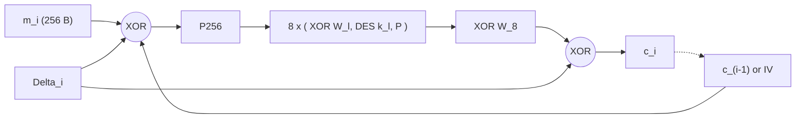

# Mathematical analysis of SillyDES 5.1.0

This analyses the wrapping scheme around DES, not DES itself. DES is treated as a keyed random permutation on 64-bit words. Everything below refers to the current code in [src/](src/) (the cipher is in [src/sillydes_cipher.cpp](src/sillydes_cipher.cpp)). Items marked **(measured)** were checked against the built binary or a model run for this revision (section 12). Classical and quantum attackers are treated side by side: each attack is costed classically first and then in the quantum models of section 2. Claims about key-search cost are heuristic arguments about a custom construction that nobody has reviewed.

## 1. Summary

| Property | Result |
|---|---|
| Block width | 2048 bits (32 DES words); one plaintext bit reaches every word after 6 layers, one output word depends on every plaintext word after 5 layers, in both directions **(measured)** |
| Layers | 8 DES layers, 256 DES operations per 256-byte block |
| Keys | 8 DES keys (64 bytes); all 512 key bits feed the 2048-bit whitening and the per-block tweak |
| Per-block tweak | XEX: a secret 2048-bit mask, a PRF of key, salt and block index, XORed before and after the cipher. Every block is encrypted by its own permutation instance, used once |
| Generic key search | about $2^{512}$ classically, $2^{256}$ Grover iterations. With one input-output pair per permutation instance, which is all the scheme ever provides, no quantity an attacker can compute depends on a proper subset of the key bits, so no divide-and-conquer or meet-in-the-middle split exists (sections 5.2 and 5.4) |
| Same cascade without whitening | $2^{224}$ time from the 4\|4 split; about $2^{149}$ with quantum claw finding |
| Differential, linear, slide and Simon-type attacks | need two pairs under one permutation instance; the tweak and the fresh salt and IV ensure none exist, classically or in superposition. The bare core, given many pairs of one fixed instance, would fall to a lane-confined truncated differential: about $2^{196}$ chosen texts and $2^{288}$ work classically, $2^{116}$ superposition queries and $2^{144}$ work with quantum queries (section 6) |
| Chaining | CBC around all layers with a random 256-byte IV, inside the tweak |
| Randomisation | Salt, IV and padding are random and drawn inside the sealing routine only, with error 14 if the generator fails: equal messages give unrelated ciphertexts **(measured)**; two files made with one key file share no whitening and no tweak |
| Integrity | HMAC-SHA-512 (512-bit key, 512-bit tag) over header and ciphertext, verified before decryption; $2^{256}$ Grover iterations for the MAC key or a forgery |
| Passphrase | Argon2id (2 GiB, 1 pass, 4 lanes, RFC 9106 first recommendation), random salt; strength is the phrase entropy, halved by Grover |
| 64-bit word collisions | occur at the random rate (about $2^{30}$ blocks) and carry no information, because the tweak masks every ciphertext word with a block-specific secret (section 8) |
| Speed | 1 MiB in 0.09 s each way; 16 MiB in 1.22 s each way, about 13 MB/s; phrase mode adds 1.8 s **(measured)** |
| Against AES-256 | about $2^{256}$ quantum for cipher and MAC against $2^{128}$ for AES-256, heuristic and unreviewed; 100 to 700 times slower (section 10) |

The key-search bound rests on one structural fact: every layer input, including the first and the last, is XORed with a pseudorandom function of **all** 512 key bits, so there is no partial-key test anywhere in the cipher. The tweak adds a second fact: no permutation instance is ever used for more than one block, so there is nothing for a multi-pair attack to compare. Both facts hold for a quantum attacker as well as a classical one.

## 2. Model

Let $D_k$ be DES-ECB applied to each of the 32 eight-byte words of a 256-byte block, and let $P_s$ be the keyless nibble swap on $s$-byte groups (section 3). The eight keys $k_0,\dots,k_7$ and nine whitening blocks $W_0,\dots,W_8$ (each 2048 bits) define the wide block cipher $G$:

$$s_0 = P_{256}(u),\qquad s_{l+1} = P_{g_l}\big(D_{k_l}(s_l \oplus W_l)\big)\ (l<7),\qquad G(u) = D_{k_7}(s_7\oplus W_7)\oplus W_8$$

with $g_l = 16\cdot 2^{\,l \bmod 5}$ bytes, that is 16, 32, 64, 128, 256, 16, 32 for $l=0,\dots,6$. With $K = k_0\|\cdots\|k_7$ (all 64 bytes) and the 16-byte salt from the file header, the whitening and the per-block tweak are

$$W_j = \mathrm{HMAC\text{-}SHA\text{-}512}_{K}\big(\text{"SillyDES 5.1.0 white"}\,\|\,\text{salt}\,\|\,j\,\|\,c\big)_{c=0..3},\qquad
\Delta_i = \mathrm{HMAC\text{-}SHA\text{-}512}_{K}\big(\text{"SillyDES 5.1.0 tweak"}\,\|\,\text{salt}\,\|\,i\,\|\,c\big)_{c=0..3},$$

four 64-byte outputs each, $i$ the 8-byte big-endian block index. The whitening costs 36 HMAC calls once per file; the tweak costs 4 per block, with the HMAC pad states computed once.

The message is encrypted in CBC mode around $G$, and each block is wrapped in its tweak (the XEX construction). For padded plaintext blocks $m_i$:

$$u_i = m_i \oplus c_{i-1},\qquad c_i = G(u_i \oplus \Delta_i)\oplus\Delta_i,\qquad c_{-1} = \mathrm{IV}$$

Decryption is $m_i = G^{-1}(c_i\oplus\Delta_i)\oplus\Delta_i\oplus c_{i-1}$. Writing $G_i(x) = G(x\oplus\Delta_i)\oplus\Delta_i$, the scheme is plain CBC over a family of permutations $G_0, G_1, \dots$ of which each member encrypts exactly one block.

The file is `SD\x05\x10 | log2 m, t, p, 0 | salt | IV | c_0 ... c_n | tag`: a 280-byte header (format version bytes major and minor·16+patch; $m$ the Argon2id memory in KiB, $t$ the passes, $p$ the lanes), the blocks, and $\text{tag}=\mathrm{HMAC\text{-}SHA\text{-}512}(K_{mac},\ \text{everything before it})$, 64 bytes, with $K_{mac}$ a 512-bit key. Salt and IV are drawn from the system random generator inside the sealing routine on every encryption; no interface accepts them from a caller, and the program stops with error 14 if the generator fails or returns an all-zero value.

Key material by mode:

| | Key-file mode | Phrase mode |
|---|---|---|
| $K$ (DES keys) | the 64 bytes of the file | Argon2id output bytes 0..63 |
| $K_{mac}$ | $\mathrm{HMAC\text{-}SHA\text{-}512}_K(\text{"SillyDES 5.1.0 mac"})$ | Argon2id output bytes 64..127 |
| Salt | input to $W_j$ and $\Delta_i$ | input to Argon2id, $W_j$ and $\Delta_i$ |
| Varies per file | salt, hence all $W_j$ and $\Delta_i$, and IV | salt, hence $K$, $K_{mac}$, all $W_j$, $\Delta_i$, and IV |

The three HMAC labels differ in their first bytes, so whitening, tweak and MAC key are domain-separated outputs of one PRF under $K$.

**Attacker models.** Three settings are used throughout:

- **Classical.** The attacker has classical computation and, at most, classical access to an encryption oracle.
- **Q1.** The attacker has a quantum computer but only classical access to the encryption. This fits stored files: the data must be collected classically and cannot be amplified afterwards; only the attacker's own computation gets a quantum speed-up.
- **Q2.** The attacker can query the encryption in superposition. This is not realistic for file encryption, but it is the model in which the exponential quantum speed-ups (Simon's algorithm) are known, so it is included to show which structures would be exposed if the oracle existed.

Shor's algorithm does not apply: the scheme is purely symmetric, and how the keys are exchanged is outside this analysis. Grover's algorithm finds a $k$-bit key in about $2^{k/2}$ iterations, each running the whole cipher in superposition; it parallelises poorly, $S$ machines giving only a factor $\sqrt S$. Two further terms are used from section 6 on: the **bare core** is one fixed instance of $G$ that the attacker may query at will; the **deployed scheme** is the file format, with the tweak and a fresh salt and IV for every encryption.

## 3. The expansion permutations

For a group of $s$ bytes and $i < s/2$, with $j = i + s/2$:

$$\text{new}[i] = (\text{old}[j] \,\&\, \mathtt{0x0F}) \ll 4 \;\big|\; (\text{old}[i] \,\&\, \mathtt{0x0F}),\qquad
\text{new}[j] = (\text{old}[j] \,\&\, \mathtt{0xF0}) \;\big|\; (\text{old}[i] \gg 4)$$

Properties, all checked on random blocks for $s = 16, 32, 64, 128, 256$ **(measured)**:

- **Bit permutation:** $P_s$ is linear over $\mathrm{GF}(2)$ and has no key. An attacker can apply or invert it freely.
- **Involution:** $P_s^2 = \mathrm{id}$.
- **Lane-preserving:** the byte position inside a 64-bit word never changes, because $s/2$ is a multiple of 8.
- **Pairing:** each layer pairs word $b$ with word $b \oplus \text{stride}$, taking half the nibbles from each.
- **Stay set:** in every $P_s$, exactly 32 of the 64 bit positions of a word stay in that word: the low nibbles for a word in the lower half of its group, the high nibbles for a word in the upper half. The other 32 move to the partner word. This number governs the best differential trail (section 6).

| Position | initial | after $D_0$ | $D_1$ | $D_2$ | $D_3$ | $D_4$ | $D_5$ | $D_6$ |
|---|---|---|---|---|---|---|---|---|
| Permutation | $P_{256}$ | $P_{16}$ | $P_{32}$ | $P_{64}$ | $P_{128}$ | $P_{256}$ | $P_{16}$ | $P_{32}$ |
| Stride (words) | 16 | 1 | 2 | 4 | 8 | 16 | 1 | 2 |

Read forwards, the strides after $D_0$ to $D_4$ are 1, 2, 4, 8, 16: each bit of the five-bit word index once, a butterfly. Read backwards from the ciphertext, the strides are 2, 1, 16, 8, 4: again each bit once. So the network is a butterfly in both directions, and the sixth to eighth layers repeat the pattern.

## 4. Diffusion

Modelling each DES layer as fully mixing its word, the word-level cones over all 2048 start bits are **(measured, model)**:

| After layer | 1 | 2 | 3 | 4 | 5 | 6 | 7 | 8 |
|---|---|---|---|---|---|---|---|---|
| Words reached by one plaintext bit | 1 | 2 | 4 | 8 | 16 | 32 | 32 | 32 |
| Words reached by one ciphertext bit (inverse layers 8 to 1) | 1 | 2 | 4 | 8 | 16 | 32 | 32 | 32 |
| Plaintext words that one output word of the layer depends on | 2 | 4 | 8 | 16 | 32 | 32 | 32 | 32 |

- The counts are identical for every start bit (min = max).
- The third row starts at 2 because $P_{256}$ precedes the first layer: every input word of $D_0$ already holds nibbles from two plaintext words.
- A single bit reaches the whole block at layer 6, and every output word depends on the whole plaintext at layer 5. Layers 7 and 8 are extra margin, not needed for diffusion. Symmetrically, from the ciphertext side layers 1 and 2 are margin.
- Hence every pair of consecutive layers can be regarded as "spare" from one side or the other, but no layer is spare from both sides: a trail must cross at least six fully diffusing layers.
- $c_i$ depends on $m_0,\dots,m_i$ and the IV. A change in $m_i$ changes about half of the bits of $c_i$, and since $c_i$ is the next chaining value, every later block changes too.

## 5. Key space and generic attacks

### 5.1 Cascade without whitening

With public permutations between the layers, a meet-in-the-middle split works: guess the keys of the first half from the plaintext side and of the second half from the ciphertext side. For $r$ layers the time is about $2^{56\lceil r/2\rceil}$. For $r=8$ that is $2^{224}$. Deriving the layer keys from a master key does not change this, because the attacker searches the layer keys directly.

A quantum attacker does better still: claw finding replaces the classical meet-in-the-middle and costs about the $2/3$ power of it, if a large quantum memory exists, which puts the eight-layer cascade without whitening near $2^{149}$. The same applies to any cascade of standard ciphers, which is why a cascade of AES-256 would not raise its quantum level either (section 10).

### 5.2 Whitening and tweak derived from all key bits

The argument is simpler and stronger than a bit count. Under the assumption that HMAC-SHA-512 with a 512-bit key is a pseudorandom function:

1. Every layer input, including the plaintext side ($W_0$ and $\Delta_i$) and the ciphertext side ($W_8$ and $\Delta_i$), is XORed with a value that is a PRF output of the **whole** key $K$.
2. Any computation that produces a checkable quantity, from either end, must evaluate at least one DES word, and therefore must know at least one 64-bit word of some $W_l$ (and, at the outer layers, of $\Delta_i$).
3. A PRF output gives no information about any other output, and a partial key gives no information about any output. So knowing one word of one $W_l$ costs guessing all 512 bits of $K$.

Therefore **there is no partial-key test anywhere in the cipher**: no guess of fewer than 512 bits can be confirmed or refuted. This excludes meet-in-the-middle, divide-and-conquer over layers, and divide-and-conquer over words, and reduces the generic attack to brute force over $K$ at about $2^{512}$. The whitening cannot be solved for separately, because it is added before a nonlinear layer, so it is not removed by combining blocks; the tweak cannot be solved for either, because it differs for every block. With no halves to meet in the middle, quantum claw finding has nothing to work on, and the quantum generic attack is Grover over $K$ (section 5.4).

The argument holds for what the attacker actually gets: one input-output pair per permutation instance $G_i$. It does not hold for many pairs of one fixed instance, because differences cancel the whitening and a right pair of a differential then gives a 120-bit partial test on $k_7$ and one word of $W_8$ (section 6.2). The tweak and the fresh salt and IV are what deny such pairs, so the $2^{512}$ figure rests on them, not on the core alone.

For completeness, a bit-count model treats every whitening word as 64 independent unknown bits and asks what a meet-in-the-middle at each cut would have to guess, ignoring the tweak. The cut sits at the output of $D_l$; the forward side needs the cone of one output word, the backward side the cone of the two words of $s_{l+1}$ that feed it (64 bits per whitening word, 56 per key, 64 per ciphertext word because of $W_8$):

| Cut after layer | Forward unknown bits | Backward unknown bits | Cost of the split ($\max$) |
|---|---|---|---|
| 1 | 120 | 10504 | $2^{10504}$ |
| 2 | 304 | 8400 | $2^{8400}$ |
| 3 | 616 | 6296 | $2^{6296}$ |
| 4 | 1184 | 3168 | $2^{3168}$ |
| 5 | 2264 | 1576 | $2^{2264}$ |
| 6 | 4368 | 752 | $2^{4368}$ |
| 7 | 6472 | 312 | $2^{6472}$ |

The numbers above $2^{512}$ are an artefact of treating the whitening as independent: a real attacker would guess $K$ instead. The table's only content is that every cut needs far more than 512 unknown bits on each side, which is the same conclusion as the PRF argument. As a check of the method, the same model applied to a hypothetical six-layer cascade without whitening gives $2^{168}$ at the 3|3 cut, matching $2^{56\lceil r/2\rceil}$.

### 5.3 DES-specific properties

- **Key bits.** DES ignores the lowest bit of each key byte, so the DES layers use 448 bits. The whitening reads all 64 bits of each key, so all 512 bits count. A key file that differs in one such bit fails authentication **(measured)**.
- **Complementation.** DES satisfies $D_{\bar k}(\bar x) = \overline{D_k(x)}$, which halves brute force on a plain DES cascade. Here complementing $K$ replaces every $W_l$ by an unrelated PRF output, so the property gives no saving.
- **Weak and semi-weak keys.** A weak key makes $D_k$ an involution. Random keys hit one with probability $2^{-52}$ per layer; with chosen key files it is the user's responsibility. Even then, the whitening between layers means no $D_k \circ D_k$ cancellation can occur.
- **Equivalent keys.** Two keys $K \ne K'$ give the same cipher only if they agree on all 448 DES bits and all nine $W_j$ and every $\Delta_i$ collide, which for a PRF has probability below $2^{-18432}$.

### 5.4 Quantum key search

With no partial-key test (section 5.2), the quantum generic attack is Grover over the whole key:

| | AES-256 | SillyDES 5.1.0, key file | Hypothetical 512-bit cipher |
|---|---|---|---|
| Key bits | 256 | 512 (448 DES bits, 64 bits that only feed whitening and tweak) | 512 |
| Grover iterations | $2^{128}$ | $2^{256}$ | $2^{256}$ |
| Cost per iteration | one AES-256 circuit | 256 DES circuits plus 40 HMAC-SHA-512 computations for whitening and tweak | one circuit |

AES-256 key search is NIST's reference for its highest post-quantum category (category 5). Without the whitening the cascade would be near $2^{149}$ by claw finding (section 5.1), which is another reason to keep it.

The cipher key is not the only 512-bit quantity. Where the quantum bound of the whole scheme lies:

| Part | Quantum cost | Reason |
|---|---|---|
| Cipher key | $2^{256}$ iterations | Grover on 512 bits (heuristic, section 5.2) |
| MAC key | $2^{256}$ iterations | HMAC-SHA-512 key is 512 bits, derived from the keys or the passphrase |
| Tag forgery | $2^{256}$ iterations | 512-bit tag |
| **Whole scheme, key file** | **about $2^{256}$** | limited by the cipher and MAC keys, which are both 512 bits |

- A 256-bit MAC key and tag, such as HMAC-SHA256, would limit the whole scheme to $2^{128}$, the same as AES-256 with HMAC-SHA256 or GCM. The 512-bit MAC key and tag give authentication the same quantum cost as encryption. Both the whitening and the MAC use HMAC-SHA-512; BLAKE2b is used only inside Argon2id, on the passphrase path.
- This is a cost model of the keys and tag, not a proof. The MAC key is a PRF output of the same keys as the cipher, so the two are not independent, and nobody has reviewed the construction.
- In phrase mode the limit is the phrase entropy, halved by Grover (section 8).

### 5.5 What this does not show

- It is a heuristic about cost, not a proof. It assumes there is no structural attack on XOR-whitened networks of DES words beyond guessing the unknowns.
- Security of whitening and tweak rests on HMAC-SHA-512 behaving as a pseudorandom function, an additional assumption beyond DES. In key-file mode the MAC key is a PRF output of the same $K$, so cipher and MAC are not independent.
- In phrase mode the real limit is the phrase entropy (section 8).
- The construction is custom and unreviewed. A standard cipher such as AES-256 would give a 256-bit bound with reviewed security.

### 5.6 Other bounds

- **Unicity:** one known 256-byte block gives 2048 bits of constraint against 512 key bits, so a single block identifies the key.
- **Known pairs:** in CBC the attacker knows $u_i = m_i\oplus c_{i-1}$, but the input of $G$ is $u_i\oplus\Delta_i$ and its output is $c_i\oplus\Delta_i$, both unknown. Each known plaintext block is therefore a known pair of $G_i$, a permutation instance that encrypts nothing else. There are no known pairs of $G$ itself.

## 6. Differential, linear, slide and period-finding attacks

This section treats the structural attacks: first why the deployed scheme gives them nothing to work with, then how the bare core would fare without that protection, classically and in the Q1 and Q2 models. The published quantum results used, checked against their abstracts unless stated otherwise:

- Kaplan, Leurent, Leverrier, Naya-Plasencia, *Quantum differential and linear cryptanalysis*, ToSC 2016(1): differential and linear distinguishers get at most a quadratic speed-up in Q2 (about $p^{-1/2}$ queries for a differential of probability $p$); key-recovery variants gain less than quadratic; in Q1 the data cannot be amplified, so only the offline key guessing gets a Grover speed-up.
- Kaplan, Leurent, Leverrier, Naya-Plasencia, *Breaking symmetric cryptosystems using quantum period finding*, Crypto 2016: Simon's algorithm in Q2 breaks CBC-MAC, PMAC, GMAC, GCM and OCB with $O(n)$ queries, and slides a one-round self-similar cipher at the same cost. The Even-Mansour break by the same method is Kuwakado and Morii 2012, cited from memory.
- Leander and May, *Grover meets Simon*, Asiacrypt 2017: in Q2, whitening keys add essentially nothing, because an FX construction is broken in about the time Grover takes on the inner cipher alone, with Simon stripping the whitening inside each Grover iteration.
- Bonnetain, Hosoyamada, Naya-Plasencia, Sasaki, Schrottenloher, *Quantum attacks without superposition queries: the offline Simon's algorithm*, Asiacrypt 2019: Even-Mansour and FX fall in Q1 with about $2^{n/3}$ classical queries and comparable quantum time, better than Grover, by reusing a classical database inside a Grover search.
- Bonnetain, Naya-Plasencia, Schrottenloher, *On quantum slide attacks*, SAC 2019: quantum versions of the advanced slide attacks (Feistel self-similarity up to four rounds, sliding with a twist, complementation slide, mirror slidex, slides combined with FX, cycle finding), all in Q2.
- Anand, Targhi, Tabia, Unruh, *Post-quantum security of the CBC, CFB, OFB, CTR and XTS modes*, PQCrypto 2016: OFB and CTR are IND-qCPA from a standard-secure PRF; CBC and CFB need a quantum-secure PRP, with counterexamples otherwise; XTS is not IND-qCPA from a standard-secure PRF.

### 6.1 Why the tweak closes the door

Differential and linear cryptanalysis compare at least two pairs under the **same** permutation with a known input difference (or a known linear relation between inputs). Here block $i$ is encrypted by $G_i$ and block $j$ by $G_j$; relative to the core $G$ their inputs differ by $\Delta u\oplus\Delta_i\oplus\Delta_j$ and their outputs by $\Delta c\oplus\Delta_i\oplus\Delta_j$, where $\Delta_i\oplus\Delta_j$ is an unknown PRF output. The attacker therefore knows neither the input nor the output difference of $G$ for any two blocks, in this file or in any other file, because the salt enters the tweak. There is no pair to analyse. The same holds for any attack that needs a repeated input or a repeated internal state across blocks, and it holds in Q2 as well: a superposition query to the encryption carries a fresh salt and IV, so even such a query reaches a family $\{G_i\}$ that is never queried again.

This depends on the salt and the IV being fresh for every encryption, which [src/container.cpp](src/container.cpp) enforces: both are drawn inside `seal` from the system random generator, no interface accepts them from a caller, and an all-zero value or a generator failure stops the program with error 14. Two files made with the same key file, salt and IV would share every $W_j$ and $\Delta_i$; their first blocks would then be two pairs of the single permutation $G_0$ with a known input difference, and the attack of section 6.2 would apply to it, block for block, across such files. The tweak alone does not prevent this, since a constant XOR is transparent to differences; the randomisation does.

The remainder of this section asks how the core $G$ would fare **if the tweak and the randomisation were not there**, that is, if the attacker could query one fixed instance of $G$ at will. This is the second line of defence, and it shows how much work the DES layers do on their own.

### 6.2 The core without the tweak: lane-confined differentials

XOR with the chaining value or with $W_l$ does not change differences and only changes the sign of linear approximations, so the whitening is transparent to both kinds of attack. What is not transparent is that the attacker never sees any inner value, and that peeling a layer costs 64 unknown whitening bits for every word it touches on top of the 56-bit layer key, with the number of words doubling per layer peeled.

The cheapest way for a difference to cross the network is to stay in a single DES word. After each DES layer the output difference in the active word is essentially random; $P_s$ keeps it inside the word only if it lies in the 32-bit stay set (section 3), which a random permutation does with probability $2^{-32}$. The attacker can choose the plaintext difference inside the stay set of $P_{256}$ for free, and the eighth layer's output needs no confinement because it is observed directly. That leaves seven confinements, after $D_0$ to $D_6$:

$$\Pr\big[\Delta c \text{ confined to one word} \mid \Delta u \text{ confined to the stay set of that word}\big] \approx 2^{-7\cdot 32} = 2^{-224}.$$

For a random 2048-bit permutation the same event has probability $2^{-1984}$, so this is a distinguisher for the bare $G$ with about $2^{224}$ chosen pairs. Allowing two active words costs $2^{-64}$ per layer, because both must confine, and a two-word difference can never merge back into one word for free, so no trail does better in this model.

- **Data.** A structure of $2^{32}$ plaintexts that vary only in the 32 stay-set bits of word $w$ contains $2^{63}$ pairs, every one with an admissible input difference. About $2^{161}$ structures, $2^{193}$ chosen texts, contain one right pair, which is found by sorting the ciphertexts of each structure on the 1984 bits outside word $w$: a wrong pair collides there with probability $2^{-1984}$, so every collision is a right pair, and it is identified without any key guess. Six right pairs, needed below, cost about $2^{196}$ chosen texts ($2^{204}$ bytes).
- **Key recovery.** Differences cancel the whitening, so a right pair is a partial-key test. From the ciphertext side: guess $k_7$ and $W_8[w]$ (120 bits), invert $D_7$ on word $w$, and require the difference at the input of $D_7$ to lie in the stay set of $P_{32}$; a wrong guess passes with probability $2^{-32}$ per pair, so four pairs leave the right one. The next layer needs the full output word $w$ of $D_6$, which $P_{32}$ assembled from words $w$ and $w\oplus 2$ of the input of $D_7$, so the guess grows to $W_8[w\oplus 2]$, 64 bits of $W_7$ and $k_6$: 184 bits, six pairs. One layer further the backward cone doubles again (section 5.2): 312 bits for $k_5$, 568 for $k_4$, more than the key. The plaintext side mirrors this: 120 bits for $k_0$ and $W_0[w]$, 184 for $k_1$, 312 for $k_2$. The cheapest course is $2\cdot 2^{120}+2\cdot 2^{184}$ for $k_0,k_1,k_6,k_7$, then brute force over the remaining 288 key bits, each guess checked by deriving the whitening: about $2^{288}$ in total, against $2^{512}$ generic.
- **Data model.** Controlling $\Delta u_i$ requires knowing $c_{i-1}$ before choosing $m_i$, an adaptive encryption oracle, and every pair must go through the same instance of $G$, which the tweak and the randomisation prevent. Encrypting files offers neither. The attack is therefore a statement about the core, not about the scheme: the core on its own is below its generic bound, and the tweak with fresh salt and IV is the component that restores it.
- **Assumption.** Sixteen-round DES is assumed to have no truncated differential into a fixed 32-bit subset with probability noticeably above $2^{-32}$. If it had probability $2^{-32+e}$ the trail would gain $2^{7e}$, still far from feasible for any plausible $e$.

**Quantum cost.** Nothing quantum changes the trail, only the cost of exploiting it:

| Setting | Data | Work | Against |
|---|---|---|---|
| Bare core, classical | $2^{196}$ chosen texts of one instance | $2^{288}$ | $2^{512}$ |
| Bare core, Q1 | $2^{196}$ classical chosen texts of one instance | $2^{144}$ quantum, but the data dominates | $2^{256}$ |
| Bare core, Q2 | $2^{116}$ superposition queries to one instance | $2^{144}$ | $2^{256}$ |
| Deployed scheme, any model | no second pair of any instance exists | $2^{256}$ (Grover on $K$) | $2^{256}$ |

- **Finding right pairs.** The trail holds with probability $2^{-224}$ and is recognised from the ciphertext alone. In Q2 the attacker runs amplitude amplification over the $2^{32}$-text structures, evaluating $G$ in superposition on both texts of a candidate pair and marking the pair when the output is confined; about $2^{112}$ iterations find one right pair, the quadratic speed-up of Kaplan et al., and six pairs cost about $2^{116}$ queries. In Q1 the pairs must be collected classically, $2^{196}$ texts as before; a quantum computer cannot amplify data it does not hold.
- **Key recovery.** The guesses above become Grover searches: $2^{60}$ for the 120-bit outer guesses, $2^{92}$ for the 184-bit ones, with the same six right pairs as the filter. The remaining 288 key bits cost $2^{144}$ Grover iterations, each deriving the whitening and checking one block. That final step dominates the quantum work: about $2^{144}$ in both Q1 and Q2, against $2^{256}$ for key search on the deployed scheme and $2^{128}$ for AES-256; in Q1 the $2^{196}$ classical queries are the larger cost. The core on its own is therefore a 288-bit cipher under this attack, not a 512-bit one.
- **Deployed scheme.** Both the classical data and the superposition queries have to go to one fixed permutation. Block $i$ of a file is encrypted by $G_i$, which depends on the salt and the block index and is used once; another file has another salt and so another family. The attacker never obtains two pairs of any $G_i$ and cannot choose the input difference between $G_i$ and $G_j$, since $\Delta_i\oplus\Delta_j$ is unknown. The differential attack gets one query per instance and needs $2^{116}$; it does not start. If an implementation ever fixed the salt and the IV (deterministic encryption), the first block would be a fixed permutation of $m_0$ and the "bare core" rows would apply to it, $2^{144}$ in Q2.

### 6.3 The core without the tweak: linear approximations

A linear trail likewise needs at least one active DES word in every layer. The best 16-round DES approximation has bias about $2^{-23}$. By the piling-up lemma, eight layers give a bias of at most about $2^{7}\cdot 2^{-8\cdot 23} = 2^{-177}$, needing roughly $2^{354}$ known pairs of the bare $G$, and only if the masks could be chained through the stay sets of the permutations, which Matsui's masks cannot be assumed to do.

- **Quantum.** Kaplan et al. give a Q2 linear distinguisher with about $\varepsilon^{-1}$ queries for bias $\varepsilon$, against $\varepsilon^{-2}$ classically, by amplitude estimation; again nothing in Q1. With $\varepsilon \le 2^{-177}$ the Q2 distinguisher needs about $2^{177}$ superposition queries, which already exceeds Grover on the whole key, and it presupposes a linear mask that chains through the 32-bit stay sets of seven permutations, which has not been shown to exist for DES's best approximations. Key recovery on top of it meets the same doubling cone as the differential attack. The differential route at $2^{144}$ dominates, so linear cryptanalysis is not the limiting attack on the core in any model.
- **Deployed scheme.** A known pair is a pair of some $G_i$, used once; the whitening fixes a per-instance sign that the attacker cannot align across instances. Not applicable.

### 6.4 Slide and related-key attacks

Every slide attack, classical or quantum, needs self-similarity: the cipher must be $F_k^r$ for some keyed round $F_k$ that repeats with the same key, or with keys that differ in a known way (complementation slide, sliding with a twist). The Simon-based slide of Kaplan et al. and all the variants of Bonnetain et al. are quantizations of that requirement; cycle finding needs the same thing.

Layer $l$ of $G$ is $x \mapsto P_{g_l}\big(D_{k_l}(x\oplus W_l)\big)$. The stride pattern repeats with period five (layers 0 to 2 use $P_{16}, P_{32}, P_{64}$ and so do layers 5 to 7), which is the only self-similar element. It is broken twice over:

- The layer keys $k_l$ are independent bytes of the key file or of the Argon2id output. For $k_l = k_{l+5}$ the user would have to supply a key file with repeated keys, and even then:
- The whitening blocks $W_l$ are HMAC outputs whose input contains the layer index $j$ ([src/sillydes_cipher.cpp](src/sillydes_cipher.cpp)). $W_l = W_{l+5}$ would need a 2048-bit PRF collision, probability about $2^{-2048}$ per pair of layers. A key file with eight identical DES keys therefore still gives eight distinct layer functions. No related-key or twisted relation between $W_l$ and $W_{l+5}$ exists either, since they are unrelated PRF outputs, which rules out the complementation and twist variants.
- Eight layers are not a multiple of five, so even with identical keys and whitening the cipher would be $R'\circ R$ with $R$ the five-layer period and $R'$ only its first three layers, and a pair slid by one period would not close.
- The complementation slide relies on $D_{\bar k}(\bar x) = \overline{D_k(x)}$. Complementing $K$ replaces every $W_j$ and $\Delta_i$ with an unrelated PRF output (section 5.3), so the property does not survive the whitening.
- The slide-with-FX attacks of Bonnetain et al. strip an outer whitening by Simon and slide the inner cipher; the inner cipher here is not self-similar, so there is nothing to slide after stripping.
- Every block has its own tweak on top of all this, so the deployed scheme has even less self-similarity than the bare core.
- Related keys are outside the threat model: keys are random or Argon2id-derived, and whitening and tweak are PRFs of the whole key, so related DES keys give unrelated masks.

Conclusion: there is no slide structure to exploit or to quantize. This holds for the bare core and a fortiori for the deployed scheme. The per-layer index in the whitening label is the element that guarantees it even for degenerate key files.

### 6.5 Simon-type attacks on the whitening and the tweak

The XOR masks are the obvious target for period finding. Each known attack needs a specific shape:

- **Even-Mansour** (Kuwakado and Morii 2012; offline version in Q1 by Bonnetain et al. 2019): $E(x) = P(x\oplus k_1)\oplus k_2$ with $P$ public. Here nothing is public: the DES layers are keyed. Not applicable.
- **FX / Grover meets Simon** (Leander and May 2017): $E(x) = E'_k(x\oplus k_1)\oplus k_2$ with a small inner key $k$. The function $x\mapsto E(x)\oplus E'_{k}(x)$ is periodic with period $k_1$ for the right $k$, so a Grover search over $k$ with Simon inside finds an $m$-bit inner key in about $2^{m/2}$ iterations. For the bare core the inner cipher is $D_{k_7}\circ\cdots\circ(\oplus W_1)\circ P_{16}\circ D_{k_0}$, which contains the seven inner whitening blocks. The attacker's candidate $E'$ must reproduce them, and they are PRF outputs of all 512 bits of $K$; so the "inner key" is $K$ itself and the Grover search is over $2^{512}$, that is $2^{256}$ iterations, the generic figure. Guessing only the 448 DES bits does not give a periodic function, because wrong inner whitening leaves a nonlinear mismatch rather than an XOR period.
- **If the outer masks were independent keys.** Had $W_0$, $W_8$ and the tweak been keys independent of the DES layers, the FX attack would strip them and reduce the scheme to the search for the inner cascade's key. The inner whitening $W_1,\dots,W_7$ would still not be stripped, since it sits between nonlinear layers, so even then the residual search would be over the 448 DES bits and the seven inner blocks, not over DES alone. Deriving everything from one $K$ is what removes the small inner key entirely.
- **Offline Simon in Q1** (Bonnetain et al. 2019): trades $2^{n/3}$ classical queries to one Even-Mansour or FX instance for a Grover search over the inner key with Simon reusing the stored queries. It needs the FX shape and a fixed instance. Neither is present: the shape fails as above, and the deployed scheme gives at most one query per instance.
- **The tweak as XEX.** For a fixed block index $i$, $G_i(x) = G(x\oplus\Delta_i)\oplus\Delta_i$ is an FX construction around $G$. Simon on $G_i$ reduces to Grover meets Simon with inner cipher $G$, whose key is $K$: again $2^{256}$. Independent masks per block, rather than the XTS sequence $\Delta_0\alpha^i$, mean that no linear relation between $\Delta_i$ and $\Delta_j$ exists for Simon to exploit across indices (section 9).
- **Period finding on the mode.** Kaplan et al. break CBC-MAC and GCM by constructing a function of the message that is periodic in a key-dependent value. CBC encryption with a fresh random IV per query is not such a function, and here each query also has a fresh salt, so no two queries evaluate the same keyed function. Simon needs $O(n)$ queries to one function and gets one.

None of the Simon-type attacks obtains a function with a hidden period that is cheaper to find than $K$. This is an argument about shapes, not a proof of qPRP security of $G$.

### 6.6 The mode under superposition queries

Anand et al. show that CBC and XTS are not IND-qCPA secure from a standard-secure PRP alone, but CBC is from a quantum-secure PRP. The deployed scheme differs from their CBC in three ways that each make the attacker's job harder, none of which is a proof:

1. Each block is encrypted by its own permutation $G_i$ (XEX inside CBC), so the chaining never feeds two blocks through the same permutation.
2. The salt is fresh per encryption, so every query, superposition or not, meets a fresh family $\{G_i\}$ and a fresh whitening. The IND-qCPA counterexamples and the Simon attacks all query one fixed keyed function many times.
3. The IV is random and 2048 bits wide.

What the Q2 security of the deployed scheme then rests on is that $G_i$ behaves as a strong pseudorandom permutation under a *single* superposition query. That is a weaker requirement than the quantum-secure PRP assumption of Anand et al., but it has not been shown for this core, and section 6.2 shows that under *many* queries to one instance the core does not reach its generic bound. The honest statement is: the scheme's quantum security beyond Grover rests on never reusing an instance, which the file format enforces, and not on a proven property of $G$. Standard AES-GCM and CBC-based schemes are likewise not secure against superposition queries; the sensible assumption for both is that no such oracle exists.

### 6.7 Summary and a design remark

| Attack | Bare core, classical | Bare core, best quantum model | Deployed scheme | Limiting factor |
|---|---|---|---|---|
| Lane-confined differential | $2^{196}$ texts, $2^{288}$ work | $2^{144}$ work, $2^{116}$ Q2 queries | not applicable | needs two pairs of one instance |
| Linear | $2^{354}$ pairs, if a chaining mask exists | $2^{177}$ Q2 queries, same proviso | not applicable | dominated by the differential |
| Slide (all variants) | no self-similarity | no self-similarity | not applicable | layer index in the whitening, independent keys |
| Simon on whitening or tweak | — | reduces to Grover on $K$, $2^{256}$ | $2^{256}$ | inner whitening between nonlinear layers |
| Mode-level Q2 | — | not applicable | one query per instance | fresh salt and IV per encryption |
| Generic key search | $2^{512}$ | $2^{256}$ (Grover) | $2^{256}$ | 512-bit key |

The lane-confined differential is the only sub-generic structure found in this analysis, and it comes from a single fact: $P_s$ moves exactly half of each word, so a word-confined difference survives a layer with probability $2^{-32}$. A permutation that spread each word over four or eight words per layer would cut that to $2^{-48}$ or $2^{-56}$, giving trails of $2^{-336}$ or $2^{-392}$ over seven layers and pushing the Q2 distinguisher on the bare core to about $2^{168}$ or $2^{196}$ queries; it would also widen the backward cone, so each peeled layer would cost more key material, and shorten full diffusion to three or two layers. None of this changes the bound of the deployed scheme, which is $2^{512}$ classically and $2^{256}$ quantumly with or without it, because the tweak and the randomisation already deny the attacker a second pair of any instance. The nibble swap is therefore kept, and the randomisation is enforced in code (section 6.1) rather than left to convention.

All figures in this section are heuristic trail counts and cost models on a custom construction assuming independent layers, not proofs.

## 7. Equal plaintext blocks

**Why the chaining is outside $G$.** If the chaining XOR sat before only the last layer, equal inputs to that layer would have a public difference, and a single-DES search would recover the last key in about $2^{55}$ operations. The XOR sits at the input of the whole cipher instead, so every layer sees the chained value and checking a key requires all eight keys and all masks.

**Why the tweak makes chaining a second line.** With $m_i = m_j$ at different positions, the inputs to the core are $m_i\oplus c_{i-1}\oplus\Delta_i$ and $m_j\oplus c_{j-1}\oplus\Delta_j$, already unrelated by the tweak alone. Chaining is kept because it costs one XOR per block and makes $c_i$ depend on the whole prefix of the message, which the tweak alone does not provide.

**Measured.** The unit test in [test/test_primitives.cpp](test/test_primitives.cpp) encrypts blocks $A,B,A$ and asserts that blocks 0 and 2 differ in at least 200 of 256 bytes and share no 8-byte word; feeds the same value to the core at block index 0 and 1 and asserts the outputs are unrelated; asserts that two tweak values are unrelated; asserts that changing the salt or any tested key bit, parity bits included, changes the first ciphertext block; and seals the same plaintext twice and asserts that the two containers share neither salt, IV nor first block.

## 8. Mode properties and key derivation

| Property | Result |
|---|---|
| Determinism | Random salt, IV and padding. The same message encrypts to unrelated ciphertext, every block differs **(measured)**. |
| Repeated blocks | Nine identical blocks give nine distinct blocks with no repeated 8-byte word **(measured)**. |
| Padding | Always at least one byte: random fill plus a length byte `cnt ^ tbtmtd`, where `tbtmtd` is a key-derived mask. The mask adds nothing, since the length byte is inside the encrypted and authenticated block. The output is $256(\lfloor n/256\rfloor + 1)$ bytes plus 344 bytes of header and tag. |
| Integrity | Encrypt-then-MAC with HMAC-SHA-512, constant-time compare, checked before any decryption. Truncation, block edits, header edits and a wrong key all fail with error 13 **(measured)**. A 1-byte message gives a 600-byte file **(measured)**. |
| Timing of the cipher | DES is bitsliced ([src/des.cpp](src/des.cpp)): the S-boxes are boolean circuits, every array index is a compile-time or loop constant, and no branch depends on key or data. Encryption and decryption time depends only on the file size. |
| Oracles | Every failure returns the same error 13, so there is no padding or length oracle. Format checks (magic, size, KDF bounds) fail before the KDF runs and are therefore faster, but they depend only on public data. |
| Denial of service | In phrase mode the KDF runs before the tag can be checked, since the MAC key comes from it. The header bounds cap this at 2 GiB of memory and 4 passes per attempt, four times the default work. The memory is checked against what the machine has before it is allocated, so a hostile header makes the program stop with error 7 rather than swap or be killed. |
| Error propagation | Moot: damaged data is rejected whole. At the cipher level, as in any CBC, one flipped bit in $c_i$ garbles $m_i$ fully and flips exactly the same bit in $m_{i+1}$, which is why the MAC is required. |
| Full-block collisions | In plain CBC, $c_i = c_j$ leaks $m_i \oplus m_j = c_{i-1} \oplus c_{j-1}$ (Sweet32 on 64-bit ciphers). Here it would need about $2^{1024}$ blocks, and even then the tweak turns the leak into $m_i\oplus m_j = c_{i-1}\oplus c_{j-1}\oplus\Delta_i\oplus\Delta_j$, with an unknown right-hand side. Quantum collision finding applies to data an attacker can query, not to stored ciphertext, so it changes little here. |
| Word collisions | Occur at the random rate and carry no information; see below. |
| Data ceiling | The program reads the whole file into memory, so the practical limit per file is RAM. |
| Memory hygiene | Core dumps are disabled and the process is marked non-dumpable at startup, so a crash leaves no core file and same-user processes cannot read its memory. Keys, key schedules, whitening, HMAC pad states, the phrase and all KDF intermediates are zeroised with `explicit_bzero` when they go out of scope. Swap is not prevented: the memory is not locked. |
| CRC-32 (e-mail mode) | Unkeyed, detects accidents only. The HMAC is authoritative. |
| Cost | 256 DES operations, 4 HMAC-SHA-512 calls (8 SHA-512 compressions with the pad states precomputed) and 12 XORs of 256 bytes per block. |

**Word collisions.** The last layer is, per word position $w$, a fixed permutation of the state followed by the block's mask: $c_i[w] = D_{k_7}(s_7^{(i)}[w] \oplus W_7[w]) \oplus W_8[w]\oplus\Delta_i[w]$. Two ciphertext words at the same position in blocks $i \ne j$ are equal exactly when

$$D_{k_7}(x_i)\oplus D_{k_7}(x_j) = \Delta_i[w]\oplus\Delta_j[w],$$

and the right-hand side is an unknown PRF output, different for every pair of blocks. The event therefore says nothing about the internal states; in particular it does not say that they are equal. With $n$ blocks there are about $32\,n^2/2^{65}$ such coincidences, the first one expected near $n\approx 2^{30}$ blocks (256 GiB), exactly the rate for a random 2048-bit permutation, and a random permutation is indistinguishable from this on that evidence. Collisions between different positions $w\ne w'$ involve $W_8[w]\oplus W_8[w']$ as well and are equally uninformative. From the plaintext side, the attacker knows $u_i$ but not $u_i\oplus\Delta_i$, so he cannot even tell when two blocks present equal input words to $D_0$.

Passphrase derivation:

- Trailing spaces are removed from the phrase; at least 20 other characters are required and there is no upper limit. Every byte of the phrase enters the KDF.
- Argon2id (RFC 9106, version 0x13) over the phrase and a random 16-byte salt yields 128 bytes: 64 for the eight DES keys and 64 for the MAC key. The implementation is the project's own, with BLAKE2b written for it; it passes the RFC 9106 vector and eight vectors of the reference implementation (section 12).
- **Parameters:** $m = 2^{21}$ KiB (2 GiB), $t = 1$ pass, $p = 4$ lanes, the first recommendation of RFC 9106 section 4. The lanes are computed one after another, so the running time is that of a single thread.
- **Work per guess:** $t \cdot m = 2^{21}$ block compressions, each two BLAKE2b-style rounds over 1 KiB, plus three BLAKE2b hashes that cost almost nothing. All 128 output bytes come from the same memory-hard pass, so verifying a guess through plaintext structure saves nothing. Encrypting 1 MiB in phrase mode takes 1.9 s against 0.09 s with a key file, so the KDF costs about 1.8 s **(measured)**, zeroing and wiping of the 2 GiB included.
- **Memory-hardness:** Argon2id's first half pass addresses memory independently of the phrase, the remainder depends on it. An attacker who keeps less than the full 2 GiB must recompute the missing blocks; for the data-dependent half the cost of that grows steeply with the memory saved, and RFC 9106 section 9 describes the known trade-offs for the data-independent half. A GPU or ASIC must give every parallel guess its own 2 GiB and its own memory bandwidth, which removes most of the advantage over a CPU that a cheap hash-based KDF would give.
- **Strength:** guess count times that cost. The 20-character minimum is set for random input: 20 printable ASCII characters carry about 131 bits, 39 carry 256 and 78 carry 512 (6.57 bits each). English text carries about 1 to 1.5 bits per character, so a 20-character sentence gives only $2^{20}$ to $2^{30}$ guesses, and even 100 characters give $2^{100}$ to $2^{150}$. The 512-bit key bound only applies to random keys, and a key file reaches it directly.
- **Quantum:** Grover halves the entropy: $H$ bits of phrase entropy give about $2^{H/2}$ iterations, each needing a reversible Argon2id with 2 GiB of partly data-dependent memory access. That makes each iteration expensive, but I have not costed it and I am not aware of a published bound for it. To reach $2^{128}$ quantum security from a phrase takes 256 bits of entropy: about 39 random printable characters (6.57 bits each), or about 170 to 250 characters of English text. Use a key file or a random phrase from a password manager. AES-256 with a passphrase-derived key has the same limit. In this mode the phrase, not the 512-bit keys, is the limit for every attacker.
- **Human factor:** the phrase is the only part of the system chosen by a person, and a memorable phrase follows the statistics of a language, which is what a guessing program exploits. Typing errors, reuse and disclosure are not addressed by any KDF. The README therefore recommends a password manager's random string over a phrase from memory.
- **Side channel:** Argon2id's second half of the first pass and all later passes index memory by data derived from the phrase; on a shared machine, cache observation of that access pattern can test phrase guesses offline. The data-independent first half is what distinguishes Argon2id from scrypt here: an observer gets no information from it, and the trade-off attacks that pure data-independent addressing (Argon2i) permits are blocked by the dependent half. This is the compromise RFC 9106 recommends.
- **Resource check:** before the 2 GiB are allocated, the program compares the requirement with `MemAvailable` from `/proc/meminfo` and with the address-space and data limits of the process, and stops with error 7 if either is too small ([src/kdf.cpp](src/kdf.cpp), `require_memory`). Without this, Linux would overcommit the allocation and kill the process when the pages are touched, without an exit code. The check reads only public data and runs before any key material is derived.
- **Header limits:** $\log_2 m$, $t$ and $p$ are stored in the header. When reading a file they must satisfy $10\le\log_2 m\le 21$ (1 MiB to 2 GiB), $1\le t\le 4$, $1\le p\le 8$, and the fourth byte must be zero; anything else fails with error 13 ([src/keys.cpp](src/keys.cpp), `kdf_ok`). Changing them changes the derived keys, so a modified header also fails authentication. In key-file mode the parameters are written and authenticated but not used.

## 9. The per-block tweak: design rationale

The tweak is the XEX construction (Rogaway, 2004; the core of XTS) applied to the 2048-bit cipher: $G_i(x) = G(x\oplus\Delta_i)\oplus\Delta_i$ with $\Delta_i$ a PRF of key, salt and block index. The choices behind it:

- **Same mask on both sides.** Because $\Delta_i$ is applied at the input and at the output, the masks cancel if $G$ is weak: with $G=\mathrm{id}$ the scheme would output $u_i$ in clear. The XEX security proof requires $G$ to be a strong pseudorandom permutation. So the DES layers remain the thing an attacker has to break; the tweak is not a stream cipher laid over a decorative core. Conversely, a construction that masked only one side would be equivalent to counter-mode HMAC output XORed onto the data, and its security would no longer depend on $G$ at all.
- **Secret, not public, masks.** A public per-block value (a counter, a hash of the index) would leave $G$'s input and output differences known to the attacker and change nothing. The mask must be a PRF of the key.
- **Independent masks, not a geometric sequence.** XTS derives its masks as $\Delta_i = \Delta_0\cdot\alpha^i$ in $\mathrm{GF}(2^{128})$, so that consecutive masks are related by a public linear map. Here every $\Delta_i$ is a fresh PRF output, so $\Delta_i\oplus\Delta_j$ is unknown for every pair. This costs four HMAC calls per block instead of one multiplication, and it is why section 6.1 can say that no two blocks have a known difference, and why no Simon-type attack finds a linear relation between masks (section 6.5).
- **Salt in the tweak and the whitening.** The salt is random per file and authenticated. Feeding it to both PRFs means that two files made with the same key file share no mask at all, so blocks at equal positions in different files are as unrelated as blocks in one file. In phrase mode the salt already changes $K$; including it again is harmless.
- **Domain separation.** The labels `SillyDES 5.1.0 white`, `SillyDES 5.1.0 tweak` and `SillyDES 5.1.0 mac` differ in their first bytes, so the three PRF uses under $K$ can never produce the same output for related inputs.
- **Chaining retained.** CBC inside the tweak costs one XOR and makes $c_i$ depend on the whole message prefix (section 7).
- **Cost.** About 14 percent of the running time: 16 MiB takes 1.22 s each way, 256 DES operations and 8 SHA-512 compressions per block **(measured)**.
- **Derived from the same key as the layers.** Masks that were independent keys would be stripped by Grover-meets-Simon in Q2 and the attack would continue against the inner cascade. Because the masks are PRF outputs of $K$, the "inner key" of that attack is $K$ itself (section 6.5). This is an observation, not a proof, and no file-encryption attacker has a superposition oracle anyway.

## 10. Comparison with AES-256

### 10.1 What is compared

- **"AES-512" does not exist.** AES has a 128-bit block and 128, 192 or 256-bit keys; the original Rijndael design stops at 256 bits for both. The comparison is with AES-256 (as AES-256-GCM, or CBC plus HMAC-SHA256). A hypothetical cipher with a 512-bit key is used where the key size matters (section 5.4).
- Both schemes are purely symmetric, so Shor's algorithm applies to neither, and both are limited by the phrase entropy when the key comes from a passphrase (section 8).

### 10.2 Parameters

| | AES-256 | SillyDES 5.1.0 |
|---|---|---|
| Block size | 128 bits | 2048 bits (64-bit DES words inside) |
| Key material | 32 bytes | 64 bytes, plus a 64-byte MAC key derived from it |
| Birthday limit on observed data | $2^{64}$ blocks, in practice kept well below | $2^{1024}$ blocks, and the tweak masks even that leak (section 8) |
| Hash used | SHA-256 in HMAC | HMAC-SHA-512 for the tag, the whitening and the tweak; BLAKE2b only inside Argon2id |
| Side channels | AES-NI is constant-time | bitsliced DES with no key- or data-dependent memory access or branch; Argon2id in phrase mode is data-dependent after its first half pass (section 8) |
| Hardware support | AES-NI | none |
| Review | standardised (FIPS 197), decades of analysis | custom, unreviewed, estimates only |

### 10.3 Security levels and speed

| Criterion | AES-256-GCM or AES-256-CBC + HMAC-SHA256 | SillyDES 5.1.0, key file |
|---|---|---|
| Classical key search | $2^{256}$ | $2^{512}$ (heuristic, section 5.2) |
| Quantum key search (Q1) | $2^{128}$ iterations | $2^{256}$ for the cipher and for the MAC (heuristic, section 5.4) |
| Overall quantum level | about $2^{128}$ (limited by the 128-bit tag or 256-bit MAC key) | about $2^{256}$ (heuristic) |
| Superposition queries (Q2) | not secure; assumed not to exist | one query per instance; rests on never reusing an instance (section 6.6) |
| Throughput on this CPU | 1.8 GB/s (CBC), 9.2 GB/s (GCM) **(measured)** | about 13 MB/s **(measured)**, roughly 100 to 700 times slower |

AES-256 already reaches the highest NIST post-quantum category, $2^{128}$. With the 512-bit cipher key and the HMAC-SHA-512 MAC, this scheme's modelled quantum cost is $2^{256}$ in key-file mode, twice the exponent. That is a larger margin than any standardised AES variant offers; AES has no 512-bit key, and a cascade of AES-256 would not supply one, since quantum claw finding attacks cascades (section 5.1). The margin, however, is a cost model for a custom, unreviewed construction, and a $2^{128}$ level is already out of reach for any foreseeable quantum computer. The scheme's extra margin therefore has little practical value, while it is two to three orders of magnitude slower.

## 11. Recommendations

1. **Get the construction reviewed**, or use a standard cipher, before relying on it. The bounds in sections 5 and 6 come from cost models and heuristic trail counting, not from proofs, and that applies to the classical and the quantum figures alike. AES-256 gives a reviewed $2^{128}$ post-quantum level, which is already beyond any foreseeable quantum computer (section 10).
2. **Keep the data-at-rest threat model.** The analysis finds structure in the bare core only under an adaptive chosen-plaintext oracle, classical or in superposition (section 6.2), and the tweak removes even that; neither scenario applies to encrypting a file. No file-encryption attacker has a superposition oracle; the same assumption is made for AES-GCM.
3. **Use a key file or a random phrase from a password manager.** In phrase mode the limit is the phrase entropy, not the cipher, and Grover halves it (section 8). The 20-character minimum assumes random characters; English text needs about 100 characters for the same 128 bits and 170 to 250 for the 256 bits that $2^{128}$ quantum security needs.
4. **Keep the tweak and the random salt and IV mandatory.** The core on its own does not reach its generic bound, classically or quantumly (sections 6.2 and 6.7); the scheme does because no permutation instance is ever used twice. The sealing routine enforces this (section 6.1) and the unit tests check it. Do not add a variant that fixes the salt or the IV, for deterministic output or for deduplication: it reopens the differential attack on the first block, at $2^{144}$ in Q2.
5. **Leave the core as it is.** Spreading each word over four or eight words per layer instead of two would remove the only sub-generic trail found, but only for the bare core; the deployed bound stays at $2^{512}$ classically and $2^{256}$ quantumly either way (section 6.7). The change is not worth a format break on its own.

## 12. Experiments run

| Check | Result |
|---|---|
| `make` and `make test` (unit tests and shell self-test) | pass |
| $P_s$ involution and byte-lane preservation, $s = 16 \dots 256$, random blocks | true |
| Stay set size per word per $P_s$, both halves | 32 bits in every case |
| Forward and backward cones, 8 layers, all 2048 start bits | 1, 2, 4, 8, 16, 32, 32, 32 words, identical for every start bit |
| Plaintext words feeding one output word, layers 1 to 8 | 2, 4, 8, 16, 32, 32, 32, 32 |
| Split-cost model, 8 layers with whitening | minimum over cuts $2^{2264}$ |
| Split-cost model, hypothetical 6 layers without whitening | minimum $2^{168}$ at the 3\|3 cut, matching $2^{56\lceil r/2\rceil}$ |
| BLAKE2b (RFC 7693 "abc", empty, 20-byte digest, one and three blocks, against Python's hashlib), Argon2 $H'$, SHA-512, HMAC-SHA-512 (RFC 4231 cases 2 and 6), Argon2id (RFC 9106 section 5.3 and eight vectors of the reference implementation: $p = 1, 2, 4$; $t = 1, 2, 3, 4$; $m$ from 32 KiB to 256 MiB) | pass ([test/test_primitives.cpp](test/test_primitives.cpp)) |
| KDF header bounds: default accepted, each limit rejected on its own; phrase-mode seal and unseal with non-default parameters | pass |
| Generated S-box circuits against the FIPS 46 tables, all 8 x 64 inputs; DES against four published vectors, both directions; the bitsliced layer equals 32 single-word calls, inverts itself, and a change in one word stays in that word | pass |
| One core block with a fixed key and salt against a stored answer, and back | pass |
| Wrong phrase, oversized KDF parameters in the header | error 13 |
| Phrase of 19 characters; phrase mode with a 1.5 GB address-space limit | error 10, no output; error 7, no output |
| Cipher and CBC round trips, padding for 0, 1, 255, 256, 257, 700 bytes | pass |
| Equal blocks $A,B,A$, unit test | blocks 0 and 2 unrelated |
| Every tested key bit (parity bits included) changes the ciphertext, unit test | pass |
| Changing one salt bit changes the ciphertext, unit test | pass |
| Equal core input at block index 0 and 1 gives unrelated output; two tweak values unrelated, unit test | pass |
| One flipped input bit or one changed input word, 64 trials each way through the core | all 32 output words change, 896 to 1152 output bits flip, unit test |
| Eight identical DES keys: avalanche holds, output unrelated to input, encrypting twice is not the identity, unit test | pass |
| Same plaintext sealed twice: salt, IV and first block all differ, both unseal correctly, unit test | pass |
| Container magic `SD 5 0x10`, reserved byte zero, size $280 + 256(\lfloor n/256\rfloor+1) + 64$, unit test | pass |
| Version byte changed to 1; e-mail tags rewritten to another version | error 13; error 8 |
| Files written by release 5.1.0: e-mail style and binary with the key file, e-mail style with a phrase | decrypt |
| Salt bytes of two encryptions of one file | differ |
| Round trips through the program, sizes 0, 1, 255, 256, 257, 1000, 5000, both modes | pass |
| Key file differing in one parity bit | error 13 |
| Key file with six keys | error 5 |
| Same data encrypted twice with one key file | every byte of ciphertext differs |
| Bit flip, truncation, version byte changed to 0, wrong key | error 13 |
| Container size for a 1-byte message | 600 bytes = 280 header + 256 block + 64 tag |
| 1 MiB file, key file | 0.09 s encrypt, 0.09 s decrypt |
| 1 MiB file, phrase | 1.86 s encrypt, 2.05 GiB peak memory (1.8 s of it Argon2id) |
| 16 MiB file | 1.22 s encrypt, 1.23 s decrypt (about 13 MB/s); 2.01 s with the table-based DES of 5.02 |
| OpenSSL 3.5.5 on the same CPU (AES-NI) | AES-256-CBC 1.8 GB/s, AES-256-GCM 9.2 GB/s |
