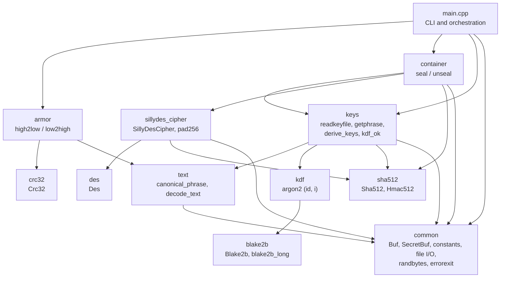
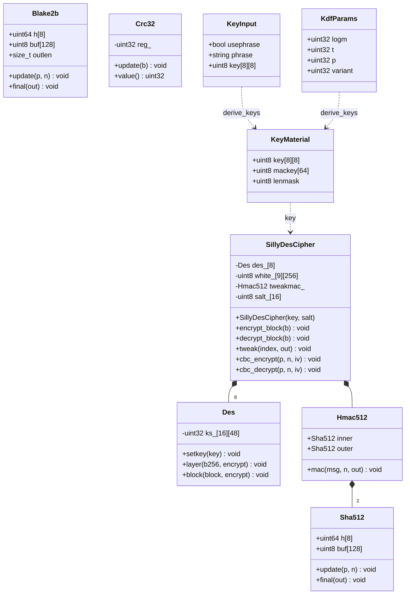
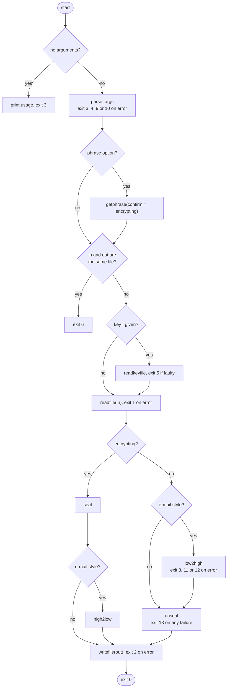
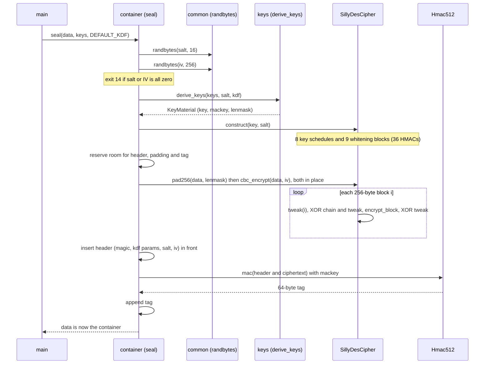
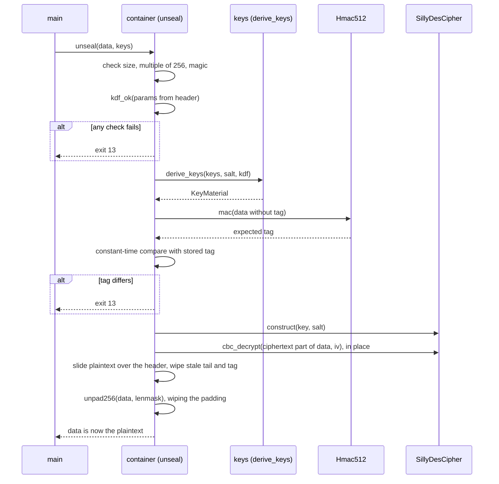
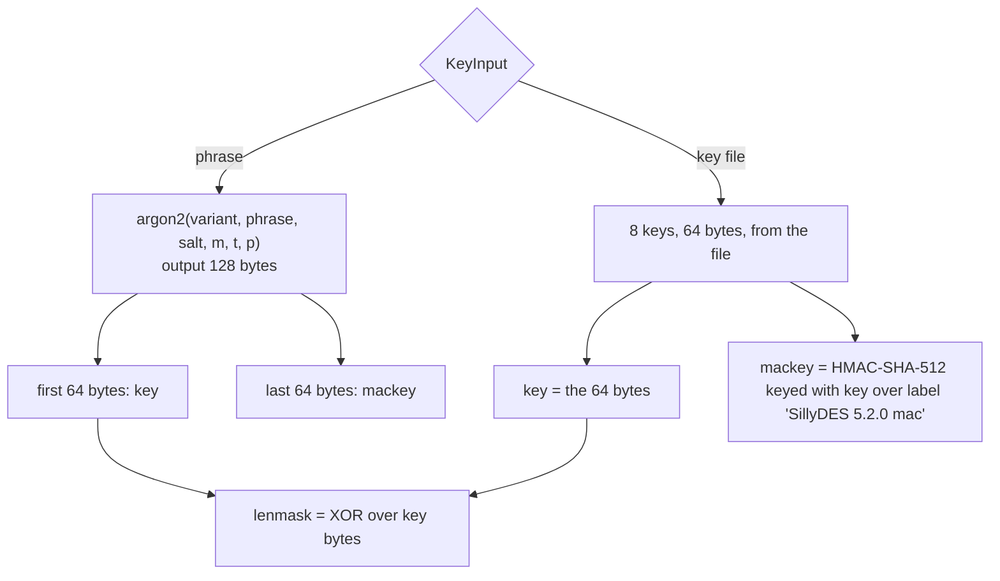
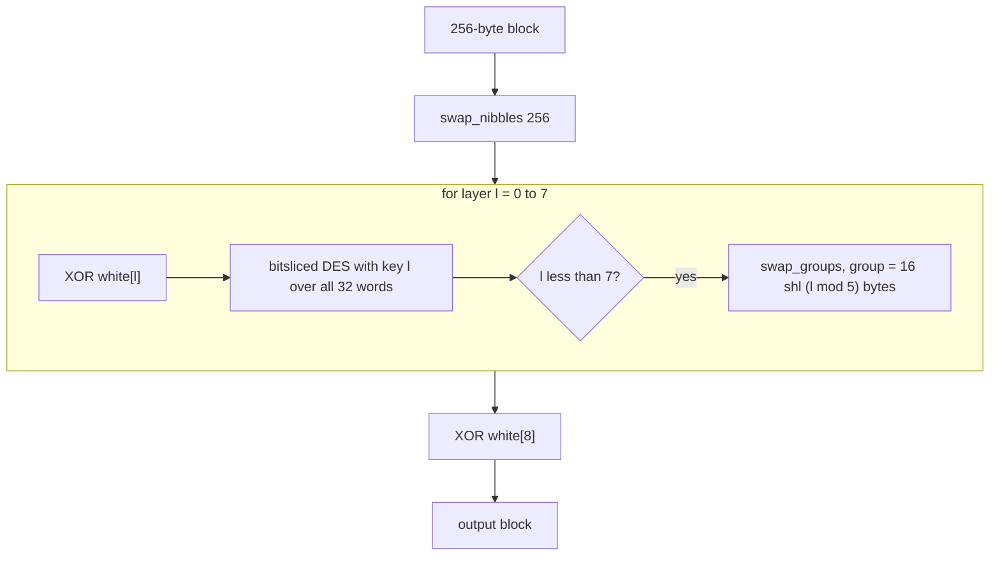
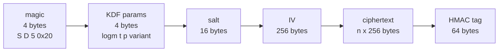
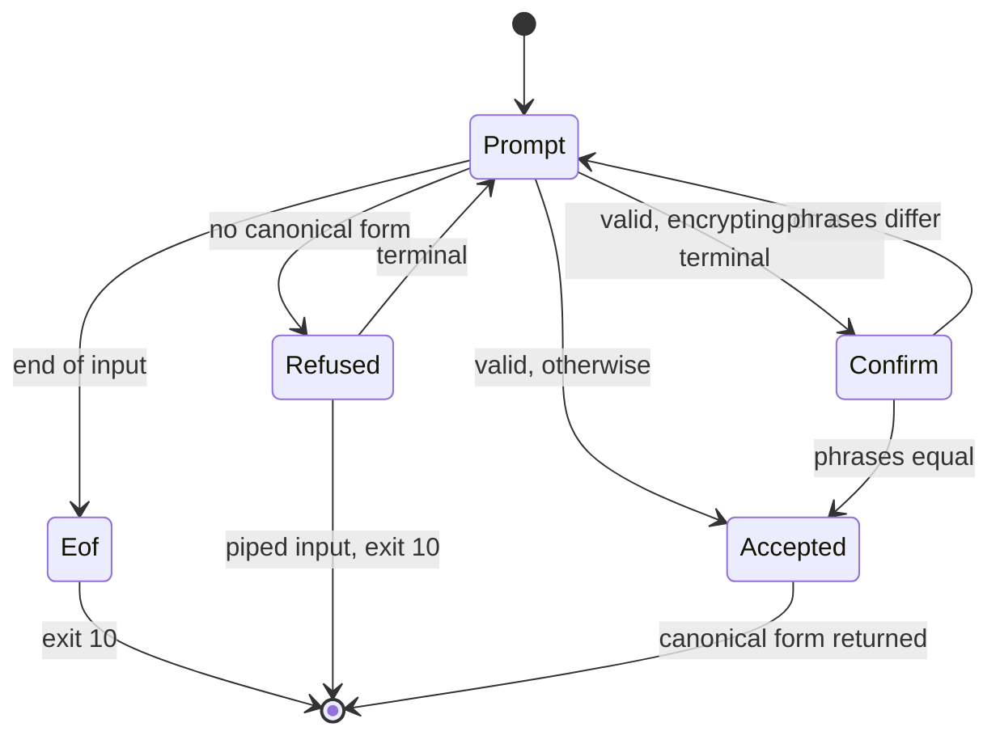
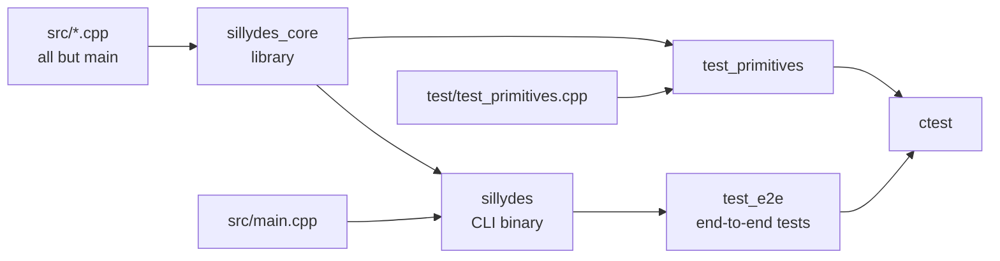

# SillyDES 5.2.5: software structure and flow

This document describes how the program is built and how data moves through it. For the cryptographic reasoning see [ANALYSIS.md](ANALYSIS.md); for usage see [README.md](README.md); for diagrams of one block passing through the cipher see [VISUALIZATION.md](VISUALIZATION.md); for the tests, the CI and what they cannot show see [TESTING.md](TESTING.md); for the threat model and how to report a problem see [SECURITY.md](SECURITY.md).

## 1. Overview

SillyDES is a single-process command line tool written in C++11 for Linux, macOS and Windows (64-bit, x86-64 and arm64), with no third-party dependencies. Everything that differs between the systems is in one platform layer (sections 2 and 11). It reads one input file completely into memory, transforms it, and writes one output file. There is no daemon, network access, or persistent state.

```
sillydes act=e|d|em|dm in=FILE out=FILE key=KEYFILE | phrase [requirelock] [argon2i] [allowweak]
```

| `act=` | Meaning | Steps |
|---|---|---|
| `e` | Encrypt, binary output | read, `seal`, write |
| `d` | Decrypt, binary input | read, `unseal`, write |
| `em` | Encrypt, e-mail text output | read, `seal`, `high2low`, write |
| `dm` | Decrypt, e-mail text input | read, `low2high`, `unseal`, write |

The code is split into small units, each with one job. Source files are in [src/](src/); the build is described in [CMakeLists.txt](CMakeLists.txt) and [CMakePresets.json](CMakePresets.json).

| Unit | Files | Responsibility |
|---|---|---|
| Entry point | [main.cpp](src/main.cpp) | Argument parsing (the arguments arrive as UTF-8 strings), orchestration, `bad_alloc` handling |
| Platform | [platform.h](src/platform.h), [platform_posix.cpp](src/platform_posix.cpp) (Linux, macOS), [platform_win32.cpp](src/platform_win32.cpp) (Windows) | Everything that needs an operating system and nothing else does: file calls, system random generator, same-file test, available memory, process hardening, memory and stack locking, the wiping allocators' back end, messages, the phrase prompt without echo. No other file includes an OS header. Memory locking is `mlock` on Linux and macOS; on Windows it is `VirtualLock` after the working set has been raised, and secret blocks are registered with the Windows Error Reporting exclusion list so that crash dumps leave them out; macOS also refuses debuggers (`PT_DENY_ATTACH`); on Windows the access control list of the process keeps the owner's other processes from reading its memory and mitigation policies forbid dynamic code, extension points, remote images and child processes |
| Common | [common.h](src/common.h), [common.cpp](src/common.cpp) | `Buf` and `SecretBuf` types with wiping allocators, format constants, error messages and exits, `readfile` and `writefile`, size arithmetic that cannot wrap around |
| Versions | [version.h](src/version.h) | Program version; name and magic of the file format |
| Keys | [keys.h](src/keys.h), [keys.cpp](src/keys.cpp) | Key file parser, phrase prompt, KDF parameter check, key derivation |
| Container | [container.h](src/container.h), [container.cpp](src/container.cpp) | `seal` and `unseal`: file format, MAC, order of operations |
| Cipher | [sillydes_cipher.h](src/sillydes_cipher.h), [sillydes_cipher.cpp](src/sillydes_cipher.cpp) | The 2048-bit wide-block cipher, tweak, CBC, padding |
| DES | [des.h](src/des.h), [des.cpp](src/des.cpp), [des_sbox_ct.h](src/des_sbox_ct.h) | Single DES, bitsliced over the 32 words of a block, constant-time; the S-box circuits are generated by [tools/gen_des_sbox.cpp](tools/gen_des_sbox.cpp) |
| Hashes | [sha512.h](src/sha512.h), [blake2b.h](src/blake2b.h) (+ `.cpp`) | SHA-512 with HMAC; BLAKE2b (RFC 7693) with Argon2's variable-length hash $H'$ |
| KDF | [kdf.h](src/kdf.h), [kdf.cpp](src/kdf.cpp) | Argon2id (RFC 9106) and the memory check that precedes it |
| Armor | [armor.h](src/armor.h), [armor.cpp](src/armor.cpp), [crc32.h](src/crc32.h), [crc32.cpp](src/crc32.cpp) | Binary to text conversion for e-mail, with CRC-32 |
| Text | [text.h](src/text.h), [text.cpp](src/text.cpp), [unicode_tables.h](src/unicode_tables.h) | The canonical form of a phrase (UTF-8 check, Unicode normalisation, removal of invisible characters); decoding of a key file or e-mail text that comes from another system. The tables are generated by [tools/gen_unicode.cpp](tools/gen_unicode.cpp) |
| Tests | [test_primitives.cpp](test/test_primitives.cpp), [test_e2e.cpp](test/test_e2e.cpp), [unicode_conformance.cpp](test/unicode_conformance.cpp), [ct_valgrind.cpp](test/ct_valgrind.cpp), [ct_timing.cpp](test/ct_timing.cpp), [ct_branches.sh](tools/ct_branches.sh) | Unit tests of primitives, end-to-end shell tests, the Unicode conformance check, and the constant-time checks (Valgrind with secrets marked uninitialised, a statistical timing test, a branch report of the disassembly; run by the [constant-time](.github/workflows/constant-time.yml) workflow) |

Every cryptographic algorithm is implemented here from its standard; no cryptographic library is linked. The same holds for the Unicode normalisation of a phrase. The normative document for each one, and what it is checked against (by `test_primitives` unless stated otherwise):

| Algorithm | Standard | Implementation | Tested against |
|---|---|---|---|
| DES | FIPS 46-3 | [des.cpp](src/des.cpp); S-boxes generated from the FIPS 46 tables into [des_sbox_ct.h](src/des_sbox_ct.h) | FIPS 46 / SP 800-17 vectors; all 64 inputs of every S-box |
| SHA-512 | FIPS 180-4 | [sha512.cpp](src/sha512.cpp) | FIPS 180-4 vectors |
| HMAC | RFC 2104 (FIPS 198-1) | [sha512.cpp](src/sha512.cpp) | RFC 4231 vectors |
| BLAKE2b | RFC 7693 | [blake2b.cpp](src/blake2b.cpp) | RFC 7693 vectors, cross-checked with Python `hashlib` |
| Argon2id, $H'$ | RFC 9106 (version 0x13) | [kdf.cpp](src/kdf.cpp), [blake2b.cpp](src/blake2b.cpp) | RFC 9106 vector and the reference implementation's vectors |
| CRC-32 | IEEE 802.3, as in zlib | [crc32.cpp](src/crc32.cpp) | Standard check value of `"123456789"` |
| Normalisation (NFKC) | Unicode Standard Annex #15, Unicode 18.0.0 | [text.cpp](src/text.cpp); tables generated from the Unicode Character Database into [unicode_tables.h](src/unicode_tables.h) | The complete `NormalizationTest.txt` of that version (`make unicode-check`); a fixed subset in `test_primitives` |

## 2. Layers and module dependencies

The program is layered. Higher layers call lower ones; nothing calls upward. `common` is used by almost everything and is omitted from some arrows below for readability.

In words: `main` drives everything. It asks `keys` for key input, `container` for sealing or unsealing, `armor` for text conversion, and `common` for file I/O. `container` combines `keys` (key derivation) with `sillydes_cipher` (encryption) and `sha512` (the MAC). `sillydes_cipher` uses `des` for the permutation layers and `sha512` (HMAC) to generate whitening and tweaks. `keys` uses `kdf` (Argon2id) for phrases, and `kdf` uses `blake2b`. `keys` and `armor` use `text` for what comes from outside as text: the phrase, the key file and the e-mail message.



## 3. Class and data model

Most units are free functions; the stateful parts are small classes and structs.

In words: `SillyDesCipher` is the central class. At construction it expands the eight DES keys (one `Des` each), computes nine 256-byte whitening blocks and stores an `Hmac512` object keyed with all key bytes, which is later used to compute the per-block tweak. `KeyInput` carries what the user supplied (a phrase or eight raw keys); `KeyMaterial` is what is left after derivation (cipher keys, MAC key and a length mask). `KdfParams` are the Argon2 parameters and the variant (Argon2id or Argon2i), stored in the file header.



Free functions by unit:

| Unit | Functions |
|---|---|
| common | `Buf` and `SecretBuf` with their wiping allocators, `readfile`, `writefile`, `randbytes`, `wipe`, `checked_add`, `checked_mul`, `errorexit` and `ExitError`; global `errarg` names the file or argument the next error message refers to |
| platform (`platform_posix.cpp` for Linux and macOS, `platform_win32.cpp` for Windows) | `secure_zero`, `os_random`, `open_input`, `read_input`, `open_output`, `write_output`, `close_file`, `same_file`, `available_memory`, `harden_process`, `exit_process`, `lock_memory`, `lock_stack`, `scrub_stack`, `secure_alloc`, `locked_alloc` (and their `free`), `write_message`, `stdin_is_terminal`, `read_secret_line` |
| keys | `readkeyfile`, `getphrase(confirm)`, `kdf_ok`, `derive_keys` |
| container | `seal`, `unseal` |
| sillydes_cipher | `pad256`, `unpad256` |
| kdf | `argon2` (`argon2id` is the same with the variant fixed) |
| blake2b | `blake2b_long` |
| armor | `high2low`, `low2high` |

## 4. Program flow

### 4.1 Top level

`main` first calls `harden_process`, which sets the core-file limit to zero and clears the dumpable flag, so a crash leaves no core file and other processes of the same user cannot attach a debugger or read the process memory, and then `lock_stack`, which locks a window of stack in RAM; when everything has returned it calls `scrub_stack`, which wipes the same window, so that temporaries and spilled registers the compiler left behind are gone too, and then `exit_process`, which ends the process with `_exit`: the vector registers can still hold plaintext (glibc copies through them), and exit-time code, such as the dynamic linker resolving a library symbol, would save them on the stack after the wipe. (These are functions of the platform layer, [platform.h](src/platform.h); the Linux versions are described here. On macOS `harden_process` sets the core-file limit and calls `ptrace(PT_DENY_ATTACH)`, and the build is signed with the hardened runtime. On Windows `wmain` converts the arguments to UTF-8 and calls `run`; `harden_process` replaces the access list of the process by one that leaves the owner no right to read its memory, sets four process mitigation policies and switches off the crash dialog, and `lock_stack`, the locking of pages, the exclusion from crash dumps and the memory check use `VirtualLock`, the working-set size, Windows Error Reporting and the job-object limit. README section 8 has the table.) It runs everything else inside one `try` block (see section 8). It then parses exactly four arguments (`act=`, `in=`, `out=`, and `key=` or `phrase`); any other count, a duplicate, an unknown option or a missing argument ends the program with an error code. It then obtains key input, rejects an input that is the same file as the output (`same_file`: by name, and by device and inode on Linux, so links and other spellings count too), reads the input and runs the selected pipeline. Output is written last and only if everything before it succeeded.



Out-of-memory (`std::bad_alloc`) anywhere between reading and writing is caught in `main` and reported as error 7. In phrase mode `argon2` checks beforehand, with `available_memory()` of the platform layer, that the machine has the 2 GiB and exits with error 7 itself, because Linux would otherwise grant the allocation and kill the process later; Windows commits the arena at once, and macOS only estimates what is free.

### 4.2 Encryption sequence

In words: `seal` draws a random 16-byte salt and a random 256-byte IV, derives the key material (for a phrase through Argon2id; for a key file through one HMAC), builds the cipher, pads the plaintext to a multiple of 256 bytes, encrypts in CBC mode, assembles the header, ciphertext and finally appends an HMAC-SHA-512 tag over everything before it (encrypt-then-MAC).

The salt and the IV are drawn inside `seal` and nowhere else; no interface lets a caller supply them, and `seal` exits with error 14 if the random source fails or returns an all-zero value. This is an invariant of the design, not a convenience: the cipher's security argument needs every block to be encrypted by a permutation instance that is never used again, and the fresh salt is what separates the instances of one file from those of every other file (see [ANALYSIS.md](ANALYSIS.md), section 6.1).



### 4.3 Decryption sequence

In words: `unseal` first validates the size and magic number, then checks the KDF parameters against hard limits, because those bytes are not yet authenticated. It derives the keys, recomputes the HMAC over the whole file except the tag and compares it in constant time. Only if the tag matches does it decrypt. Every failure before decryption gives the same error 13, so an attacker learns nothing about which check failed.



## 5. The cipher in detail

### 5.1 Key derivation



The phrase arrives here in its canonical form (section 7.1), with at least 20 characters and no upper limit; its bytes are the Argon2id password. In key-file mode the salt does not feed key derivation but still feeds the whitening and tweaks, so two files made with the same key file share nothing.

### 5.2 One 256-byte block

`encrypt_block` applies a keyless nibble permutation first, then eight rounds of: XOR with a 256-byte whitening block, DES on each of the 32 eight-byte words with that layer's key, and a nibble swap whose group size cycles 16, 32, 64, 128, 256, 16, 32 bytes. A ninth whitening block is XORed at the end. The nibble swaps spread every bit across the whole 2048-bit block.

The DES pass is one call to `Des::layer`, which is bitsliced: the 32 words are transposed into 64 `uint32_t` values, one per DES bit position, with one word per lane, so the same key runs over all 32 words at once. The S-boxes are boolean circuits (algebraic normal form of the FIPS 46 tables, generated into [des_sbox_ct.h](src/des_sbox_ct.h) by the target `regenerate_sbox`), the permutations are index renamings with constant indices, and the subkey bits are stored as all-ones or all-zeros lane masks. Nothing in the pass reads memory at a key- or data-dependent address or branches on key or data. `Des::block` runs one word through the same path and exists for the known-answer tests.



### 5.3 CBC with tweak

For block *i*: `work = plain[i] XOR previous_ciphertext XOR tweak(i)`, then `encrypt_block`, then `XOR tweak(i)`, giving ciphertext *i*. The first "previous" value is the random IV. The tweak is a 256-byte output of HMAC-SHA-512 keyed with all 64 key bytes, over a label, the salt and the block number, so every block uses its own permutation. Decryption reverses the steps and uses the previous ciphertext block as chain value.

### 5.4 Padding

`pad256` appends random bytes so the length becomes a multiple of 256, with at least one byte of padding. The last byte stores the number of real bytes in the final block (0 to 255) XORed with `lenmask`. `unpad256` is only called after authentication has succeeded; it wipes the bytes it removes. Both work in place on the caller's buffer.

## 6. File formats

### 6.1 Binary container



| Part | Size | Notes |
|---|---|---|
| Header | 280 bytes | magic (4), KDF params (4), salt (16), IV (256) |
| Ciphertext | multiple of 256, at least 256 | CBC output |
| Tag | 64 bytes | HMAC-SHA-512 over header and ciphertext |

The smallest possible container is 600 bytes. The KDF parameters are validated by `kdf_ok` before use: `logm` (log2 of the Argon2 memory in KiB) 10 to 21, lanes `p` 1 to 8, so at most 2 GiB of memory, and the variant byte (header byte 7): 0 is Argon2id with passes `t` 1 to 4, 1 is Argon2i with `t` 3 to 8, anything else is rejected. The default written by `seal` is `logm=21, t=1, p=4, variant=0` (2 GiB, one pass, four lanes; RFC 9106's first recommendation). `main` passes `ARGON2I_KDF` (`logm=21, t=6, p=4, variant=1`) instead when encrypting with a phrase and the word `argon2i` or `SILLYDES_ARGON2I=1` (`argon2i_requested` of the platform layer) asks for it; decryption reads the variant from the header and needs neither. `argon2` in `kdf.cpp` is one implementation for both: Argon2i is the data-independent addressing of the first half pass applied to every pass, with the type 1 in the address blocks and in the initial hash.

### 6.2 E-mail (armored) format

`high2low` appends a `0xFF` end marker, encodes the bytes with a 64-character alphabet (`0-9 : ;`, `A-Z`, `a-z`), inserts a newline at regular intervals, and wraps the result in a `*BEGIN SillyDES 5.2.0 message, valid char: N` line (N is the count of encoded characters) and a `*END SillyDES 5.2.0 message, CRC: C` line. The newline is LF on every system, so equal containers give equal text. `low2high` first undoes the encoding another system may have given the text (`decode_text`: a UTF-8 byte order mark is removed, UTF-16 with a byte order mark becomes bytes), scans for the BEGIN line, decodes exactly N valid characters while ignoring everything else (whitespace, line breaks, quoting damage), finds the END line, checks the CRC-32 and removes the end marker. A line may end in LF, CR LF or CR. Both tag lines must start at the beginning of a line, so a message whose tag lines are quoted or indented is not found (error 8). The CRC only catches transmission damage; authenticity comes from the HMAC checked afterwards in `unseal`.

### 6.3 Key file

Eight keys of 16 hexadecimal digits, one per line, the first word of the line; the rest of the line is a comment. Empty lines and lines that start with `;` are skipped, spaces and tabs before a key are allowed, and what follows the eighth key is not read. `readkeyfile` passes the file through `decode_text` first and takes LF, CR LF and CR as line endings, so a key file saved by an editor or a shell on another system gives the same keys. Anything else is error 5, which names the file and never its contents.

`seal` refuses (error 16), after the keys are derived and before anything is encrypted, a set of eight keys in which one is weak in the wide sense: at most four different round keys. The round keys are rotations of the halves C and D that PC-1 makes of the 56 key bits, so that is the case exactly when both halves repeat with a period that divides 4 (`has_weak_key` in `keys.cpp` tests `h == rotl28(h, 4)` for both). That is 16 x 16 = 256 settings of the key bits, times 256 parity settings: the 4 weak keys (one round key), the 12 semi-weak keys (two) and 240 keys with four round keys, among them the 48 "possibly weak" keys of the published list. An exhaustive search over all 2^28 values of each half (the partition of the 16 rounds by equal PC-2 bits, combined) finds no other key with four or fewer round keys. The test is branch-free and has no index on the key; only its verdict is used, and `seal` branches on it, which is why `ct_valgrind` runs `seal` with `allow_weak` set and `has_weak_key` on its own. It sees the keys of a phrase too (`KeyMaterial::key`, after Argon2). `unseal` does not check, so files that were made with such a key still open. Allowing weak keys is for research only, and is documented as such in the usage text, the README and the message of error 16. `main` sets `allow_weak` from the word `allowweak` or from `SILLYDES_ALLOW_WEAK=1` (`weak_keys_allowed` of the platform layer, exactly `1`, as for the other variables).

## 7. Phrase input



Echo is switched off on a terminal, and switched back on by a destructor however the prompt is left. The phrase is read by `read_secret_line` of the platform layer into a `SecretBuf`, so no stdio buffer holds a copy and a phrase of any length can grow the buffer without leaving a stale one: with `read(2)`, one byte at a time, on Linux and macOS, and on Windows with `ReadConsoleW` on a console (UTF-16, converted strictly to UTF-8, an unpaired surrogate is refused; a line that starts with Ctrl+Z is the end of the input) and with `ReadFile` on a pipe or a file, where the bytes are taken as they come, which is why a PowerShell 5.1 pipe of ASCII (every other character a `?`) cannot be told from the real phrase. Piped input is read once and never confirmed. The confirmation compares canonical forms.

### 7.1 The canonical form of a phrase

What a terminal or a pipe delivers for one typed phrase differs between systems, keyboards and shells. `canonical_phrase` in [text.cpp](src/text.cpp) turns the line that was read into the bytes that are hashed, in these steps, the same ones for encryption and decryption:

| Step | What | If it fails |
|---|---|---|
| 1 | Remove one trailing CR | |
| 2 | The bytes must be well-formed UTF-8: shortest form, no surrogates, at most U+10FFFF | refused |
| 3 | No control character (U+0000-001F, U+007F-009F), so no tab and no escape sequence of an arrow key | refused |
| 4 | Normalise: compatibility decomposition, removal of the code points with the property Default_Ignorable_Code_Point, canonical ordering, canonical composition. This is NFKC of the text without its invisible characters | |
| 5 | Remove trailing spaces | |
| 6 | At least 20 code points must be left | refused |

Step 4 makes one phrase of an accent typed as a separate character, of full-width and half-width forms, of no-break and other spaces and of ligatures, and removes zero width characters, soft hyphens, direction marks, variation selectors and a byte order mark. Leading spaces, case and look-alike characters are left as they are. A phrase of ASCII only skips step 4 and touches no table. A refused phrase is asked again on a terminal and is error 10 otherwise; that happens before the key derivation, so an unusable phrase never costs the 2 GiB of Argon2id and never ends in error 13.

**These rules are part of the file format**: they decide which keys a phrase gives. So are the tables in [unicode_tables.h](src/unicode_tables.h), which [tools/gen_unicode.cpp](tools/gen_unicode.cpp) makes from the Unicode Character Database, version 18.0.0: 5982 decompositions, 422 ranges of combining classes, 961 composition pairs and 17 ranges of ignorable code points; Hangul syllables are computed. Characters that a later Unicode version adds pass through unchanged. `test_primitives` compares a SHA-512 of the tables with a stored value, so that tables of another version cannot slip in under the same format name.

The phrase is decoded into 32-bit code points for step 4. Those vectors use `LockedAllocator` like the phrase itself, so they are locked, wiped and unmapped when released. The normalisation is not constant-time: its table lookups and branches depend on the phrase.

## 8. Error handling

All failures end in `errorexit(code)`, which prints a message to stderr and throws `ExitError{code}`; `main` catches it, and `bad_alloc` (reported as error 7), and returns the code. There is no `exit` call on an error path, because `exit` would skip the destructors that wipe the keys, the cipher state and the data buffer. Nothing else uses exceptions, and nothing may catch `ExitError` except `main` and the tests. The global `errarg` carries the file name or argument for the message. Key-file errors name only the file.

| Code | Raised by | Meaning |
|---|---|---|
| 1 | `readfile`, `readkeyfile` | cannot read (open failure, directory, read error) |
| 2 | `writefile` | cannot write (also refuses symlinks; the output is a temporary file with mode 0600 that replaces the target only when complete, and is removed on every failure) |
| 3, 4, 9, 10 | `parse_args`, `getphrase` | wrong count, invalid, duplicate or missing argument |
| 5 | `readkeyfile` | faulty key file |
| 6 | `main` | input and output are the same file |
| 7 | `argon2`, `main` | out of memory: the machine has less than 2 GiB available for the KDF, or an allocation failed |
| 8, 11, 12 | `low2high` | no BEGIN line, no END line or short body, CRC mismatch |
| 13 | `unseal` | authentication failed, bad header, wrong key or altered data |
| 14 | `randbytes`, `seal` | system random generator failed or returned an all-zero salt or IV |
| 15 | `argon2` | the table could not be locked in RAM and `requirelock` or `SILLYDES_REQUIRE_LOCK=1` is given (`KeyInput::require_lock`) |
| 16 | `seal` | one of the eight keys (key file or phrase) has at most four different DES round keys (weak, semi-weak and the like) and neither `allowweak` nor `SILLYDES_ALLOW_WEAK=1` (research only) is given (`KeyInput::allow_weak`) |

## 9. Build and test structure

This section describes how the build is put together. What the tests prove, how the CI is arranged, the rules for writing a test and what the tests cannot show are in [TESTING.md](TESTING.md).

[CMakeLists.txt](CMakeLists.txt) is the only build: the units except `main.cpp` as the library `sillydes_core`, `sillydes`, `test_primitives`, `test_e2e`, the scan binary `sillydes_scan` and (Linux) `residue_scan`, with C++11 and no compiler extensions, for 64-bit targets only. `CMakePresets.json` has `default`, `ci` (warnings are errors, what CI runs), `universal` (macOS, arm64 and x86_64 in one file) and `debug`; on macOS a post-build step signs `sillydes` with the hardened runtime and no entitlements (`SILLYDES_CODESIGN`, `SILLYDES_CODESIGN_IDENTITY`), and the `hardening` test checks the signature and every architecture; `cmake --preset ci && cmake --build --preset ci && ctest --preset ci` builds and tests the program, with gcc and clang. CTest runs `test_primitives`, `test_e2e` and `hardening`, on every OS. `test_e2e --interop-make` and `--interop-check` (not part of CTest) are what the `interop` job of the `build` workflow uses: each build makes files for the others and opens theirs. `-DSILLYDES_REGENERATE_SBOX=ON` adds the target `regenerate_sbox`, which builds [tools/gen_des_sbox.cpp](tools/gen_des_sbox.cpp) and rewrites [src/des_sbox_ct.h](src/des_sbox_ct.h); the generated header is committed, so a normal build does not need it. `-DSILLYDES_REGENERATE_UNICODE=dir` adds `regenerate_unicode`, `check_unicode` and the test `unicode_check`, for [src/unicode_tables.h](src/unicode_tables.h) and [tools/gen_unicode.cpp](tools/gen_unicode.cpp): `dir` holds the Unicode data files, which [tools/fetch_ucd.sh](tools/fetch_ucd.sh) downloads and checks against stored SHA-256 sums, and the notice comes from [LICENSE.Unicode](LICENSE.Unicode); the tables belong to the file format, so `regenerate_unicode` is only for a new format. `check_unicode` confirms that the committed tables are exactly what the generator makes of those files and runs [test/unicode_conformance.cpp](test/unicode_conformance.cpp) on the conformance file of that Unicode version; the [unicode](.github/workflows/unicode.yml) workflow does this whenever one of the files involved changes. The target `sbom` (Linux only) runs [tools/gen_sbom.sh](tools/gen_sbom.sh) on the built binary and writes `sillydes.cdx.json` into the build directory, a CycloneDX 1.5 SBOM with the binary's SHA-256, the shared libraries `ldd` reports (one component per distribution package, with version, purl and file hashes), the Unicode data that is compiled in, the compiler and the source commit; it is generated rather than committed because it holds the hash of the binary. Hardening flags (stack protector, stack clash protection, control-flow markers, fortified libc calls, PIE, relro and now, a non-executable stack; ASLR, DEP and control flow guard on Windows) come from [cmake/harden.cmake](cmake/harden.cmake); the CTest test `hardening` ([cmake/check_hardening.cmake](cmake/check_hardening.cmake)) reads the finished binary for them, and `-DSILLYDES_SANITIZE=ON` builds with AddressSanitizer and UndefinedBehaviorSanitizer. The `build` workflow builds on Linux (gcc and clang, x86-64 and arm64), Windows and macOS.



- `test_primitives` checks BLAKE2b (RFC 7693 and hashlib cross-checks), Argon2's $H'$, SHA-512, HMAC (RFC 4231), Argon2id (RFC 9106 and the reference implementation's vectors), DES and CRC-32 against published vectors, checks the KDF header bounds, checks every generated S-box circuit on all 64 inputs against the FIPS 46 tables, checks that the bitsliced DES layer equals 32 single-word calls with independent lanes, pins one core block with a fixed key and salt to a stored answer, and checks cipher properties: equal blocks give unrelated ciphertext, every key bit matters, salt and block index change the tweak, one changed input bit or word changes every output word in both directions, eight identical DES keys still give distinct layers, two `seal` calls on the same input share neither salt, IV nor ciphertext, and a phrase-mode container with non-default KDF parameters opens again. It also checks that errors are `ExitError` exceptions, the key file parser (comments, tabs, a missing final newline, and every kind of faulty key file), that `Buf` and `SecretBuf` keep their contents while they grow across the page and 64 KiB thresholds, and, where `RLIMIT_MEMLOCK` allows (it skips otherwise, and under sanitizers, which turn `mlock` into a no-op), that `scrub_stack` clears a pattern that a returned function left on the stack (with a control that skips the test where the frames do not line up), that `lock_stack` and `SecretBuf` lock memory, `SecretBuf` unlocks it when freed and `lock_memory` past the limit locks nothing. For text from other systems it checks `decode_text`, that one key file gives the same keys with LF, CR LF and CR line endings, with a byte order mark and as UTF-16 in either byte order, that e-mail text in the same variants and inside a mail message decodes, that the e-mail text of a fixed input is a stored answer without a CR, a table of normalisation cases (ordering, blocked composition, exclusions, singletons, full-width forms, Hangul, characters outside the BMP, invisible characters between a letter and its accent), which phrases are refused and for what reason, which spellings give the same canonical phrase, and the hash of the Unicode tables.
- `core_structure`, `core_model` and `core_scale` in [tools/](tools/) (not part of `ctest` unless the build is configured with `-DSILLYDES_ANALYSIS_TOOLS=ON`, which adds the target `check_analysis` and the test `analysis_check`) are the measurements behind [ANALYSIS.md](ANALYSIS.md) sections 6.2 and 14.4. `core_structure` links `sillydes_core` and uses `Des`, `Hmac512` and `SillyDesCipher` through their public interfaces; `core_model` and `core_scale` stand alone. A change to the layers, the swaps or the whitening in [sillydes_cipher.cpp](src/sillydes_cipher.cpp) makes `core_structure` fail, which is the sign that the analysis has to be redone.
- `guess_cost` in [tools/](tools/) (only with `-DSILLYDES_GUESS_COST=ON`, target `guess_cost`, not a test) measures the time of one key guess behind [ANALYSIS.md](ANALYSIS.md) sections 5.4 and 10.3: the tag check of the smallest file against an AES-256 trial. It needs x86-64 with AES-NI and links the system's OpenSSL 3, which the program never uses; the build looks for it with `find_package(OpenSSL)` and does not bring it along. It links `sillydes_core` to check its tag check against `Hmac512` and its AES against OpenSSL, and stops with exit code 1 when either differs. Timings depend on the machine; run it on one core.
- `unicode_conformance` (not part of `ctest`, because it needs a file that is not in the repository) runs the complete `NormalizationTest.txt`: every line must give its NFKC column from each of its five columns, every code point the file does not list must be left alone, and the folding of a phrase must give one result for the five columns of a line, hold no ignorable code point and do nothing when applied twice, for every line and every single code point.
- `test_e2e` runs the real binary, on every OS the same way (a small program that starts `sillydes` with arguments and input and checks exit code, output and files; the operating system comes in through [test_os.h](test/test_os.h) only): decryption of files of format 5.2.0 (`hello.sdes` and [test/format-5.2.0/](test/format-5.2.0/), one of them made with a phrase of Latin, Greek and Japanese text and a character outside the BMP), round trips in all four modes for several sizes, phrase mode (2 GiB), refusal of a short phrase and of phrase mode under a 1.5 GB address-space limit, wrong-key and corrupted-input failures, truncation and block-edit detection, out-of-range KDF parameters, rejection of files of another format version, fresh salt per encryption, container size, key files and e-mail text with CR LF, CR, a byte order mark and as UTF-16, a phrase piped with a byte order mark, trailing spaces and CR LF, the non-ASCII phrase typed in another way (decomposed, full-width and half-width forms, other spaces, invisible characters), refusal before the key derivation of a phrase that is not UTF-8 or holds a control character, data with CR, LF, 0x1A and NUL bytes, file names outside ASCII (also in a redirected message), the phrase typed into a terminal (pty, or ConPTY on Windows: echo off, a character outside the BMP, retries, the end of input) and, on Windows, what Windows PowerShell 5.1, PowerShell 7 and cmd.exe pipe and write, that the sources are ASCII with LF line endings, and memory residue: a scanner (the program's own scan build `sillydes_scan` on every system, a library preloaded into the real binary on Linux) searches the finished process for the key text, the key bytes, the phrase (5000 characters, longer than the read buffer) and the plaintext, after encryption, after decryption and after a failed authentication, and for a non-ASCII phrase also its code points, which the normalisation holds as 32-bit values; a positive control shows that the scanner finds a mark that is there.

## 10. Design notes for maintainers

- **Order of operations is security-relevant.** Encrypt-then-MAC, with the MAC verified before any decryption or unpadding. Header fields are untrusted until the tag is verified, so they are bounded by `kdf_ok`.
- **Two versions.** [version.h](src/version.h) holds them. `PACKAGE_VERSION` is the program's version and changes with every release; the code uses it only in the usage banner, and the titles of the documents repeat it by hand. `FORMAT_NAME` and `MAGIC` identify the file format, which is named after the release that introduced it and keeps that name in every later release that does not change it. A patch release never changes the format.
- **File format.** The on-disk format is defined by `HDR_LEN`, `MAGIC` (byte 2 the format's major version, byte 3 minor·16+patch) and `FORMAT_NAME`, which is hashed into the keys through the labels `"SillyDES 5.2.0 white"`, `"... tweak"` and `"... mac"` and written in the e-mail tags; changing any of them breaks existing files. The meaning of the four KDF parameter bytes is part of the format too, which is why the change from scrypt to Argon2id started a new format; so are the cipher, the padding, what the MAC covers, the e-mail encoding, and the canonical form of a phrase with its Unicode tables (section 7.1), which is why format 5.2.0 exists: it made the phrase rules the same for every system. When one of these changes, set `FORMAT_NAME` and `MAGIC` to the release that makes the change.
- **Format fixtures.** `hello.sdes` and the files in [test/format-5.2.0/](test/format-5.2.0/) were written when format 5.2.0 was introduced, and `test_e2e` decrypts them. Do not regenerate them: a release that fails that test has changed the format, whatever its notes say. Only a deliberate format change replaces them, with files written in the new format.
- **Text from outside.** A phrase goes through `canonical_phrase` and nowhere else into the KDF; a key file and an e-mail text go through `decode_text`. Data files never do: they are bytes. What the program writes as text has LF line endings on every system. The sources are ASCII with LF line endings ([.gitattributes](.gitattributes) keeps a checkout from changing that, and the fixtures from being converted), which `test_e2e` checks, because the labels in them are hashed into the keys. `setlocale` is never called.
- **Unicode tables.** Never regenerate [unicode_tables.h](src/unicode_tables.h) from another Unicode version under the same format name: some phrases would give other keys. `test_primitives` fails on changed tables. A new version of the tables goes with a new `FORMAT_NAME`.
- **Randomisation is mandatory.** Salt and IV are drawn in `seal` only. Do not add a deterministic mode or a caller-supplied salt or IV, and do not use `encrypt_block` without the tweak: the eight DES layers are below AES-128 when many blocks go through one instance, and the scheme is strong because none does; see section 4.2 and [ANALYSIS.md](ANALYSIS.md), sections 6.2 and 11.
- **Memory model.** Whole files are held in memory, in one buffer: `readfile` reads a regular file straight into a buffer of its size with unbuffered `read`, `seal` and `unseal` transform that buffer in place, and `writefile` writes it with unbuffered `write`. No second copy of the plaintext is made, in the heap or in stdio. `Buf` is a `std::vector` with `SecureAllocator`, which wipes every block before it is released, so a buffer that grows, shrinks or is destroyed leaves no copy; blocks of 64 KiB and more get their own mapping, excluded from core dumps. Argon2id allocates 2 GiB in phrase mode, after checking that the machine has it.
- **No global state** other than `errarg`; the DES tables are compile-time constants indexed only by loop counters.
- **The documents say what is known now.** Every document, the analysis and every section of the changelog included, gives the current figures and findings and says nothing about what an earlier text said: no "earlier revisions", "was given as", "is now", "no longer", "corrected", "superseded" or "reassessed", and no section that lists how the conclusions changed. When a figure or a finding changes, replace it in every place that names it, the sections of released versions in [CHANGELOG.md](CHANGELOG.md) included, so that the text reads as if it had always said so. The changelog says what a release contains and what it changes in the program and its files. Where a measurement comes from (which release, which tool) is a fact and stays, in section 12 of [ANALYSIS.md](ANALYSIS.md). The same rule is written down for AI assistants in [.github/copilot-instructions.md](.github/copilot-instructions.md); keep the two in step.
- **Constant time.** `Des` must stay free of key- or data-dependent memory addresses and branches; secrets are compared with `ct_equal`, hexadecimal key digits are decoded without branches (`hex_digit` in `keys.cpp`), and `value_barrier` keeps the compiler from turning masks back into branches. Edit the S-boxes only through [tools/gen_des_sbox.cpp](tools/gen_des_sbox.cpp) and the target `regenerate_sbox`. The normalisation of a phrase is not constant-time and is not meant to be (section 7.1).
- **Secrets are wiped.** `KeyInput`, `KeyMaterial`, `Des`, `SillyDesCipher`, `Blake2b` and `Sha512` zeroise their key material, schedules, whitening and HMAC pad states in their destructors with `wipe` (which is `explicit_bzero` on Linux); the key-file parser, the phrase confirmation copy and the Argon2id intermediates (including the 2 GiB table) are wiped before they go out of scope. The per-block tweak, the bitsliced state inside `Des::layer` and the padding removed by `unpad256` are wiped as well, and `main` wipes the data buffer after writing it. The one buffer that holds the user's data is therefore the only place where plaintext exists, and only for as long as it is needed. Keep new code holding key material or plaintext inside one of these types, or wipe it explicitly.
- **Secrets are kept out of stdio and `std::string`.** The phrase is a `SecretBuf` (a vector with `LockedAllocator`: private pages, `mlock`ed best effort, excluded from dumps, wiped and unmapped when freed) read byte by byte with `read(2)`; the key file goes through `readfile`. A `std::string` keeps short contents inside the object, where no allocator can wipe it, and `getchar` and `fopen` leave copies in library buffers, so none of them may hold a secret. [test/residue_core.cpp](test/residue_core.cpp), run by `test_e2e` (through the scan build `sillydes_scan`, whose `exit_process` calls it, and on Linux also preloaded into the real binary), searches the finished process for the phrase, the key and the plaintext, and the test fails if any is left.
- **Making a release.** A release is a version tag; [release.yml](.github/workflows/release.yml) does the rest. In order:
  1. Decide whether the file format changes. Usually it does not, and then `FORMAT_NAME` and `MAGIC` stay as they are (see *Two versions* and *File format* above). If it does, change both together and add new fixtures under `test/format-*`.
  2. Set `PACKAGE_VERSION` in [version.h](src/version.h) and update the document titles that carry the program version (line 1 of [README.md](README.md), this file, [ANALYSIS.md](ANALYSIS.md), [TESTING.md](TESTING.md) and [VISUALIZATION.md](VISUALIZATION.md)). Leave every place that names the *format* (the key labels, the e-mail tags, the format paragraph of the README, the fixtures). Add a `## [X.Y.Z] - date` section to [CHANGELOG.md](CHANGELOG.md), starting with whether the file format changed, and fix the compare links at its end; the workflow publishes that section as the text of the GitHub Release and stops if it is missing.
  3. Run what CI runs, from a clean tree: `rm -rf build`, `cmake --preset ci`, `cmake --build --preset ci`, `ctest --preset ci`, and `cmake --build --preset ci --target sbom` to check that the SBOM still generates.
  4. Commit and push to `main`, and wait for the `build` workflow to go green (all jobs). Then start the release workflow by hand as a dry run (`gh workflow run release.yml --ref main`): it builds, tests and makes the SBOMs on all five targets and publishes nothing.
  5. Tag that commit `vX.Y.Z` and push the tag: `git tag vX.Y.Z && git push origin vX.Y.Z`. The tag must equal `v` plus `PACKAGE_VERSION`; the workflow stops at its first step if it does not. Only tags of the form `v<number>.<number>.<number>` trigger it.
  6. The workflow ([release.yml](.github/workflows/release.yml)) checks the tag and the changelog, builds and tests on five targets (Linux x86-64 and arm64 as static PIEs, built with `-DSILLYDES_STATIC=ON` on Ubuntu 22.04, so that they need no library of the system; macOS as one universal file; Windows x86-64 and arm64), generates a CycloneDX SBOM for each binary ([tools/gen_sbom.sh](tools/gen_sbom.sh), which runs in bash on all three systems), attests the build provenance and the SBOM of each binary, and creates the GitHub Release with the changelog section as its notes, a line that the Windows and macOS binaries are not signed, and `sillydes-X.Y.Z-linux-x86_64`, `-linux-arm64`, `-macos-universal`, `-windows-x86_64.exe` and `-windows-arm64.exe`, an `.cdx.json` for each and `SHA256SUMS`. Check the release page afterwards, and verify downloads with `sha256sum -c SHA256SUMS` and `gh attestation verify sillydes-X.Y.Z-linux-x86_64 --repo avw1ein/sillydes`, which checks the build provenance; add `--predicate-type https://cyclonedx.org/bom` to check the SBOM attestation. Releases up to 5.2.0 are Linux x86-64 only and have the SBOM attestation only.

  The same procedure, with the checks and the extra steps of a release that does change the format, is written down for AI assistants in [.github/skills/make-release/SKILL.md](.github/skills/make-release/SKILL.md); keep the two in step.

  Never move or reuse a published tag: a pushed tag is not run again, and users may already have its files. If a run fails before the last step, nothing was published, so fix the cause and re-run the failed workflow; if a bad release did go out, delete the release and the tag and publish the next patch version instead. Each SBOM holds the hash of its CI-built binary and is attached to the release; it is never committed. The tag `v5.1.0` already exists from before the workflow, so it will not trigger it; the first release with all five binaries and the build provenance attestation is the next version.

## 11. Platforms

### 11.1 Decisions that stay

| Topic | Decision |
|---|---|
| Build system | CMake only (3.16; the presets need 3.21). C++11, extensions off, 64-bit only (`static_assert(sizeof(void *) == 8)` and a CMake error), `-O2` and no `-DNDEBUG` |
| Targets | Linux x86-64 and arm64 (gcc, clang), macOS arm64 and x86-64 (Apple clang, one universal file possible), Windows x86-64 and arm64 (MSVC) and x86-64 (MinGW-w64, MSYS2 UCRT64) |
| Operating system code | Only in [platform.h](src/platform.h) with `platform_posix.cpp` and `platform_win32.cpp`. No other source file includes an OS header or stdio; every message goes through `write_message`. `main` takes its arguments as a `std::vector<std::string>` of UTF-8 (`run`), so a `wmain` only converts and calls it |
| Text | UTF-8 inside the program: phrase, file names, messages. Windows uses wide-character (W) functions only, never the ANSI or OEM code page, and never `SetConsoleOutputCP` (it changes the user's console for the rest of the session). The program never calls `setlocale`, so `tolower`, `strtoull` and `snprintf` behave the same everywhere. MSVC builds with `/utf-8` |
| Data | Bytes. Plaintext and the binary container are never translated: a CR LF text file decrypts to the same CR LF file on every system. Windows opens with `CreateFileW`, so no text mode exists |
| Text the program writes | The armor, with LF only, the same on every system (equal containers give equal text) |
| Text the program reads | Key file, armor and phrase are accepted with every line ending and in the common encodings (section 7 and 6.3) |
| File names | Never normalised: Linux passes the bytes, macOS and Windows hand the name to the system as given |
| Phrase | One canonical form, part of the file format (section 7.1). Anything that changes the bytes of a phrase is a format change |
| File format | 5.2.0, byte-identical on every system. `test/format-5.2.0/*` and `hello.sdes` must decrypt everywhere |
| Where it is verified | Everything that is not Linux runs only on GitHub's runners, real Windows and macOS ([TESTING.md](TESTING.md)); nothing counts until a runner has produced it |
| KDF side channel | Argon2id's data-dependent addressing is documented ([ANALYSIS.md](ANALYSIS.md) section 8); the `argon2i` mode removes it, at about four times the running time |

### 11.2 What the platform layer does per system

| Function | Linux | macOS | Windows |
|---|---|---|---|
| `secure_zero` (backs `wipe`) | `explicit_bzero` | `memset_s` (needs `__STDC_WANT_LIB_EXT1__` before the first include) | `SecureZeroMemory` |
| `os_random` | `getrandom` | `getentropy`, at most 256 bytes at a time | `BCryptGenRandom` (the system preferred generator) |
| Files | POSIX, `O_CLOEXEC`; output through `mkstemp` in the target's folder (mode 0600) and `rename`, a link or directory as target is refused, a target that is no regular file (a FIFO, `/dev/null`) is opened directly | the same | `CreateFileW`, binary; output through a random name in the target's folder (`CREATE_NEW`) and `MoveFileExW(MOVEFILE_REPLACE_EXISTING)`, a link is refused by looking at the handle (`FILE_FLAG_OPEN_REPARSE_POINT`), a console or pipe is opened directly; a new file inherits the access list of its folder |
| `same_file` | `st_dev` and `st_ino` | the same | `GetFileInformationByHandle` (volume serial and file index); `st_ino` is 0 on Windows |
| `available_memory` | `MemAvailable`, and the `RLIMIT_AS` and `RLIMIT_DATA` limits | free, inactive and purgeable pages from `host_statistics64` (an estimate), and the limits | the smaller of free physical memory, the free commit limit and the memory limit of the job object the process is in |
| `harden_process` | `RLIMIT_CORE` 0, `PR_SET_DUMPABLE` 0, DIT on arm64 | `RLIMIT_CORE` 0, `PT_DENY_ATTACH`, DIT on arm64; the binary is signed with the hardened runtime | restrictive access list on the own process, four mitigation policies, no crash dialog, DIT on arm64 by trying the instruction (section 12) |
| Secret memory | `mmap`, `mlock`, `MADV_DONTDUMP` | `mmap`, `mlock` (no `MADV_DONTDUMP`; core dumps being off covers it) | `VirtualAlloc`, `VirtualLock` after raising the working set, `WerRegisterExcludedMemoryBlock` |
| `secret_map`, `lock_required`, `weak_keys_allowed` | `memfd_secret` (5.14 and later) when `RLIMIT_MEMLOCK` or `CAP_IPC_LOCK` allows the size; a SIGBUS handler around the first touch of every page; null otherwise. `SILLYDES_REQUIRE_LOCK` | null (no such mapping) | null; `SILLYDES_REQUIRE_LOCK` through `GetEnvironmentVariableW` |
| `lock_stack`, `scrub_stack` | `alloca` window of 256 KiB (halved under a small limit) | the same | `_alloca`, the same window |
| `read_secret_line` | `termios` without echo (restored by a destructor, and by a handler for SIGINT, SIGTERM, SIGHUP, SIGQUIT and SIGTSTP that also flushes the typed input; echo goes off again after SIGCONT; a signal that is ignored or caught already is left alone), `read(2)` to LF or end of input | the same | console: no echo, `ReadConsoleW` into a locked, wiped buffer, strict UTF-16 to UTF-8 (an unpaired surrogate is refused), a line that starts with Ctrl+Z is the end of the input; pipe or file: `ReadFile`, bytes as they are |
| Arguments | the bytes | the bytes | `wmain` (MinGW: `-municode`), converted to UTF-8; an unpaired surrogate is error 4. Not `CommandLineToArgvW`, which pulls in shell32 |
| `write_message` | bytes to stdout and stderr | the same | `WriteConsoleW` when the handle is a console, UTF-8 bytes when redirected |

### 11.3 Facts and pitfalls per system

Everything below was found on a runner; the code keeps to it.

**All systems.** `long` is 32 bits on Windows: look for `long`, `unsigned long`, `strtol` and shifts wherever
text is parsed (the CRC of the armor END line was accepted as 2^32 + n on Linux and clamped on Windows; it
is `strtoll`, and counts are `uint64_t` with `PRIu64`). Sizes computed from the size of a file go through
`checked_add` and `checked_mul`. `__builtin_popcount` and `__builtin_ctz` are not portable.

**Windows.**
- Link `bcrypt` and `advapi32` (and `psapi` for the tests that read the working set); `_WIN32_WINNT` is
  0x0A00. MSVC and MinGW link the C and C++ runtime statically (`/MT`, `-static`), so no DLL travels with
  the program.
- Functions that older systems lack (`CreatePseudoConsole`, `SetProcessMitigationPolicy`,
  `WerRegisterExcludedMemoryBlock`) are looked up at run time; the pointer is made with `memcpy` from the
  `FARPROC`, which keeps MSVC (C4054) and gcc (`-Wcast-function-type`) quiet.
- `VirtualLock` is limited by the minimum working set: on `ERROR_WORKING_SET_QUOTA` the minimum and maximum
  are raised by the size plus 256 KiB (`SetProcessWorkingSetSize`, allowed for a user, commits nothing) and
  the lock is tried again. The arena is `VirtualAlloc(MEM_COMMIT)`: a failed commit is `bad_alloc`, error 7.
- A job object with a process memory limit is how `RLIMIT_AS` is imitated, in the test harness
  (assigned while the child is suspended) and in `available_memory`.
- The stack base comes from `VirtualQuery` (`AllocationBase`): `GetCurrentThreadStackLimits` is not declared
  by the MSYS2 headers. The x64 home space of the callees (32 bytes) lives in the frame of `scrub_stack`
  and is not wiped, which is why its test allows 80 bytes there.
- The runner's token has SeDebugPrivilege enabled, which bypasses the access list of the process: a check
  of it must disable the privilege in the checking process first.
- MSVC `/W4` reports conversions (`int` to `char`, `uint32_t` to `uint8_t`) that gcc and clang do not;
  `sscanf` and `getenv` need `_CRT_SECURE_NO_WARNINGS` in the test code.
- MSYS2's MINGW64 is deprecated: use UCRT64.
- DIT on Windows arm64: no feature bit (`IsProcessorFeaturePresent`), the ID register cannot be read from user
  mode and its copy in the registry (`CP 4020`) said "absent" on the runner's virtual machine while the CPU has
  it, so `enable_dit` in `platform_win32.cpp` tries `msr dit, #1` (`__emit`, MSVC arm64 only) under SEH and
  ignores an illegal-instruction exception. The bit is read back in `check_hardening` (`_ReadStatusReg`).
  Measured on `windows-11-arm`: set, and still set after sleeps and with every core busy; a new thread starts
  with it clear, which does not matter in a program with one thread.
- Windows PowerShell 5.1 and `cmd.exe` change a piped phrase before the program sees it (README section 7,
  [TESTING.md](TESTING.md) section 4).

**macOS.**
- `RLIMIT_AS` and `RLIMIT_DATA` cannot be lowered below the mapped address space (`EINVAL`), so error 7
  cannot be tested there. `available_memory()` is an estimate: about 3 GiB on an arm64 runner and 10 GiB on
  an Intel one, and a loaded Mac can get a false error 7 (a decision: the check stays strict).
- The program is signed after the link (`codesign --force --options runtime`, ad hoc unless
  `SILLYDES_CODESIGN_IDENTITY` names one, which adds the secure timestamp) and with no entitlements, so no
  `get-task-allow`. `otool` and `nm` look at the host's slice of a universal file unless `-arch all` is given.
- `PT_ATTACH` is deprecated (an error under `-Werror`; `PT_ATTACHEXC`). Fortify level is 2. clang reports
  Linux-only flags as unused arguments, which `-Werror` turns into errors, so those flags are set on Linux only.
- A universal build is the preset `universal` (`arm64;x86_64`, deployment target 11.0); each runner type
  runs its own slice natively.

**Linux.** The GNU property note carries the BTI marker only if every input has it, so arm64 links with
`-z force-bti`, and the hardening check requires the marker in the note as well as `bti` and `paciasp` in the code. Release binaries
are static PIEs (`-DSILLYDES_STATIC=ON`, linked with `-static-pie`): the C and C++ libraries are in the file, so the
program runs on any 64-bit Linux whatever its C library, and there is no loader, no lazy binding and no
library search at run time. They are built on Ubuntu 22.04, whose glibc is the one they carry. Details:
CMake puts `-pie` after the link options, and `-pie` after `-static-pie` makes a dynamic executable, so the
flag is passed with the libraries; only `sillydes` and the scan binary are static (Valgrind and the
preloaded residue scan need the dynamic loader, so the test programs stay dynamic and the preload scan is
left out of a static build); the `hardening` test checks that a static build has no interpreter and needs
no library; the SBOM lists the static archives that went in (package, version, SHA-256).

## 12. Memory, process and build hardening

How the program keeps secrets from leaving the process, and how that is checked. What it does per system
for a user is in the README, section 8; the threat model is in [SECURITY.md](SECURITY.md).

**Containers.** `Buf` is `std::vector<uint8_t, SecureAllocator>`: it wipes the whole block on release, and
blocks of 64 KiB and more get their own mapping (excluded from dumps). `SecretBuf` uses `LockedAllocator`:
private pages, locked best effort, excluded from dumps, wiped and unmapped on release; it holds the phrase,
the hash inputs and the derived keys. Neither is a `std::string`, whose short-string buffer lives inside the
object and cannot be wiped. The Argon2id table is a `SecureAllocator` vector that is locked when the limit
allows it and then zeroed.

**Errors unwind.** `errorexit` reports and throws `ExitError{code}`; `main` runs everything in one `try` and
returns the code (`bad_alloc` is error 7). Never call `exit` on an error path: it skips the destructors that wipe
keys, cipher state and data. Only `main` and the tests catch `ExitError`.

**No stdio for secrets.** The phrase is read straight into a `SecretBuf` and the key file through the same
wiped buffer; no library buffer keeps a copy. `decode_text` works in place for the same reason.

**The stack.** `lock_stack` touches and locks a 256 KiB window below `main` (halved down to 16 KiB under a
small limit), which covers every local of the program (keys, the eight key schedules of about 24 KiB together,
whitenings, pad states, hash blocks), and is never unlocked. `scrub_stack` wipes the same window before
`main` returns, because which temporaries and spilled registers a compiler leaves behind cannot be audited
from the source. Then `exit_process` ends the process with `_exit`: the vector registers can still hold
plaintext (glibc copies through them) and exit-time code, such as the dynamic linker's resolver for a lazily
bound symbol, would save them on the stack after the wipe ([TESTING.md](TESTING.md) section 3 has the
finding). A change near `scrub_stack` is followed by the residue test, several times.

**Best effort, silent.** Locking limits differ by system and distribution (macOS and Windows have small
defaults; Windows needs a larger working set first). Every hardening call may fail and is then ignored; the
tests skip below a limit. What cannot be locked (the data buffer, the 2 GiB table without a large limit)
can be swapped (`requirelock` or `SILLYDES_REQUIRE_LOCK=1` makes the table an error, level 15): encrypted swap is the remedy, and hibernation writes all of RAM whatever was locked.

**Process hardening** ([README](README.md) section 8 has the table): Linux and macOS set `RLIMIT_CORE` to 0;
Linux clears the dumpable flag, macOS calls `PT_DENY_ATTACH` and is signed with the hardened runtime. Windows
replaces the access lists of the process and of its main thread by one entry that gives the owner only
`PROCESS_QUERY_LIMITED_INFORMATION`, `PROCESS_TERMINATE` and `SYNCHRONIZE` (thread: the matching thread rights), plus an OWNER
RIGHTS entry that grants `READ_CONTROL` only (so a debugger or dump tool of the same user cannot read it, and
the owner cannot rewrite the list), sets the mitigation policies for dynamic code, extension points (AppInit DLLs,
global hooks), remote images and child processes, switches off the crash dialog, and registers secret blocks
with Windows Error Reporting as excluded from dumps. The strict handle check (an exception on an invalid
handle) is left out on purpose: the program is single-threaded and closes each handle once, so the gain is
small and a crash is worse than a failed call. An administrator, root and (on Windows) the debug privilege
are not stopped; this is a mitigation, not a boundary. A user-only access list on output files was
decided against: they inherit the folder's list, as every program's files do.

**Build hardening** ([cmake/harden.cmake](cmake/harden.cmake); every flag is tried first and left out if the
compiler does not know it; `SILLYDES_HARDEN=OFF` turns it off). Linux: `-fstack-protector-strong`,
`-fstack-clash-protection`, `-fcf-protection=full` (x86-64) or `-mbranch-protection=standard` (arm64),
`-D_FORTIFY_SOURCE=3` (not in Debug, not with the sanitizers), PIE, `-z relro -z now -z noexecstack`.
macOS: stack protector, fortify 2, PIE by default, the signature. MinGW: stack protector, `--dynamicbase
--nxcompat --high-entropy-va`. MSVC: `/GS /sdl /guard:cf /Qspectre`, `/DYNAMICBASE /HIGHENTROPYVA
/NXCOMPAT /GUARD:CF /CETCOMPAT`. The `hardening` test reads the finished binary
([cmake/check_hardening.cmake](cmake/check_hardening.cmake)), so a flag that was passed but did nothing fails.

**Constant time.** `value_barrier` (an empty asm on GCC and clang, a volatile read on MSVC) keeps the
compiler from turning masks into branches in `Des::setkey`, `ct_equal` (the MAC compare) and the key file's
hexadecimal decoding (`hex_digit`, branch-free, tested for every byte value). On arm64 CPUs that have it,
the data-independent timing mode (DIT) is switched on once in `harden_process` (the program has no threads):
`getauxval` on Linux, `sysctl hw.optional.arm.FEAT_DIT` on macOS, and on Windows arm64 (which has no way to ask) by trying the instruction under SEH. The DES layers are bitsliced, with no
secret-dependent address or branch. Argon2id and the normalisation of a phrase outside ASCII are not
constant-time, by design ([ANALYSIS.md](ANALYSIS.md) section 8). Verified with Valgrind, a branch report and
a timing test ([TESTING.md](TESTING.md) section 5): measured, not proved.
